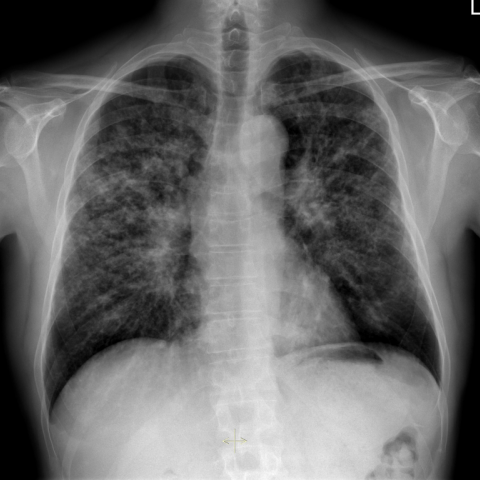
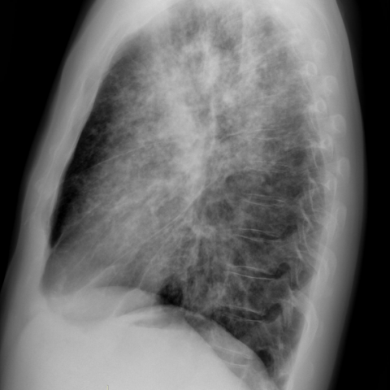

# Official gain: 14838_8353800529839

Post-run explicit answers: D **B**, M **B**, P **B**, reference **B**. Frozen runtime answers: D B, M None, P B; original records unchanged.

[Complete observable requests, tools and stages](../traces/14838_8353800529839.json) · [Original benchmark case](../../v12/results/cases/14838_8353800529839.md) · [D cached original observable request](../../direct_qwen60/requests/14838_8353800529839.json)

```text
Based on the chest X-ray findings in Figure 1a and 1b, which of the following statements best aligns with the diagnosis of stage 2 sarcoidosis, and what is the rationale behind this conclusion?

A) Diffuse nodular opacities are predominantly located in the lower lung lobes, which is consistent with stage 2 sarcoidosis due to the presence of bilateral hilar lymphadenopathy.
B) Diffuse nodular opacities are predominantly located in the upper lung lobes with moderate bilateral hilar lymphadenopathy, which is consistent with stage 2 sarcoidosis.
C) Diffuse nodular opacities are predominantly located in the lower lung lobes with moderate unilateral hilar lymphadenopathy, suggesting an alternative diagnosis rather than stage 2 sarcoidosis.
D) There are no nodular opacities present, but moderate bilateral hilar lymphadenopathy suggests stage 1 sarcoidosis.
E) Diffuse nodular opacities are predominantly located in the middle lung lobes with no hilar lymphadenopathy, suggesting stage 0 sarcoidosis.
F) Diffuse nodular opacities are present throughout all lung zones with massive pleural effusion, indicating advanced sarcoidosis.
```





## D

```text
Answer: B  
Reason: Figure 1a (PA view) shows bilateral hilar lymphadenopathy and diffuse nodular opacities predominantly in the upper and mid lung zones; Figure 1b (lateral view) confirms bilateral hilar enlargement and upper lobe–predominant reticulonodular infiltrates. Stage 2 sarcoidosis is defined by the coexistence of bilateral hilar lymphadenopathy and parenchymal lung involvement (typically upper lobe–predominant), which matches option B.
```

## M

```text
Looking at the tool outputs, I need to critically evaluate them since some seem inconsistent with what I visually observe in the images.

The chest_xray_classifier shows:
- High probability for Nodule (0.651), Lung Opacity (0.776), Infiltration (0.663), and Fibrosis (0.561)
- Moderate probability for Enlarged Cardiomediastinum (0.536)

However, the chest_xray_report_generator gives a conflicting report stating "no focal consolidation, effusion, or pneumothorax" and "interval improvement in bilateral pulmonary edema" - this seems incorrect given the obvious diffuse nodular opacities visible in Figure 1a.

The xray_phrase_grounding confirms bilateral hilar lymphadenopathy (with bounding boxes in both hila) and identifies nodular opacities in the right upper lobe.

Visually examining Figure 1a and 1b:
- Clear bilateral hilar enlargement (lymphadenopathy)
- Diffuse fine nodular opacities throughout lungs
- The nodular opacities appear more prominent in the upper and mid lung zones, which is classic for sarcoidosis
- No significant pleural effusion or other findings that would suggest alternative diagnoses

Stage 2 sarcoidosis is defined by the combination of bilateral hilar lymphadenopathy AND parenchymal lung involvement (nodular opacities). The distribution in sarcoidosis is typically upper lobe predominant.

Looking at the answer choices:
A) Lower lobe predominance - incorrect, sarcoidosis is upper lobe predominant
B) Upper lobe predominance with bilateral hilar lymphadenopathy - this matches stage 2 sarcoidosis
C) Lower lobe predominance with unilateral lymphadenopathy - incorrect on both counts
D) No nodular opacities - incorrect, they are clearly present
E) Middle lobe predominance with no lymphadenopathy - incorrect
F) Massive pleural effusion - not present

The evidence strongly supports option B: "Diffuse nodular opacities are predominantly located in the upper lung lobes with moderate bilateral hilar lymphadenopathy, which is consistent with stage 2 sarcoidosis."

The rationale is that stage 2 sarcoidosis requires both bilateral hilar lymphadenopathy (confirmed by xray_phrase_grounding) and pulmonary parenchymal involvement (nodular opacities, confirmed by classifier and visual inspection), with the characteristic upper lobe predominance seen in sarcoidosis.

Return Answer: B followed by: Stage 2 sarcoidosis requires bilateral hilar lymphadenopathy plus pulmonary parenchymal involvement; the images show both with upper lobe predominant nodular opacities, which is classic for sarcoidosis.
```

## P

```text
Answer: B) Diffuse nodular opacities are predominantly located in the upper lung lobes with moderate bilateral hilar lymphadenopathy, which is consistent with stage 2 sarcoidosis.

Evidence: The PA view (Figure 1a) shows bilateral hilar enlargement (confirmed by bounding boxes) with reticulonodular opacities extending peripherally; the lateral view (Figure 1b) reveals diffuse hazy opacities involving the upper and mid lung zones, typical of parenchymal involvement in sarcoidosis. Stage 2 sarcoidosis is defined by concurrent bilateral hilar lymphadenopathy and pulmonary parenchymal infiltrates—most commonly upper lobe–predominant nodular or reticulonodular opacities—matching this pattern.
```

