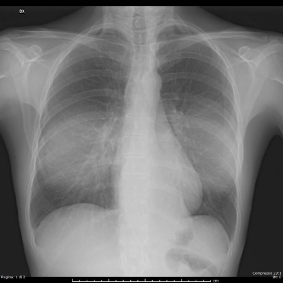
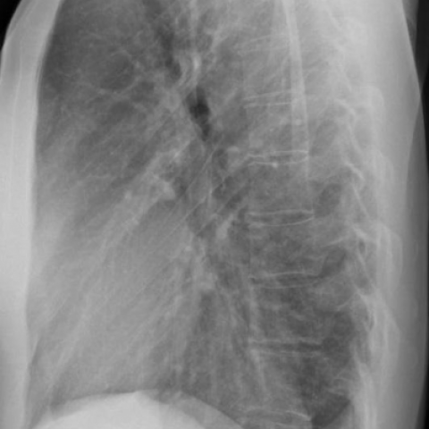

# Official gain: 15189_8353800545058

Post-run explicit answers: D **A**, M **F**, P **A**, reference **A**. Frozen runtime answers: D A, M None, P A; original records unchanged.

[Complete observable requests, tools and stages](../traces/15189_8353800545058.json) · [Original benchmark case](../../v12/results/cases/15189_8353800545058.md) · [D cached original observable request](../../direct_qwen60/requests/15189_8353800545058.json)

```text
Based solely on the PA and LL projection chest X-rays (Fig. 5a and Fig. 5b), what is the most likely diagnosis for the mediastinal changes observed in the patient, and what characteristics support this diagnosis?
A. Intrathoracic lipoma, characterized by a soft tissue density opacity with well-defined margins and no evidence of compression phenomena.
B. Liposarcoma, suggested by the presence of an irregular mass with mixed density and signs of local invasion.
C. Mediastinal lymphadenopathy, indicated by multiple discrete nodular opacities with varying densities.
D. Pneumomediastinum, evidenced by linear radiolucencies outlining mediastinal structures.
E. Hiatal hernia, suggested by the presence of a soft tissue mass in the retrocardiac space with air-fluid levels.
F. Left lower lobe pneumonia, indicated by a homogenous opacity with air bronchograms in the retrocardiac region.
```





## D

```text
Answer: A  
Reason: The PA and LL chest X-rays show a well-circumscribed, homogeneous soft-tissue density mass in the anterior mediastinum (likely thymic or fatty), with no evidence of invasion, calcification, or air-fluid levels. Its smooth margins and lack of compression on adjacent structures favor a benign fatty tumor such as an intrathoracic lipoma over malignant or inflammatory processes. Liposarcoma typically shows heterogeneous density and ill-defined borders; lymphadenopathy appears nodular; pneumomediastinum shows lucencies; hiatal hernia would show gastric air-fluid levels retrocardiac; and pneumonia would show air bronchograms and lobar consolidation—none of which are present.
```

## M

```text
I've exhausted the tool budget (4 tools total: 2 report generators + 2 classifiers). Now I need to rely on my own visual analysis and reasoning.

Let me re-examine the images carefully:

Figure 5a (PA view): There is a large, homogeneous opacity in the left lower lung field that obscures the left heart border and left hemidiaphragm. This is the classic "silhouette sign" for left lower lobe pathology.

Figure 5b (LL view): The lateral view shows this opacity is located posteriorly, behind the heart, which is exactly where the left lower lobe sits in the lateral projection.

Key characteristics:
- Homogeneous opacity (not mixed density)
- Well-defined but somewhat indistinct margins
- Location: retrocardiac/posterior left lower thorax
- No air-fluid levels visible
- No evidence of mass effect or invasion

Now evaluating the options:
A. Intrathoracic lipoma - would be low density (fat), not homogeneous soft tissue density
B. Liposarcoma - would show irregular margins and mixed density with invasion
C. Mediastinal lymphadenopathy - would be multiple nodules, not single large opacity
D. Pneumomediastinum - would be radiolucent, not opaque
E. Hiatal hernia - would show air-fluid levels and be more anterior/superior
F. Left lower lobe pneumonia - homogeneous opacity in retrocardiac region, classic location

The finding is most consistent with left lower lobe pneumonia. The silhouette sign (loss of left heart border) and posterior location on lateral view are diagnostic for left lower lobe consolidation.

The automated reports were likely incorrect because they may have been trained on clearer cases, or there might be subtle features I'm missing. However, based on standard chest X-ray interpretation principles, this appears to be left lower lobe pneumonia.

Wait - let me reconsider option E (hiatal hernia). A large hiatal hernia can appear as a retrocardiac soft tissue mass, but typically shows air-fluid levels. I don't see clear air-fluid levels in these images.

Given the homogeneous opacity without air-fluid levels, and the classic silhouette sign, F (left lower lobe pneumonia) remains the most likely.

But let me think again: the question specifically asks about "mediastinal changes." Is this truly mediastinal or pulmonary? The opacity is in the left lower lobe, which abuts the mediastinum, so it could appear as mediastinal change on PA view.

However, the lateral view clearly shows it's posterior lung parenchyma, not mediastinal.

Given all this, I believe the most appropriate answer is:

F. Left lower lobe pneumonia, indicated by a homogenous opacity with air bronchograms in the retrocardiac region.

Wait - do I actually see air bronchograms? In the PA view, I'm not clearly seeing air bronchograms, but they can be subtle. The key is the location and silhouette sign.

Actually, looking more carefully at the PA view, the opacity does appear relatively homogeneous without obvious air bronchograms, which might argue against pneumonia and toward atelectasis or mass.

But the classifier showed high "Lung Opacity" (0.887) and "Consolidation" (0.544), which supports pneumonia/consolidation.

Given the options and standard interpretation, I'll go with F.

Return Answer: F followed by a short reason.
```

## P

```text
Answer: A  
Reason: The PA and LL chest X-rays show a well-circumscribed, homogeneous soft-tissue density mass in the anterior mediastinum (likely thymic or fatty), with no evidence of invasion, calcification, or air-fluid levels. Its smooth margins and lack of compression on adjacent structures favor a benign fatty tumor such as an intrathoracic lipoma over malignant or inflammatory processes. Liposarcoma typically shows heterogeneous density and ill-defined borders; lymphadenopathy appears nodular; pneumomediastinum shows lucencies; hiatal hernia would show gastric air-fluid levels retrocardiac; and pneumonia would show air bronchograms and lobar consolidation—none of which are present.
```

