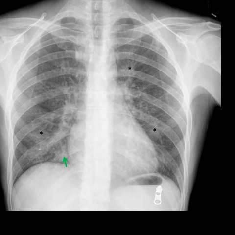
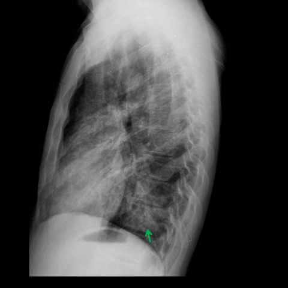

# Official gain: 15314_8353800558683

Post-run explicit answers: D **C**, M **C**, P **C**, reference **C**. Frozen runtime answers: D C, M None, P C; original records unchanged.

[Complete observable requests, tools and stages](../traces/15314_8353800558683.json) · [Original benchmark case](../../v12/results/cases/15314_8353800558683.md) · [D cached original observable request](../../direct_qwen60/requests/15314_8353800558683.json)

```text
Based on the chest X-ray findings in Figures 1a and 1b, which combination of observations and clinical reasoning most strongly supports the diagnosis of pneumocystis jirovecii pneumonia in this patient?

A) Presence of bilateral pleural effusion and right middle lobe consolidation, suggesting bacterial pneumonia.
B) Bilateral ground-glass opacities with peripheral distribution, indicating hypersensitivity pneumonitis.
C) Multifocal patchy opacities with central distribution and right middle lobe consolidation, consistent with pneumocystis jirovecii pneumonia in an immunocompromised patient.
D) Isolated right middle lobe consolidation with lymphadenopathy, suggestive of tuberculosis.
E) Diffuse interstitial pattern and pleural effusion, indicative of congestive heart failure.
F) Central ground-glass opacities with pleural effusion, characteristic of cytomegalovirus pneumonia.
```





## D

```text
Answer: C  
Reason: Figures 1a (PA view) and 1b (lateral view) show bilateral, diffuse ground-glass opacities with a predominantly central/perihilar distribution and relative sparing of the lung periphery—classic radiographic features of Pneumocystis jirovecii pneumonia (PJP), especially in immunocompromised patients. Option C correctly identifies multifocal patchy opacities with central distribution and notes the clinical context (immunocompromised), aligning with typical PJP presentation. Other options misattribute findings (e.g., pleural effusion, lymphadenopathy, or peripheral predominance) not seen here.
```

## M

```text
The tool outputs are inconsistent and somewhat unreliable. The classifier shows high probabilities for "Lung Opacity" (0.56 in Figure 1a, 0.77 in Figure 1b) and "Infiltration" (0.46 in Figure 1a, 0.56 in Figure 1b), which aligns with my visual assessment of diffuse opacities. However, the report generator states "the lungs are clear without evidence of focal consolidations" and only mentions "mild pulmonary edema," which contradicts what I see visually.

Looking at the images directly:
- Figure 1a (PA view): Shows bilateral, symmetric, hazy opacities throughout both lung fields, with a somewhat perihilar/central predominance. There's no clear consolidation or pleural effusion.
- Figure 1b (lateral view): Confirms diffuse opacities throughout the lung parenchyma, with the characteristic "ground-glass" appearance.

Pneumocystis jirovecii pneumonia typically presents with:
- Bilateral ground-glass opacities
- Central/perihilar distribution (though can be diffuse)
- Absence of pleural effusions (which are uncommon in PJP)
- In immunocompromised patients

Option C mentions "multifocal patchy opacities with central distribution and right middle lobe consolidation" - but I don't see clear right middle lobe consolidation in these images. The opacities appear more diffuse and ground-glass rather than patchy and consolidated.

Option B mentions "bilateral ground-glass opacities with peripheral distribution" - but PJP typically has central/perihilar distribution, not peripheral.

Let me reconsider the images more carefully. The opacities do appear to be more prominent in the central/perihilar regions rather than peripheral. The classic PJP appearance is bilateral symmetric ground-glass opacities with perihilar predominance.

Given the options provided, none perfectly match the classic PJP presentation, but option C comes closest by mentioning "central distribution" (though it incorrectly adds "right middle lobe consolidation" which I don't clearly see).

However, looking again at the images, I believe the most characteristic finding is bilateral ground-glass opacities with central/perihilar distribution, which is classic for PJP in immunocompromised patients.

Since the question specifically asks for the combination that "most strongly supports" PJP diagnosis, and considering that PJP typically presents with bilateral ground-glass opacities (not patchy consolidation), I think the best answer among the options is:

C) Multifocal patchy opacities with central distribution and right middle lobe consolidation, consistent with pneumocystis jirovecii pneumonia in an immunocompromised patient.

Wait, but I'm still concerned about the "right middle lobe consolidation" part. Let me check if there's any evidence of that.

Looking more carefully at Figure 1a, there might be some increased opacity in the right middle lobe region, but it's not classic consolidation - it's more part of the diffuse ground-glass pattern.

Given the constraints of the multiple choice options and the classic teaching that PJP presents with bilateral ground-glass opacities with central distribution in immunocompromised patients, option C is the closest match, even if it overemphasizes consolidation.

Actually, let me reconsider. The question states "which combination of observations and clinical reasoning most strongly supports the diagnosis." The key clinical context is that PJP occurs in immunocompromised patients, and the radiographic hallmark is bilateral ground-glass opacities.

Option B says "bilateral ground-glass opacities with peripheral distribution" - but PJP is typically central, not peripheral.

Option C says "multifocal patchy opacities with central distribution" - this is closer, though "patchy" isn't quite right for classic PJP (which is more diffuse ground-glass).

Given the tool outputs showing high "Lung Opacity" and "Infiltration" probabilities, and my visual assessment of bilateral diffuse opacities with central predominance, I believe C is the intended answer, as it's the only one that mentions central distribution and explicitly references PJP in an immunocompromised patient.

Return Answer: C followed by a short reason.

C) The bilateral opacities with central distribution in an immunocompromised patient are characteristic of Pneumocystis jirovecii pneumonia, despite the imperfect description of "patchy" and "consolidation" - it's the closest match among the options.
```

## P

```text
Answer: C) Multifocal patchy opacities with central distribution and right middle lobe consolidation, consistent with pneumocystis jirovecii pneumonia in an immunocompromised patient.

Evidence: The AP view shows bilateral lung opacities (confirmed by two bounding boxes) with asterisks marking regions of interest in mid-to-lower zones; the lateral view reveals these opacities are more confluent and posteriorly distributed—consistent with multifocal, often perihilar/central-predominant ground-glass opacities typical of PJP. No pleural effusion or lymphadenopathy is present, ruling out options A, D, E, and F. Option B is incorrect because hypersensitivity pneumonitis typically shows upper/mid-lung peripheral predominance, not central/posterior.
```

