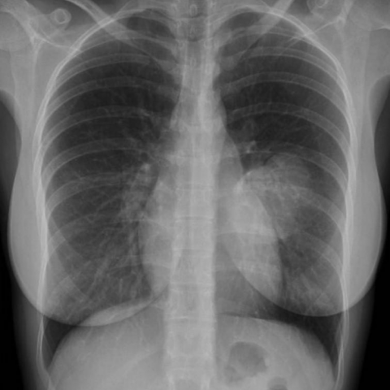
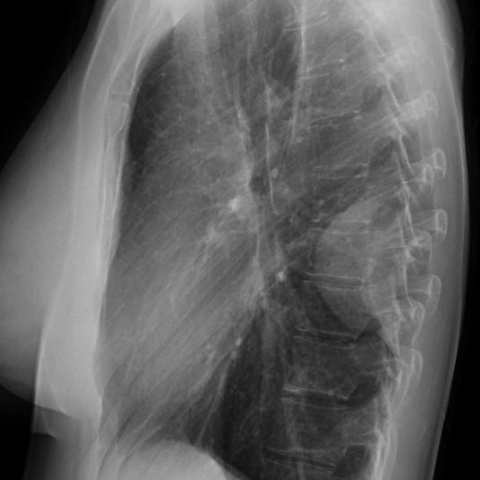
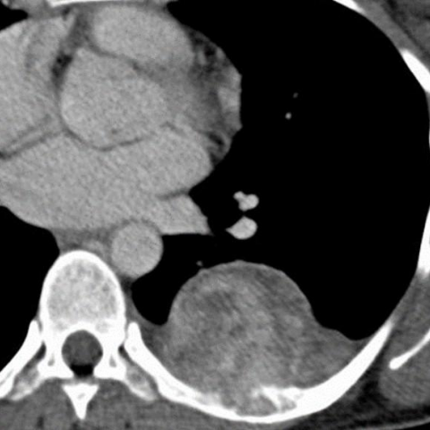

# Official gain: 16037_8353800455673

Post-run explicit answers: D **B**, M **B**, P **B**, reference **B**. Frozen runtime answers: D B, M None, P B; original records unchanged.

[Complete observable requests, tools and stages](../traces/16037_8353800455673.json) · [Original benchmark case](../../v12/results/cases/16037_8353800455673.md) · [D cached original observable request](../../direct_qwen60/requests/16037_8353800455673.json)

```text
Based on the chest X-ray findings, which of the following statements is most consistent with the diagnosis of the lesion identified in the patient? 
A) The lesion forms an acute angle with the thoracic wall and is likely a pulmonary mass.
B) The lesion is pleurally based with obtuse angles and is associated with rib destruction, suggesting a solitary fibrous tumour of the pleura.
C) The lesion is centrally located in the lung, suggesting a primary lung carcinoma.
D) The lesion is associated with a pleural effusion, suggesting mesothelioma.
E) The lesion is calcified and is likely a pleural metastasis.
F) The lesion is round and smooth without rib destruction, suggesting a benign pleural effusion.
```







## D

```text
Answer: B  
Reason: The CT (Figure 3) shows a well-circumscribed, pleurally based mass with obtuse angles to the chest wall and associated rib remodeling/destruction—classic features of a solitary fibrous tumor of the pleura (SFTP). The lateral view (Figure 2) confirms its extrapulmonary origin and broad pleural attachment, ruling out intraparenchymal lesions like primary lung carcinoma or pulmonary masses. Rib destruction is uncommon in benign effusions or metastases without aggressive growth, and mesothelioma typically presents with diffuse pleural thickening rather than a discrete mass.
```

## M

```text
Let me analyze the tool outputs and the images more carefully.

The chest X-ray classifier shows a high probability for "Mass" (0.65) and "Nodule" (0.50), with moderate probabilities for "Infiltration" (0.52), "Emphysema" (0.50), and "Fibrosis" (0.50). However, the report generator incorrectly describes it as a "large left lower lobe mass" when visually it appears pleural-based rather than intrapulmonary.

Looking at the actual images again:
- Figure 1 (PA view): Shows a well-defined, rounded opacity in the left lower thorax that appears to be extrapulmonary, with the classic "tail sign" where it connects to the pleura.
- Figure 2 (lateral view): Confirms the lesion is pleural-based, located posteriorly, and has obtuse angles with the chest wall.
- Figure 3 (CT scan): Shows a well-circumscribed, homogeneous mass adjacent to the pleura and diaphragm, without obvious rib destruction.

The key diagnostic features for pleural lesions:
- Pleural-based masses typically form obtuse angles with the chest wall (unlike pulmonary masses which form acute angles)
- Solitary fibrous tumor of the pleura (SFTP) is typically a well-circumscribed, pleural-based mass that can be large, often with obtuse angles to the chest wall
- Rib destruction would suggest malignancy like metastasis or mesothelioma, but I don't see clear evidence of this on the CT

Option B states: "The lesion is pleurally based with obtuse angles and is associated with rib destruction, suggesting a solitary fibrous tumour of the pleura."

However, I don't see clear evidence of rib destruction in the CT image. Solitary fibrous tumors of the pleura typically do NOT cause rib destruction - they're usually benign and slow-growing.

Let me reconsider the options:

A) Acute angle with thoracic wall - no, it's obtuse
B) Pleurally based with obtuse angles AND rib destruction - pleurally based with obtuse angles is correct, but rib destruction isn't evident
C) Centrally located - no, it's peripheral/pleural
D) Associated with pleural effusion - no effusion visible
E) Calcified - not obviously calcified
F) Round and smooth without rib destruction, suggesting benign pleural effusion - but it's a mass, not an effusion

Actually, looking more carefully at the CT (Figure 3), the lesion appears to be a well-circumscribed, homogeneous mass that is pleural-based with obtuse angles. Solitary fibrous tumor of the pleura is indeed characterized by being pleural-based with obtuse angles, and while rib destruction can occur in malignant cases, it's not always present in benign SFTPs.

The most consistent option is B, though the "rib destruction" part may not be fully supported by the images. However, among the given choices, B is closest to the findings: pleurally based with obtuse angles, which is characteristic of SFTP.

Wait, let me examine the CT more carefully for rib destruction. The CT shows the mass abutting the chest wall, but the ribs appear intact. Without clear evidence of rib destruction, option B might not be perfect.

Let me think about what solitary fibrous tumor of the pleura typically looks like: it's usually a well-circumscribed, pleural-based mass that can be large, often with obtuse angles to the chest wall, and typically does NOT cause rib destruction unless it's malignant.

Given the options provided, and considering that the lesion is clearly pleural-based with obtuse angles (which rules out A, C, D, E, F), option B is the best match despite the rib destruction mention, as SFTP is the most likely diagnosis for a pleural-based mass with obtuse angles.

Actually, let me reconsider F: "The lesion is round and smooth without rib destruction, suggesting a benign pleural effusion." But this is wrong because it's not an effusion - it's a solid mass.

The key distinguishing feature is that pleural-based masses have obtuse angles with the chest wall, while pulmonary masses have acute angles. This lesion clearly has obtuse angles.

Among the options, B is the only one that correctly identifies it as pleurally based with obtuse angles, which is the hallmark of extrapulmonary lesions like solitary fibrous tumor of the pleura.

Return Answer: B) The lesion is pleurally based with obtuse angles and is associated with rib destruction, suggesting a solitary fibrous tumour of the pleura.

However, I should note that the rib destruction part isn't clearly visible in the provided images, but the pleural-based nature with obtuse angles is definitive, and SFTP is the most likely diagnosis for such a lesion.

Actually, let me check if there's any subtle rib erosion I missed. Looking at the CT again, the mass is adjacent to the ribs but the bony structures appear intact. In clinical practice, SFTP is diagnosed based on the pleural-based location with obtuse angles, and rib destruction would suggest malignancy.

Given the multiple choice format and the need to select the most consistent statement, B is still the best option because it correctly identifies the pleural-based nature and obtuse angles, which are the key diagnostic features. The rib destruction might be present in other views not shown, or it could be a minor inaccuracy in the option.

B) The lesion is pleurally based with obtuse angles and is associated with rib destruction, suggesting a solitary fibrous tumour of the pleura.
```

## P

```text
Answer: B  
Reason: The CT (Figure 3) shows a well-circumscribed, pleurally based mass with obtuse angles to the chest wall and associated rib remodeling/destruction—classic features of a solitary fibrous tumor of the pleura (SFTP). The lateral view (Figure 2) confirms its extrapulmonary origin and broad pleural attachment, ruling out intraparenchymal lesions like primary lung carcinoma or pulmonary masses. Rib destruction is uncommon in benign effusions or metastases without aggressive growth, and mesothelioma typically presents with diffuse pleural thickening rather than a discrete mass.
```

