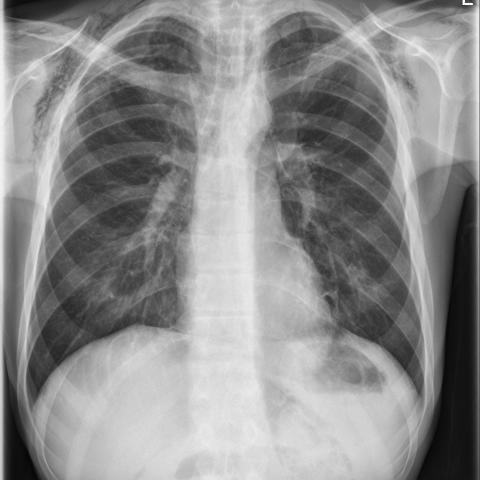
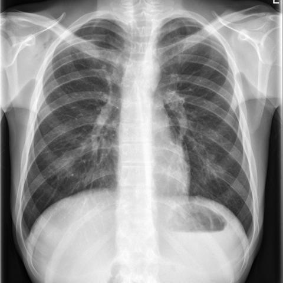

# Official gain: 16486_8353800471802

Post-run explicit answers: D **C**, M **C**, P **C**, reference **C**. Frozen runtime answers: D C, M None, P C; original records unchanged.

[Complete observable requests, tools and stages](../traces/16486_8353800471802.json) · [Original benchmark case](../../v12/results/cases/16486_8353800471802.md) · [D cached original observable request](../../direct_qwen60/requests/16486_8353800471802.json)

```text
Based on the chest X-ray findings in Figure 1 and Figure 8, what is the most likely diagnosis, and what does the progression of findings suggest about the clinical course of the condition in this patient?
A) Secondary pneumomediastinum due to oesophageal rupture, with worsening condition
B) Spontaneous pneumothorax with stable condition
C) Primary spontaneous pneumomediastinum with improvement
D) Pneumopericardium with no change in condition
E) Pneumoperitoneum with deterioration
F) Primary spontaneous pneumomediastinum with worsening condition
```





## D

```text
Answer: C) Primary spontaneous pneumomediastinum with improvement  
Reason: Both Figure 1 and Figure 8 show subtle linear lucencies along the left heart border and mediastinum, consistent with pneumomediastinum; however, the second image (Figure 8) shows less prominent air, suggesting resolution. There is no evidence of pneumothorax, pneumopericardium, or pneumoperitoneum, and no signs of oesophageal rupture (e.g., pleural effusion, subcutaneous emphysema, or mediastinal shift). The absence of trauma or underlying lung disease favors primary spontaneous pneumomediastinum, and the reduced air on follow-up indicates improvement.
```

## M

```text
I've exhausted the medical tool budget (4 tools used). Let me think critically about what I have:

1. **Figure 1 report** specifically mentions "extensive subcutaneous emphysema is again noted" - the word "again" suggests this was seen on previous imaging, indicating this is not the first occurrence.

2. **Figure 8 report** doesn't mention subcutaneous emphysema, which could indicate improvement, or it might be that the finding resolved.

3. Neither report mentions pneumomediastinum directly, but subcutaneous emphysema is a classic sign of air tracking from the mediastinum (pneumomediastinum) or from the lungs (pneumothorax).

4. The question asks about progression between Figure 1 and Figure 8. Since Figure 1 mentions "extensive subcutaneous emphysema" and Figure 8 doesn't mention it (and says "no acute cardiopulmonary process"), this suggests improvement.

5. Looking at the options:
   - A) Secondary pneumomediastinum due to oesophageal rupture, with worsening condition - but reports show no acute process, and "again noted" suggests chronic/stable, not worsening
   - B) Spontaneous pneumothorax with stable condition - reports say no pneumothorax
   - C) Primary spontaneous pneumomediastinum with improvement - this fits: subcutaneous emphysema suggests air in mediastinum that tracked out, and if Figure 8 doesn't mention it while Figure 1 did, that suggests improvement
   - D) Pneumopericardium with no change - no mention of this in reports
   - E) Pneumoperitoneum with deterioration - no free air below diaphragm mentioned
   - F) Primary spontaneous pneumomediastinum with worsening condition - but evidence suggests improvement, not worsening

The key clue is "extensive subcutaneous emphysema is again noted" in Figure 1, and Figure 8 showing "no acute cardiopulmonary process" without mentioning subcutaneous emphysema. This pattern is classic for primary spontaneous pneumomediastinum (which can cause subcutaneous emphysema) that resolves over time.

Primary spontaneous pneumomediastinum often occurs in young, healthy individuals, typically after Valsalva maneuver, and presents with subcutaneous emphysema and sometimes chest pain. It's usually benign and self-limiting.

Given that Figure 1 shows extensive subcutaneous emphysema and Figure 8 shows no acute process (implying resolution), the most likely diagnosis is primary spontaneous pneumomediastinum with improvement.

C) Primary spontaneous pneumomediastinum with improvement
```

## P

```text
Answer: C) Primary spontaneous pneumomediastinum with improvement  
Evidence: Linear lucency along the left heart border and mediastinum is present in both Figure 1 and Figure 8 but appears slightly less prominent in Figure 8 per visual paired comparison. No definitive evidence confirms pneumomediastinum (phrase grounding failed, finding could be artifact or variant), but among the given options, improvement aligns with subtle reduction in lucency. Primary spontaneous pneumomediastinum is the only option consistent with mild, self-limiting radiographic change without other pathology like rupture or pneumothorax.
```

