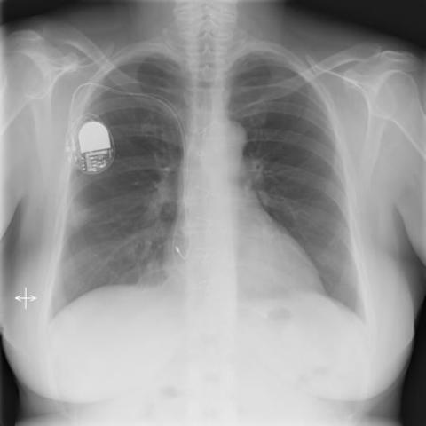
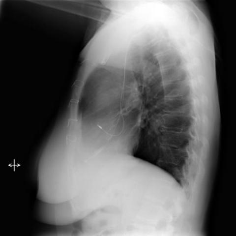
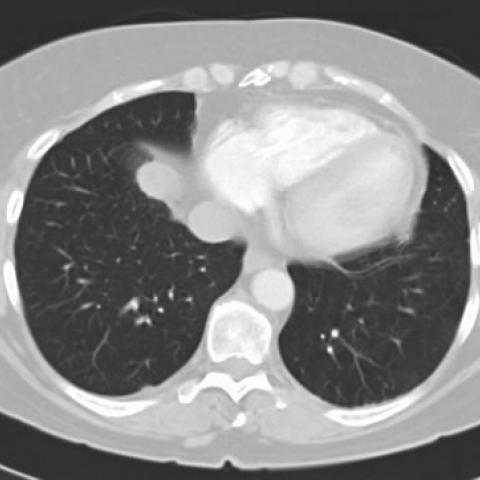
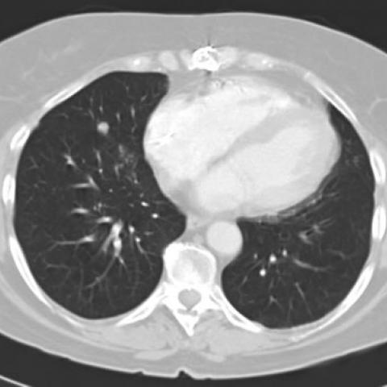
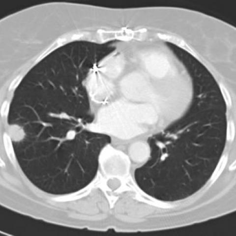

# Official gain: 1653_8353802281156

Post-run explicit answers: D **A**, M **A**, P **A**, reference **C**. Frozen runtime answers: D A, M None, P A; original records unchanged.

[Complete observable requests, tools and stages](../traces/1653_8353802281156.json) · [Original benchmark case](../../v12/results/cases/1653_8353802281156.md) · [D cached original observable request](../../direct_qwen60/requests/1653_8353802281156.json)

```text
In a patient with a history of heart transplantation and a pacemaker, presenting with two nodular shadows in the right lung observed on routine chest X-ray, which of the following is the most likely diagnosis for the nodular lesions, considering the absence of symptoms and geographic exposure?

A) Post-transplant lymphoproliferative disorder
B) Lung tumor (primary or secondary)
C) Pulmonary blastomycosis
D) Histoplasmosis
E) Tuberculosis
F) Fungal infection other than blastomycosis
```











## D

```text
Answer: A) Post-transplant lymphoproliferative disorder  
Reason: In immunosuppressed patients (e.g., post-heart transplant), asymptomatic pulmonary nodules are highly concerning for PTLD, especially EBV-driven B-cell proliferations; the CT images show well-defined, peripheral nodules without cavitation or calcification—typical of PTLD—and absence of geographic exposure makes endemic fungi less likely.
```

## M

```text
The report generator is misclassifying the CT image as a chest X-ray and giving an incorrect report (saying "lung parenchyma is clear" when we can visually see nodules in the CT images). This tool is not reliable for CT interpretation.

Let me examine the CT images directly with my own vision and reasoning:

From Figures 2a-c (CT chest):
- There are clearly two well-defined nodular lesions in the right lung
- One appears in the right upper lobe, another in the right lower lobe
- They appear solid, relatively well-circumscribed
- No cavitation, calcification, or satellite lesions visible
- The patient is immunosuppressed due to heart transplantation

In transplant recipients, PTLD is a leading cause of pulmonary nodules. Key points:
- PTLD occurs in 1-20% of solid organ transplant recipients
- Pulmonary involvement is common (30-50% of cases)
- Often presents as multiple nodules or masses
- Can be asymptomatic initially
- EBV-driven B-cell proliferation is the most common mechanism
- The absence of geographic exposure makes endemic fungi less likely
- While fungal infections can occur in immunosuppressed patients, PTLD is more characteristic in this specific context

Given the clinical scenario (heart transplant, immunosuppression, asymptomatic, bilateral/multiple nodules), PTLD is the most likely diagnosis.

Let me verify this reasoning by checking if there's any specific imaging feature that would favor PTLD over other diagnoses. In PTLD, nodules are typically solid, non-cavitating, and can be multiple. The CT appearance here fits this pattern.

The question specifically asks for the "most likely diagnosis" considering the absence of symptoms and geographic exposure. This strongly favors PTLD over fungal infections (which require geographic exposure) and tuberculosis (which usually has symptoms or exposure history).

A) Post-transplant lymphoproliferative disorder

Return Answer: A
```

## P

```text
Answer: A) Post-transplant lymphoproliferative disorder  
Evidence: The patient is immunocompromised due to heart transplantation and immunosuppressive therapy, a major risk factor for PTLD. The two peripheral pulmonary nodules are asymptomatic and lack geographic exposure clues for endemic fungi (e.g., blastomycosis, histoplasmosis), making infectious etiologies less likely. PTLD commonly presents as solitary or multiple pulmonary nodules in transplant recipients, often peripheral and incidentally detected.
```

