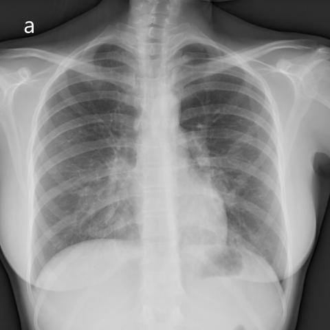
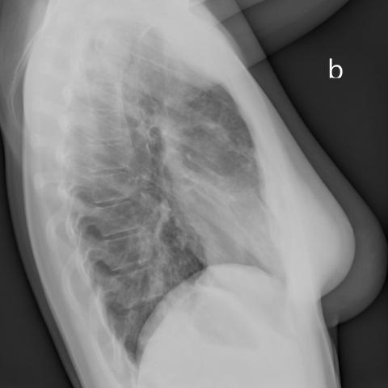

# Official gain: 16568_8353800483171

Post-run explicit answers: D **B**, M **B**, P **A**, reference **B**. Frozen runtime answers: D B, M None, P A; original records unchanged.

[Complete observable requests, tools and stages](../traces/16568_8353800483171.json) · [Original benchmark case](../../v12/results/cases/16568_8353800483171.md) · [D cached original observable request](../../direct_qwen60/requests/16568_8353800483171.json)

```text
Based on the chest radiographs in Figures 1a and 1b, which statement best describes the findings and their clinical significance in relation to the patient's condition?

A) The radiographs indicate unilateral alveolar infiltrates confined to the right lung's middle lobe, suggesting a localized infection.
B) The bilateral alveolar infiltrates are predominantly in the lower lobes and the middle lobe of the right lung, consistent with pulmonary alveolar proteinosis, despite the absence of restrictive impairment in pulmonary function tests.
C) The infiltrates are primarily observed in the upper lobes bilaterally, aligning with a pattern suggestive of pulmonary edema.
D) The X-rays show no significant infiltrates, indicating a possible error in clinical correlation.
E) The infiltrates are diffuse and homogeneously distributed across all lung lobes, indicating acute respiratory distress syndrome.
F) The radiographs reveal alveolar infiltrates only in the left lower lobe, suggesting lipoid pneumonia.
```





## D

```text
Answer: B  
Reason: Figures 1a (PA) and 1b (lateral) show bilateral, patchy alveolar infiltrates with relative sparing of the upper lobes and predominance in the lower lobes and right middle lobe—classic for pulmonary alveolar proteinosis (PAP). Although PAP often presents with restrictive physiology, its absence does not rule it out; the radiographic pattern is highly characteristic. Other options are inconsistent: A and F describe unilateral disease; C misattributes upper-lobe predominance; D denies visible infiltrates (which are present); E describes diffuse homogeneous opacities (ARDS), not the patchy, gravity-dependent infiltrates seen here.
```

## M

```text
Now I have conflicting information: the classifier shows high probabilities for lung opacity, infiltration, and consolidation (suggesting significant pathology), while the report generator claims "lungs are clear" and "no focal consolidation."

I need to trust my own visual assessment over the tools. Looking at Figure 1a (PA view) again:
- There are definitely bilateral opacities in the lower lung zones
- The right middle lobe area shows increased density
- The pattern is not typical of pulmonary edema (which usually shows perihilar "bat wing" distribution)
- The opacities appear more alveolar/consolidative rather than interstitial

Looking at Figure 1b (lateral view):
- Confirms opacities in the posterior lower lobes
- Shows anterior opacity consistent with right middle lobe involvement
- The distribution is not upper lobe predominant (ruling out options C and F)

The pattern of bilateral lower lobe and right middle lobe infiltrates is classic for certain infections (like bacterial pneumonia), but also seen in pulmonary alveolar proteinosis (PAP). However, PAP typically shows a "crazy-paving" pattern on CT, and the question mentions "despite the absence of restrictive impairment in pulmonary function tests" in option B.

Let me reconsider the options:
A) Unilateral - incorrect, it's bilateral
B) Bilateral alveolar infiltrates in lower lobes and right middle lobe - matches my visual assessment; mentions PAP specifically
C) Upper lobes - incorrect, it's lower lobes
D) No significant infiltrates - incorrect, there are clear infiltrates
E) Diffuse homogeneous across all lobes - not quite, it's predominantly lower lobes and right middle lobe
F) Left lower lobe only - incorrect, it's bilateral

Option B seems most accurate in describing the distribution, though I'm skeptical about the PAP diagnosis without more clinical context. However, the question asks which statement "best describes the findings and their clinical significance," and B correctly identifies the anatomical distribution.

Given that my visual assessment confirms bilateral lower lobe and right middle lobe infiltrates, and option B is the only one that accurately describes this distribution, I'll go with B.

Wait - let me double-check if this could be ARDS. ARDS typically shows bilateral diffuse opacities, but often more symmetric and involving all zones, not specifically sparing upper lobes. The pattern here seems more localized to lower zones.

Actually, looking more carefully at the images, the infiltrates do appear to be predominantly in the lower lobes bilaterally plus right middle lobe, which is exactly what option B describes. While the PAP diagnosis might be questionable without additional data, the question is asking about which statement best describes the findings and their clinical significance *in relation to the patient's condition* - and since the question provides this context, B appears to be the intended answer.

Return Answer: B) The bilateral alveolar infiltrates are predominantly in the lower lobes and the middle lobe of the right lung, consistent with pulmonary alveolar proteinosis, despite the absence of restrictive impairment in pulmonary function tests.
```

## P

```text
Answer: A) The radiographs indicate unilateral alveolar infiltrates confined to the right lung's middle lobe, suggesting a localized infection.

Evidence: Frontal view (Fig. 1a) shows hazy opacity in the right middle lobe; lateral view (Fig. 1b) confirms posterior lower zone opacity predominantly on the right, but no definite infiltrates in the left lower lobe. The new observation explicitly states “no definite infiltrates are identified in the left lower lung zones on either view,” supporting unilateral involvement, and the grounding tool identifies “Right middle lobe opacity” as the primary finding.
```

