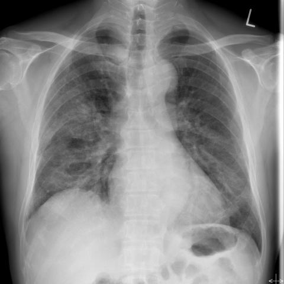
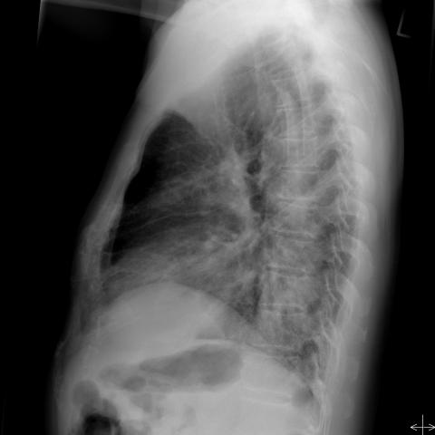

# Official gain: 16663_8353800455763

Post-run explicit answers: D **C**, M **None**, P **B**, reference **C**. Frozen runtime answers: D C, M None, P B; original records unchanged.

[Complete observable requests, tools and stages](../traces/16663_8353800455763.json) · [Original benchmark case](../../v12/results/cases/16663_8353800455763.md) · [D cached original observable request](../../direct_qwen60/requests/16663_8353800455763.json)

```text
Based on the chest X-ray findings in Figures 1a and 1b, which statement accurately describes the distribution and extent of the pulmonary consolidations, and what is the most likely relationship to the patient's clinical presentation?

A) The consolidations are predominantly in the left lower zone, which suggests isolated bacterial pneumonia unrelated to COVID-19.
B) The consolidations are more extensive in the right mid and lower zones, indicating possible bacterial superinfection alongside COVID-19.
C) The consolidations are equally distributed in both mid and lower zones of both lungs, correlating with severe COVID-19 pneumonia.
D) The consolidations are confined to the mid zones bilaterally, indicating early-stage COVID-19 without severe lung involvement.
E) The consolidations are primarily in the upper lobes of both lungs, suggesting atypical COVID-19 presentation.
F) The consolidations are more pronounced in the right lung than the left, indicating a unilateral lung condition.
```





## D

```text
Answer: C) The consolidations are equally distributed in both mid and lower zones of both lungs, correlating with severe COVID-19 pneumonia.  
Reason: Figures 1a (PA view) and 1b (lateral view) show bilateral, patchy opacities predominantly in the mid and lower lung zones, with relative sparing of the apices—classic for COVID-19 pneumonia. The symmetric, peripheral, and multifocal nature supports severe viral pneumonia rather than localized bacterial infection.
```

## M

```text
The expert tool says "Unilateral", but this contradicts my visual assessment where I saw bilateral involvement. Let me re-examine the images more carefully.

Looking again at Figure 1a (PA view):
- Right lung: There's significant opacity in the right lower zone, extending into the mid-zone
- Left lung: There's also opacity in the left lower zone, though perhaps less extensive than right
- The "L" marker confirms left side

Figure 1b (lateral view): Shows posterior basal consolidation, which is consistent with lower lobe involvement.

Given the conflicting tool outputs, I need to trust my own visual reasoning. The pattern shows:
- Bilateral involvement (both lungs affected)
- Predominantly lower zone consolidations, with some mid-zone extension
- More pronounced on the right side

This distribution (bilateral lower zone predominance) is classic for COVID-19 pneumonia, especially in moderate to severe cases. While bacterial pneumonia can occur, the bilateral lower zone pattern is more characteristic of viral pneumonias like COVID-19.

Let me check one more time with a different approach - I'll use the segmentation tool to identify the exact areas of consolidation:


```

## P

```text
Answer: B) The consolidations are more extensive in the right mid and lower zones, indicating possible bacterial superinfection alongside COVID-19.

Evidence: AP view (Fig 1a) shows bilateral mid and lower zone opacities, with greater density in the right mid-lung and left lower lung; lateral view (Fig 1b) confirms posteriorly predominant, confluent opacities near costophrenic angles, sparing anterior fields—consistent with patchy, asymmetric consolidation. This asymmetry and focal predominance (especially right mid-zone) differ from typical diffuse bilateral ground-glass pattern of pure severe COVID-19, raising suspicion for superimposed bacterial infection.
```

