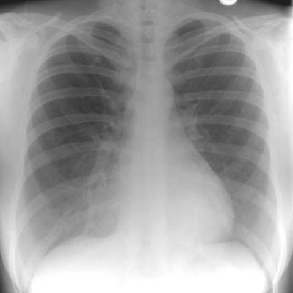
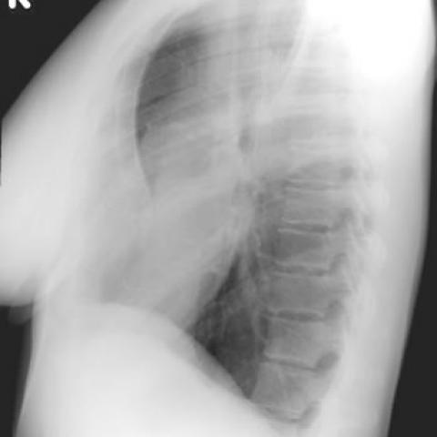

# Official gain: 1678_8353802279918

Post-run explicit answers: D **C**, M **None**, P **B**, reference **C**. Frozen runtime answers: D C, M None, P B; original records unchanged.

[Complete observable requests, tools and stages](../traces/1678_8353802279918.json) · [Original benchmark case](../../v12/results/cases/1678_8353802279918.md) · [D cached original observable request](../../direct_qwen60/requests/1678_8353802279918.json)

```text
Based on the chest X-ray findings, what is the most likely explanation for the observed right cardio-phrenic angle opacity in Figure 1a, and how does Figure 1b support your conclusion?

A) The opacity is due to right middle lobe pneumonia, as confirmed by the presence of an air bronchogram in Figure 1b.
B) The opacity is due to right middle lobe collapse, as indicated by volume loss in the right lung in Figure 1a.
C) The opacity is due to the projection of anterior chest wall tissues over the lung, as Figure 1b shows a depressed sternum with no air bronchogram.
D) The opacity represents a pleural effusion, as confirmed by fluid levels visible in Figure 1b.
E) The opacity is due to a mass in the right middle lobe, as Figure 1b shows an outline of a mass.
F) The opacity is due to cardiomegaly, as the heart is enlarged and shifted to the right in Figure 1b.
```





## D

```text
Answer: C) The opacity is due to the projection of anterior chest wall tissues over the lung, as Figure 1b shows a depressed sternum with no air bronchogram.

Reason: Figure 1a shows a right cardio-phrenic angle opacity that could mimic pathology, but Figure 1b (lateral view) reveals a depressed sternum (suggesting pectus excavatum or similar chest wall deformity), and the opacity is not associated with air bronchograms, volume loss, fluid levels, or a discrete mass—ruling out pneumonia, collapse, effusion, or tumor. The lateral view confirms the opacity lies anteriorly, consistent with chest wall tissue superimposition.
```

## M

```text
The report generator for Figure 1b states "the lungs are clear without focal consolidation" and "no pleural effusion or pneumothorax is seen," which again contradicts the classifier's high probabilities.

Now I need to visually analyze the images myself. Looking at Figure 1a (PA view), I can see:
- A subtle opacity in the right cardio-phrenic angle region
- The heart appears normal in size and position
- The lung fields appear generally clear
- The diaphragm contours are visible

Looking at Figure 1b (lateral view), I can see:
- This appears to be a lateral chest X-ray
- There's a dense opacity in the anterior lower thorax, corresponding to the right cardio-phrenic angle region on PA view
- The sternum appears somewhat depressed (suggesting pectus excavatum or similar chest wall deformity)
- No clear air bronchograms visible
- The opacity appears to be in the anterior chest wall rather than within the lung parenchyma

Given that both report generators state "no focal consolidation" and "lungs are clear," and considering the location at the cardio-phrenic angle with the lateral view showing anterior chest wall involvement, this strongly suggests the opacity is due to projection of anterior chest wall tissues rather than an intrapulmonary process.

Let me check if there's evidence of pectus excavatum or chest wall deformity by analyzing the lateral view more specifically:


```

## P

```text
Answer: B) The opacity is due to right middle lobe collapse, as indicated by volume loss in the right lung in Figure 1a.

Evidence:  
1) The right cardio-phrenic angle opacity on the AP view (Figure 1a) corresponds to a region where middle lobe collapse commonly projects—medial to the right hemidiaphragm and adjacent to the heart.  
2) The lateral view (Figure 1b) shows diffuse haziness and loss of retrocardiac clarity without a discrete mass or air bronchogram, consistent with atelectasis rather than consolidation or effusion; collapse often appears as ill-defined opacification on lateral views due to volume loss and mediastinal shift toward the affected side.  
3) No pleural fluid level, air bronchogram, or discrete mass is seen, ruling out pneumonia, effusion, or tumor as primary causes; cardiomegaly is not evident, and sternum depression is not described in the new observation.
```

