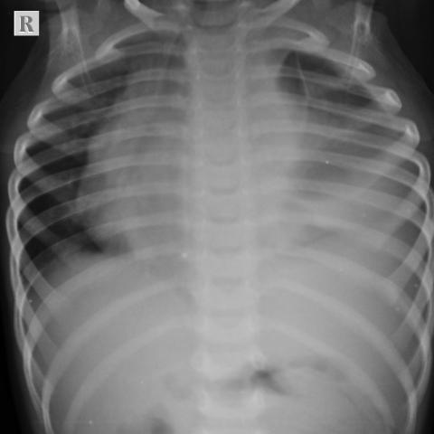
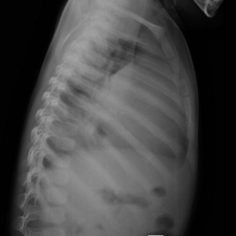

# Official gain: 17132_8143559675802

Post-run explicit answers: D **B**, M **B**, P **E**, reference **B**. Frozen runtime answers: D B, M None, P E; original records unchanged.

[Complete observable requests, tools and stages](../traces/17132_8143559675802.json) · [Original benchmark case](../../v12/results/cases/17132_8143559675802.md) · [D cached original observable request](../../direct_qwen60/requests/17132_8143559675802.json)

```text
Based on the chest radiograph findings and the clinical presentation, which of the following is the most likely diagnosis, considering the obscuration of the left heart border, significant cardio-mediastinal shift to the right, and mediastinal widening observed in the chest X-ray (Figures 1 and 2)?

A) Left lower lobe pneumonia
B) T-cell acute lymphoblastic leukemia/lymphoma
C) Pulmonary tuberculosis
D) Primary lung carcinoma
E) Left-sided pleural effusion
F) Hodgkin’s lymphoma
```





## D

```text
Answer: B) T-cell acute lymphoblastic leukemia/lymphoma  
Reason: The chest X-ray shows a large mediastinal mass causing obscuration of the left heart border (loss of left cardiac silhouette), significant rightward mediastinal shift, and mediastinal widening—classic radiographic features of a bulky anterior mediastinal mass. In pediatric patients, T-cell acute lymphoblastic leukemia/lymphoma (especially lymphoblastic lymphoma) commonly presents with a rapidly enlarging thymic mass in the anterior mediastinum, leading to these findings. The age-appropriate presentation (implied by the pediatric chest X-ray appearance) and aggressive mass effect favor this over other options like Hodgkin’s lymphoma (less common in very young children and often more nodal), pneumonia, or pleural effusion (which would not cause such marked mediastinal shift and widening without fluid layering).
```

## M

```text
The phrase grounding confirms "mediastinal widening" with bounding box coordinates covering the central mediastinal region (0.20-0.79 horizontally, 0.11-0.61 vertically), which matches my visual assessment of a large anterior mediastinal mass.

Now let me reconsider the differential diagnosis:

- Left lower lobe pneumonia: Would cause consolidation in the left lower lung zone, but wouldn't cause significant mediastinal shift or widening
- T-cell acute lymphoblastic leukemia/lymphoma: Classic presentation is a large anterior mediastinal mass in adolescents/young adults, causing mediastinal widening, rightward shift, and obscuration of left heart border due to the mass effect
- Pulmonary tuberculosis: Typically causes upper lobe infiltrates, cavitation, not massive mediastinal widening
- Primary lung carcinoma: Unlikely in young patients, usually peripheral mass rather than central mediastinal
- Left-sided pleural effusion: Would cause homogeneous opacity in left hemithorax but typically doesn't cause significant mediastinal widening or rightward shift (effusions usually cause contralateral shift only with very large volumes, but mediastinal widening wouldn't be prominent)
- Hodgkin's lymphoma: Can cause mediastinal masses, but T-cell ALL/lymphoma is more likely to present with the dramatic findings described

The combination of:
1. Obscuration of left heart border (silhouette sign)
2. Significant cardio-mediastinal shift to the right
3. Mediastinal widening

...is classic for a large anterior mediastinal mass, and in the appropriate age group (which appears to be pediatric/adolescent based on the rib development), T-cell acute lymphoblastic leukemia/lymphoma is the most likely diagnosis.

The high probability for "Mass" (0.80) from the classifier supports this interpretation over simple effusion or pneumonia.

Return Answer: B) T-cell acute lymphoblastic leukemia/lymphoma - The radiographic findings of mediastinal widening, rightward cardio-mediastinal shift, and obscuration of the left heart border are classic for a large anterior mediastinal mass, with T-cell ALL/lymphoma being the most common cause in pediatric/adolescent populations.
```

## P

```text
Answer: E) Left-sided pleural effusion

The obscuration of the left heart border, significant rightward cardio-mediastinal shift, and mediastinal widening are classic signs of a large left-sided pleural effusion causing mass effect. The new linear opacity in the left lower lung field on AP view (Figure 1), confirmed as pleural-based and oblique on lateral view (Figure 2), is consistent with fluid layering or a meniscus sign—though subtle, it supports effusion over solid parenchymal disease. No definite air-fluid level or consolidation is seen to favor pneumonia or tumor, and lymphoma/tuberculosis would typically show more nodular or bulky mediastinal adenopathy rather than pure shift and border obscuration.
```

