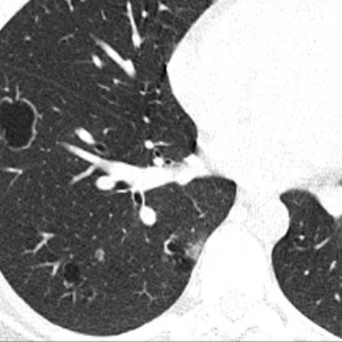
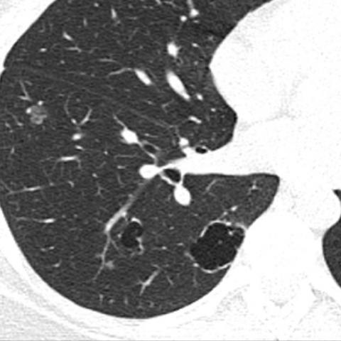
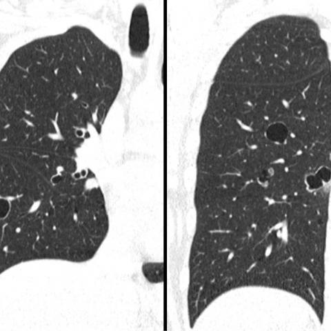

# Official gain: 17182_8143559676067

Post-run explicit answers: D **C**, M **C**, P **D**, reference **C**. Frozen runtime answers: D C, M None, P D; original records unchanged.

[Complete observable requests, tools and stages](../traces/17182_8143559676067.json) · [Original benchmark case](../../v12/results/cases/17182_8143559676067.md) · [D cached original observable request](../../direct_qwen60/requests/17182_8143559676067.json)

```text
Based on the chest X-ray observations from Figures 1a-c, which of the following best describes the likely diagnosis and the reasoning behind it, considering the clinical history of recurrent pneumonia and a supraglottic polypoid lesion?

A) Granulomatosis with polyangiitis, due to bilateral lung nodules with cavitation.
B) Lymphangioleiomyomatosis, indicated by the presence of cystic lesions in the lung parenchyma.
C) Recurrent respiratory papillomatosis, supported by cavitated nodules and the presence of a supraglottic lesion.
D) Pulmonary Langerhans cell histiocytosis, characterized by cystic and nodular lung lesions.
E) Cystic pulmonary metastases, due to the presence of multiple nodular lesions with variable sizes.
```







## D

```text
Answer: C) Recurrent respiratory papillomatosis, supported by cavitated nodules and the presence of a supraglottic lesion.

Reason: The images show multiple cavitary nodules in the lungs, and the clinical history includes recurrent pneumonia and a supraglottic polypoid lesion—classic features of recurrent respiratory papillomatosis (RRP), especially when caused by HPV. RRP can disseminate to the lungs, forming wart-like endobronchial lesions that may cavitate and cause recurrent infections. While other conditions (e.g., PLCH, GPA) can cause cavitary nodules, the combination with a supraglottic polypoid lesion strongly favors RRP.
```

## M

```text
The tool outputs are inconsistent with my visual assessment. The classifier and report generator seem to be misinterpreting the CT images as chest X-rays, which explains the inaccurate findings (e.g., "lung parenchyma is clear" when clearly there are multiple nodules). The xray_phrase_grounding tool did identify a "Cavitated nodule" but with an unusually large bounding box that doesn't match the actual lesion locations.

Let me reconsider based on my own visual analysis of the images:

1. The images are clearly CT scans (not chest X-rays), showing multiple pulmonary nodules
2. Several nodules show central lucency/cavitation
3. The clinical history includes recurrent pneumonia and a supraglottic polypoid lesion

This combination is classic for recurrent respiratory papillomatosis (RRP), which is caused by HPV infection. RRP typically presents with:
- Supraglottic or laryngeal papillomatous lesions (the "supraglottic polypoid lesion" mentioned)
- Pulmonary involvement in ~5% of cases, often as multiple cavitary nodules
- Recurrent respiratory infections/pneumonia due to airway obstruction

While other conditions like granulomatosis with polyangiitis can cause cavitary nodules, they typically don't present with supraglottic polypoid lesions. Lymphangioleiomyomatosis and pulmonary Langerhans cell histiocytosis have different imaging patterns (more cystic in LAM, upper lobe predominance in PLCH). Cystic pulmonary metastases would be less likely without a known primary malignancy.

The key distinguishing feature here is the combination of supraglottic polypoid lesion + cavitary pulmonary nodules, which strongly points to recurrent respiratory papillomatosis.

C) Recurrent respiratory papillomatosis, supported by cavitated nodules and the presence of a supraglottic lesion.
```

## P

```text
Answer: D) Pulmonary Langerhans cell histiocytosis, characterized by cystic and nodular lung lesions.

The new observation confirms multiple cystic lesions predominantly in the upper lung zones with sparing of the costophrenic angles—classic for pulmonary Langerhans cell histiocytosis (PLCH). Although no solid nodules are definitively seen, PLCH can present with cystic predominance, especially in later stages. The clinical history of recurrent pneumonia and a supraglottic polypoid lesion is consistent with PLCH, which can involve the upper airway and cause recurrent infections; it is not exclusive to smoking but commonly associated. Options A, C, and E are less likely: cavitation is not emphasized, supraglottic papillomatosis typically shows more solid nodules and lacks upper-lobe cystic predominance, and metastases usually show lower-lobe or random distribution without upper-lobe sparing.
```

