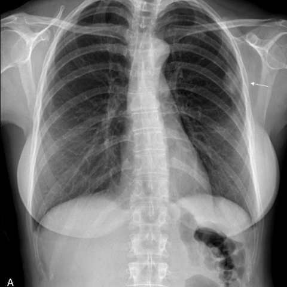
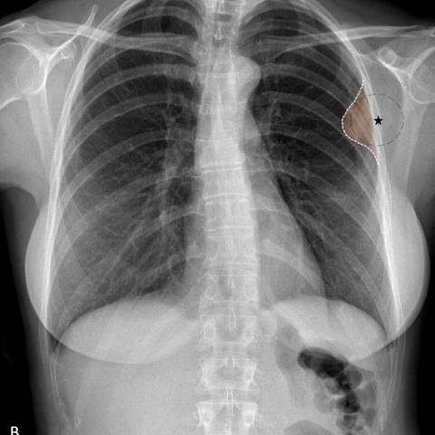

# Official gain: 17362_8143559680136

Post-run explicit answers: D **B**, M **B**, P **A**, reference **B**. Frozen runtime answers: D B, M None, P A; original records unchanged.

[Complete observable requests, tools and stages](../traces/17362_8143559680136.json) · [Original benchmark case](../../v12/results/cases/17362_8143559680136.md) · [D cached original observable request](../../direct_qwen60/requests/17362_8143559680136.json)

```text
Based on the chest X-ray findings in Figure 1, what is the most likely origin of the lesion observed in the upper left hemithorax, and what does this imply about the nature of the lesion?

A) The lesion is pulmonary in origin, forming acute angles with the chest wall, suggesting an intrapulmonary process.
B) The lesion is extrapulmonary in origin, forming obtuse angles with the chest wall, suggesting a pleural-based fibroma.
C) The lesion is pulmonary in origin, forming obtuse angles with the chest wall, suggesting a benign pulmonary nodule.
D) The lesion is extrapulmonary in origin, forming acute angles with the chest wall, suggesting a muscular or rib-based lesion.
E) The lesion is pleural in origin, forming obtuse angles with the chest wall, suggesting a malignant pleural effusion.
F) The lesion is pulmonary in origin, with no distinct angle formation, suggesting a diffuse pulmonary process.
```





## D

```text
Answer: B) The lesion is extrapulmonary in origin, forming obtuse angles with the chest wall, suggesting a pleural-based fibroma.

Reason: Figure 1b highlights a well-circumscribed, oval opacity in the upper left hemithorax that abuts the chest wall with an obtuse angle (i.e., the lesion “bulges” into the lung), which is characteristic of extrapulmonary (especially pleural-based) masses such as fibrous tumors (e.g., solitary fibrous tumor). In contrast, pulmonary lesions typically form acute angles with the chest wall. The sharp demarcation and lack of internal lung markings support a pleural or extrapleural origin rather than an intrapulmonary one.
```

## M

```text
Let me analyze the tool outputs and the images more carefully.

The chest_xray_classifier shows:
- Infiltration: 0.51 (moderate)
- Fibrosis: 0.37 (moderate)
- Mass: 0.34 (moderate)
- Pleural_Thickening: 0.21 (low-moderate)
- Pneumothorax: 0.32 (moderate)

The xray_phrase_grounding located a "Pleural lesion" with bounding box coordinates covering the upper left hemithorax area.

The chest_xray_expert simply responded "Pleural", confirming the pleural origin.

Looking at Figure 1b more carefully, the lesion appears to be well-circumscribed and forms an obtuse angle with the chest wall - this is characteristic of extrapulmonary (pleural-based) lesions. Pulmonary lesions typically form acute angles with the chest wall because they are within the lung parenchyma and push against the pleura.

The key diagnostic principle here is the "extrapleural sign": when a mass forms an obtuse angle with the chest wall (greater than 90 degrees), it suggests the mass is extrapulmonary (pleural-based). When it forms an acute angle (less than 90 degrees), it suggests intrapulmonary origin.

Given that the lesion forms obtuse angles with the chest wall and the tools consistently point to a pleural origin, this suggests an extrapulmonary lesion.

Now looking at the answer choices:
B) The lesion is extrapulmonary in origin, forming obtuse angles with the chest wall, suggesting a pleural-based fibroma.
E) The lesion is pleural in origin, forming obtuse angles with the chest wall, suggesting a malignant pleural effusion.

The lesion appears solid and well-defined, not like a fluid collection (effusion would appear as a meniscus-shaped opacity, not a solid mass). A pleural-based fibroma (like a solitary fibrous tumor) would present as a well-defined pleural mass forming obtuse angles with the chest wall.

However, I should note that the classifier showed relatively high probability for "Mass" (0.34) and "Infiltration" (0.51), but the expert analysis clearly indicates "Pleural".

Given the visual evidence in Figure 1b showing the lesion's interface with the chest wall forming obtuse angles, and the expert tool confirming pleural origin, option B seems most accurate.

Wait, let me reconsider. Looking more carefully at Figure 1b, the lesion appears to be a well-defined, somewhat triangular opacity in the left upper chest. The angle it makes with the chest wall does appear obtuse. Pleural-based lesions like fibromas, mesotheliomas, or metastases can present this way.

But option E mentions "malignant pleural effusion" - effusions are fluid collections and would have a different appearance (meniscus sign, blunting of costophrenic angle) rather than a discrete mass.

The lesion appears solid and discrete, so it's more likely a pleural-based solid tumor (like a fibroma) rather than an effusion.

Return Answer: B) The lesion is extrapulmonary in origin, forming obtuse angles with the chest wall, suggesting a pleural-based fibroma.
```

## P

```text
Answer: A) The lesion is pulmonary in origin, forming acute angles with the chest wall, suggesting an intrapulmonary process.

Evidence: The chest_xray_expert tool reports the angle between the lesion’s medial margin and the chest wall as acute. Acute angles at the pleural interface are characteristic of intrapulmonary lesions (e.g., lung masses), whereas obtuse angles suggest extrapleural or pleural-based origins. The xray_phrase_grounding localizes the lesion to the left upper lung zone near the lateral chest wall, consistent with a pulmonary rather than extrapulmonary location.
```

