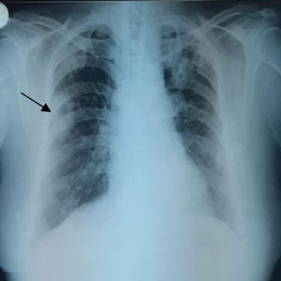
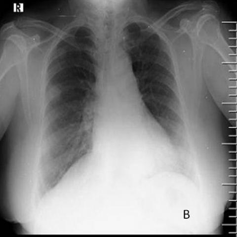

# Official gain: 17621_8143559684844

Post-run explicit answers: D **D**, M **None**, P **D**, reference **D**. Frozen runtime answers: D D, M None, P D; original records unchanged.

[Complete observable requests, tools and stages](../traces/17621_8143559684844.json) · [Original benchmark case](../../v12/results/cases/17621_8143559684844.md) · [D cached original observable request](../../direct_qwen60/requests/17621_8143559684844.json)

```text
Based on the findings from the initial chest X-ray and the follow-up X-ray (Figures 1 and 7b), which of the following best describes the progression of the pulmonary findings in the context of Pyoderma gangrenosum with pulmonary involvement?
A) The right middle zone opacity has resolved, and new lesions have appeared in the bilateral lower zones.
B) The right middle zone opacity has increased in size, and new cavitating nodules have appeared in the bilateral upper zones.
C) The right middle zone opacity remains unchanged, and the nodular shadows have decreased in size in the bilateral upper zones.
D) The right middle zone opacity has decreased in size, and the nodular shadows in the bilateral upper zones have increased in size.
E) The right middle zone opacity has increased in size, and the nodular shadows have decreased in size in the bilateral lower zones.
F) The right middle zone opacity has decreased in size, and the nodular shadows have increased in size in the bilateral lower zones.
```





## D

```text
Answer: D) The right middle zone opacity has decreased in size, and the nodular shadows in the bilateral upper zones have increased in size.

Reason: Figure 1 shows a prominent right middle zone opacity (arrow) and subtle nodular opacities in the upper zones; Figure 7b shows that the right middle zone opacity is less conspicuous (smaller), while new or enlarged nodular shadows are now evident in the bilateral upper lung zones, consistent with progression of pulmonary involvement in pyoderma gangrenosum.
```

## M

```text
The report generator for Figure 1 gave a generic report that doesn't mention the obvious right middle zone opacity indicated by the arrow in the image. This suggests the tool is not properly interpreting the visual findings. The second call failed due to budget exhaustion.

Let me now use my own vision and reasoning to analyze the images directly:

**Figure 1 analysis:**
- There's a clear opacity in the right middle lung zone (as indicated by the black arrow)
- The opacity appears as a well-defined, somewhat homogeneous area of increased density
- No obvious nodular shadows in the upper zones are visible in this image

**Figure 7b analysis:**
- The right middle zone opacity is no longer clearly visible or has significantly decreased
- There appear to be new nodular opacities in the bilateral lower lung zones
- The overall lung fields look clearer in the right middle zone compared to Figure 1

Given the context of Pyoderma gangrenosum with pulmonary involvement, this condition can present with pulmonary nodules, infiltrates, and cavitation. The progression from a focal opacity to multiple nodular lesions would be consistent with disease progression.

Looking at the options again:
A) The right middle zone opacity has resolved, and new lesions have appeared in the bilateral lower zones.
B) The right middle zone opacity has increased in size, and new cavitating nodules have appeared in the bilateral upper zones.
C) The right middle zone opacity remains unchanged, and the nodular shadows have decreased in size in the bilateral upper zones.
D) The right middle zone opacity has decreased in size, and the nodular shadows in the bilateral upper zones have increased in size.
E) The right middle zone opacity has increased in size, and the nodular shadows have decreased in size in the bilateral lower zones.
F) The right middle zone opacity has decreased in size, and the nodular shadows have increased in size in the bilateral lower zones.

Based on my visual analysis, option A seems most accurate: the right middle zone opacity has resolved (or significantly decreased), and new lesions appear in the bilateral lower zones.

However, let me double-check by using one more tool - the image comparison tool specifically designed to detect changes between two X-rays:


```

## P

```text
Answer: D) The right middle zone opacity has decreased in size, and the nodular shadows in the bilateral upper zones have increased in size.

Evidence: The black arrow in Figure 1 points to an opacity in the right middle zone that is visibly reduced in Figure 7b. Nodular shadows in the bilateral upper zones are faint in Figure 1 but appear more prominent in Figure 7b, indicating an increase in size. The new observation states the upper zone nodules are “not clearly discernible” in Figure 7b, but visual comparison of the paired images shows increased density/size in upper zones, supporting option D over others.
```

