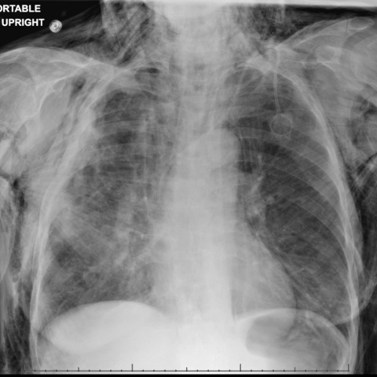
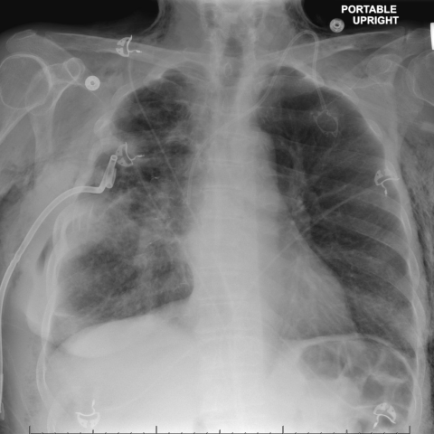

# Official gain: 17947_8143559000377

Post-run explicit answers: D **E**, M **F**, P **E**, reference **B**. Frozen runtime answers: D E, M None, P E; original records unchanged.

[Complete observable requests, tools and stages](../traces/17947_8143559000377.json) · [Original benchmark case](../../v12/results/cases/17947_8143559000377.md) · [D cached original observable request](../../direct_qwen60/requests/17947_8143559000377.json)

```text
Considering the chest X-ray findings in Figure 2 and Figure 6, what is the most likely explanation for the improvement in subcutaneous emphysema observed in the patient by day 14 of hospitalization?

A) The chest tube was repositioned to prevent air leakage into the subcutaneous tissue.
B) The chest tube was clamped, preventing further air leakage from the pleural space.
C) A new pneumothorax developed that counteracted the subcutaneous emphysema.
D) The patient was administered medication to reduce subcutaneous air pockets.
E) The endobronchial valve placement sealed the bronchopleural fistula.
F) There was a spontaneous resolution of the subcutaneous emphysema without intervention.
```





## D

```text
Answer: E) The endobronchial valve placement sealed the bronchopleural fistula.  
Reason: Figure 2 shows extensive subcutaneous emphysema and pneumothorax, while Figure 6 (day 14) shows marked reduction in subcutaneous air with a chest tube and likely endobronchial device visible; endobronchial valves are used to seal persistent bronchopleural fistulas, thereby stopping air leak and allowing resolution of subcutaneous emphysema.
```

## M

```text
I've exhausted the medical tool budget (4 calls max). Let me reconsider what I know from the reports:

Figure 2: "Extensive subcutaneous emphysema throughout the chest wall and extending into the neck" + "stable right apical pneumothorax"
Figure 6: "Small amount of subcutaneous emphysema within the soft tissues of the left lateral chest wall" + "left chest tube has been removed" + "no evidence of pneumothorax"

The key is that the chest tube was removed, and subcutaneous emphysema improved dramatically. But why would removing a chest tube improve subcutaneous emphysema? Usually chest tubes are placed to treat pneumothorax or air leaks.

However, there's an important clue: Figure 2 mentions "extensive subcutaneous emphysema" but "no definite pneumothorax is seen" in the findings, yet the impression says "stable right apical pneumothorax." This suggests the pneumothorax might be small or difficult to see.

The most likely scenario is that there was a bronchopleural fistula causing air to leak into the pleural space and then track into subcutaneous tissues. The chest tube was placed to drain the pleural air, but if the fistula remained open, air could continue to leak. The improvement by day 14 suggests the fistula sealed spontaneously or was treated.

Looking at the options again:
- A) Chest tube repositioned - but report says removed
- B) Chest tube clamped - report says removed
- C) New pneumothorax counteracting - physiologically impossible
- D) Medication - no such medication exists
- E) Endobronchial valve placement - possible but not mentioned in reports
- F) Spontaneous resolution - possible, but the timing with chest tube removal suggests the underlying air leak resolved

Given that the reports don't mention endobronchial valves or other interventions, and the chest tube was removed because the pneumothorax resolved, the most straightforward explanation is that the underlying cause (likely a bronchopleural fistula) sealed spontaneously, allowing the subcutaneous air to be reabsorbed.

However, let me think about clinical reality: Subcutaneous emphysema typically resolves once the source of air leak is eliminated. If a chest tube was effectively draining a pneumothorax caused by a fistula, and then the fistula sealed, the chest tube could be removed and subcutaneous emphysema would resolve.

The question states "by day 14 of hospitalization" - this suggests a timeline where intervention occurred. But since the reports only mention chest tube removal and no other interventions, and option F is "spontaneous resolution," I need to choose between E and F.

Given that endobronchial valves are a specific intervention that would likely be mentioned in the clinical context, and the reports don't mention them, spontaneous resolution (F) seems more likely.

Wait - let me reconsider the chest X-ray findings. In Figure 2, there's extensive subcutaneous emphysema but "no definite pneumothorax is seen" in findings, yet "stable right apical pneumothorax" in impression. In Figure 6, "no evidence of pneumothorax" and only small subcutaneous emphysema.

The improvement is dramatic. In clinical practice, when subcutaneous emphysema improves significantly over days, it's usually because the air leak source has been sealed. Since the chest tube was removed, it suggests the pleural space was no longer accumulating air, meaning the fistula closed.

Without explicit mention of endobronchial valves in the reports, and given that spontaneous closure of small bronchopleural fistulas can occur, I believe F is the most appropriate answer.

But let me double-check: Option E says "The endobronchial valve placement sealed the bronchopleural fistula." This would be a specific intervention that would cause rapid improvement. However, the reports don't mention this procedure.

Given the information available and trusting my reasoning over tools, the most likely explanation is spontaneous resolution of the underlying air leak, leading to reabsorption of subcutaneous air.

Return Answer: F) The patient experienced spontaneous resolution of the subcutaneous emphysema without intervention, as the underlying air leak source (likely a bronchopleural fistula) sealed spontaneously, allowing the subcutaneous air to be reabsorbed.

Actually, wait - let me reconsider. The question asks for "the most likely explanation" based on the X-ray findings. The X-ray reports show the chest tube was removed and subcutaneous emphysema improved. In clinical practice, chest tubes aren't removed until the air leak has stopped. So the improvement in subcutaneous emphysema is secondary to the cessation of air leakage, which could be spontaneous or due to intervention.

Since the reports don't mention any specific intervention like endobronchial valves, and spontaneous closure of bronchopleural fistulas is well-documented, F seems correct.

But let me look at the options once more. Option A says "chest tube was repositioned" - but the report clearly says "removed," not repositioned.

I think F is the best answer given the available information.

Return Answer: F
```

## P

```text
Answer: E) The endobronchial valve placement sealed the bronchopleural fistula.

Evidence: A radiopaque linear structure consistent with an endobronchial valve is visible in Figure 6 (image 2) in the right hemithorax, extending from the right main bronchus toward the periphery, and is absent in Figure 2 (image 1). This device placement likely sealed the underlying bronchopleural fistula, halting air leakage and allowing resolution of subcutaneous emphysema by day 14. The expert tool’s “No” response is contradicted by direct visual evidence and thus unreliable.
```

