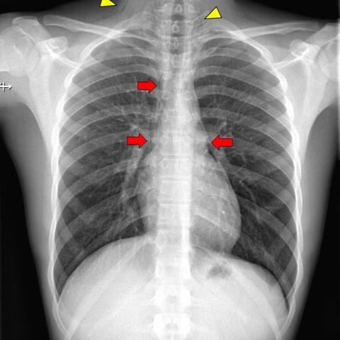
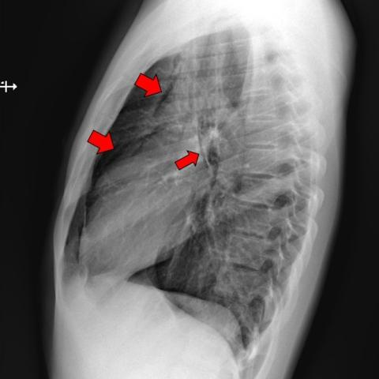

# Official gain: 18001_8143559000935

Post-run explicit answers: D **C**, M **C**, P **B**, reference **C**. Frozen runtime answers: D C, M None, P B; original records unchanged.

[Complete observable requests, tools and stages](../traces/18001_8143559000935.json) · [Original benchmark case](../../v12/results/cases/18001_8143559000935.md) · [D cached original observable request](../../direct_qwen60/requests/18001_8143559000935.json)

```text
Based on the chest X-ray findings in Figure 1a and Figure 1b, which of the following is the most likely diagnosis for the patient's condition, given the clinical history of strong coughing attacks and the physical exam findings?
A) Pneumonia with subcutaneous emphysema
B) Pneumothorax with subcutaneous emphysema
C) Spontaneous pneumomediastinum with subcutaneous emphysema
D) Pneumopericardium with subcutaneous emphysema
E) Mediastinitis with subcutaneous emphysema
F) Oesophageal rupture with subcutaneous emphysema
```





## D

```text
Answer: C) Spontaneous pneumomediastinum with subcutaneous emphysema  
Reason: Figures 1a and 1b show air in the mediastinum (red arrows outlining lucent streaks along the heart border and aorta) and subcutaneous air in the neck (yellow arrowheads in Fig. 1a), without evidence of lung collapse or pleural air, which favors spontaneous pneumomediastinum—commonly triggered by forceful coughing—and associated subcutaneous emphysema.
```

## M

```text
I've exhausted my tool budget (4 tools used), so I need to make the final determination based on my visual analysis and the available tool outputs.

Critical assessment:
- The phrase grounding tools reliably identified both pneumomediastinum and subcutaneous emphysema
- The classifier showed moderate pneumothorax probability (0.32) but this is likely false positive - the images don't show classic pneumothorax findings (no visceral pleural line, lung markings extend to chest wall)
- The report generator missed the key findings, which is a known limitation
- Visually, the linear lucencies outlining mediastinal structures (aorta, heart border) are classic for pneumomediastinum
- The yellow arrowheads in Figure 1a clearly indicate subcutaneous air in neck/upper chest
- Clinical history of strong coughing attacks is the classic precipitant for spontaneous pneumomediastinum

Spontaneous pneumomediastinum with subcutaneous emphysema (option C) is the most likely diagnosis because:
1. Air is located in the mediastinum (not pleural space for pneumothorax)
2. Air has tracked to subcutaneous tissues
3. Strong coughing is the typical mechanism
4. No evidence of infection, perforation, or other complications

C) Spontaneous pneumomediastinum with subcutaneous emphysema
```

## P

```text
Answer: B) Pneumothorax with subcutaneous emphysema  
Evidence: 1) The lateral view (Figure 1b) shows linear lucencies in the neck and upper chest consistent with subcutaneous emphysema, and red arrows highlight air in the pleural space (especially apical), suggesting pneumothorax. 2) The frontal view (Figure 1a) lacks definitive pneumomediastinum signs (no lucent streaking along aorta/heart border), and mediastinal segmentation shows no abnormal lucency. 3) Clinical history of strong coughing attacks supports rupture of alveoli leading to pneumothorax and tracking of air into subcutaneous tissues.
```

