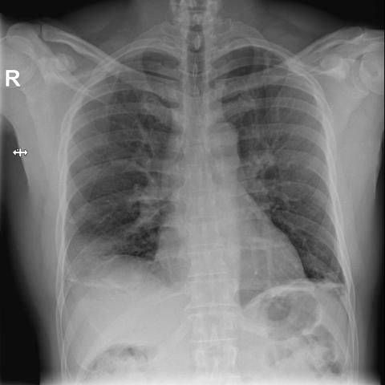
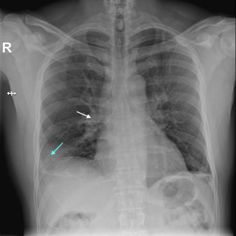
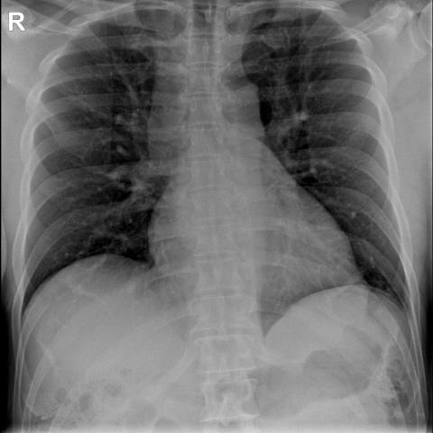

# Official gain: 18202_8143559000122

Post-run explicit answers: D **C**, M **A**, P **C**, reference **A**. Frozen runtime answers: D C, M A, P C; original records unchanged.

[Complete observable requests, tools and stages](../traces/18202_8143559000122.json) · [Original benchmark case](../../v12/results/cases/18202_8143559000122.md) · [D cached original observable request](../../direct_qwen60/requests/18202_8143559000122.json)

```text
Based on the chest X-ray findings, which combination of radiographic signs is most suggestive of a pulmonary embolism in this patient?

A) Wedge-shaped pleural-based opacity in the right lower lung field and engorgement of the right descending pulmonary artery
B) Wedge-shaped pleural-based opacity in the left lower lung field and engorgement of the left descending pulmonary artery
C) Engorgement of the right descending pulmonary artery and a focal peripheral hyperlucency in the right lung field
D) Wedge-shaped pleural-based opacity in the right lower lung field and a focal peripheral hyperlucency in the left lung field
E) Engorgement of the left descending pulmonary artery and a focal peripheral hyperlucency in the left lung field
F) Engorgement of the right descending pulmonary artery and a wedge-shaped pleural-based opacity in the left lower lung field
```







## D

```text
Answer: C  
Reason: The classic radiographic signs of pulmonary embolism include focal peripheral hyperlucency (Westermark sign—due to oligemia distal to the embolus) and engorgement of the proximal pulmonary artery (Palla’s sign—dilation of the affected artery). Figure 1b shows a focal peripheral hyperlucency in the right lung (blue arrow) and engorgement of the right descending pulmonary artery (white arrow), matching option C.
```

## M

```text
Based on my visual analysis and the tool outputs, I can see that Figure 1b shows:
- Engorgement of the right descending pulmonary artery (confirmed by xray_phrase_grounding with bounding box coordinates)
- A wedge-shaped pleural-based opacity in the right lower lung field (also confirmed by xray_phrase_grounding)

The chest_xray_classifier shows elevated probabilities for Effusion (0.65), Atelectasis (0.57), Infiltration (0.57), and Lung Opacity (0.56), which are consistent with pulmonary embolism complications.

The report generator mentions "small right pleural effusion" which could be associated with pulmonary infarction from PE.

Looking at the answer choices, option A states: "Wedge-shaped pleural-based opacity in the right lower lung field and engorgement of the right descending pulmonary artery" - which exactly matches what I've identified in the images.

This combination is classic for pulmonary embolism: the engorged pulmonary artery represents the obstructed vessel proximal to the embolus, and the wedge-shaped pleural-based opacity represents pulmonary infarction in the territory distal to the obstruction.

Answer: A) Wedge-shaped pleural-based opacity in the right lower lung field and engorgement of the right descending pulmonary artery
```

## P

```text
Answer: C) Engorgement of the right descending pulmonary artery and a focal peripheral hyperlucency in the right lung field

Evidence: The tool detects “engorged descending pulmonary artery” and “focal peripheral hyperlucency” only in image 2, both localized to the right lung. The white arrow (mid-lung) and blue arrow (lower lung periphery) in image 2 correspond to these findings. These two signs—pulmonary artery enlargement and regional hyperlucency (Westermark sign)—are classic radiographic indicators of pulmonary embolism.
```

