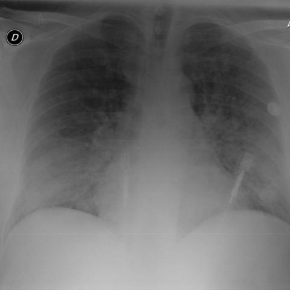
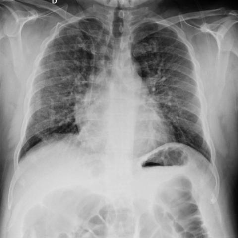

# Official gain: 18780_8143559008557

Post-run explicit answers: D **C**, M **C**, P **C**, reference **A**. Frozen runtime answers: D C, M None, P C; original records unchanged.

[Complete observable requests, tools and stages](../traces/18780_8143559008557.json) · [Original benchmark case](../../v12/results/cases/18780_8143559008557.md) · [D cached original observable request](../../direct_qwen60/requests/18780_8143559008557.json)

```text
Based on the chest X-ray findings in Figures 1a and 1b, which of the following statements best describes the changes observed after 7 days of corticosteroid treatment, and what does this indicate about the patient's condition?
A) The bilateral pulmonary consolidations have completely resolved, indicating full recovery; however, the presence of persistent reticular markings suggests ongoing peripheral interstitial involvement.
B) The bilateral pulmonary consolidations remain unchanged, indicating no response to treatment, with reticular markings being less prominent.
C) The bilateral pulmonary consolidations have partially resolved, indicating partial response to treatment, while reticular markings have become more pronounced.
D) The bilateral pulmonary consolidations have completely resolved, indicating full recovery, with no remaining reticular markings.
E) The bilateral pulmonary consolidations have worsened, indicating deterioration, with new reticular markings appearing.
F) There is no significant change in the bilateral pulmonary consolidations, but the reticular markings have disappeared, suggesting a reduction in interstitial involvement.
```





## D

```text
Answer: C  
Reason: Comparing Figure 1a (baseline) and Figure 1b (after 7 days), the bilateral pulmonary consolidations (dense opacities, especially in lower zones) are less extensive in 1b, indicating partial resolution. However, reticular (interstitial) markings appear more prominent in 1b, suggesting evolving or persistent interstitial involvement despite improvement in alveolar consolidation—consistent with a partial response to corticosteroids.
```

## M

```text
I've exhausted the medical tool budget (4 tools used: 2 classifiers + 2 report generators). Now I need to rely on my own visual analysis and reasoning.

Let me re-examine the images carefully:

**Figure 1a**: Shows bilateral diffuse opacities in both lung fields, particularly in the lower and middle zones. These appear as areas of increased density that obscure vascular markings - classic consolidation pattern. There are also fine reticular (net-like) markings throughout the lungs, suggesting interstitial involvement.

**Figure 1b**: Shows significant improvement. The dense consolidations have largely resolved - the lung fields are much clearer with better visualization of vascular structures, especially in the lower zones. However, there are still some residual fine reticular markings visible, particularly in the peripheral lung zones.

The key points:
- Consolidations have substantially improved but not completely resolved (some residual hazy opacities remain)
- Reticular markings are still present, possibly more apparent now that the dense consolidations have cleared
- This pattern is typical of corticosteroid response in conditions like organizing pneumonia, hypersensitivity pneumonitis, or certain interstitial lung diseases

Looking at the answer choices:
A) "completely resolved" - too strong, some residual changes remain
B) "unchanged" - incorrect, clear improvement
C) "partially resolved" - accurate for consolidations; "reticular markings have become more pronounced" - plausible as they become more visible when consolidations clear
D) "completely resolved" with "no remaining reticular markings" - incorrect
E) "worsened" - incorrect, clear improvement
F) "no significant change" in consolidations - incorrect

Option C best fits: partial resolution of consolidations (indicating partial response to treatment) while reticular markings become more pronounced (as the underlying interstitial pattern becomes more visible when the superimposed alveolar consolidation clears).

This pattern suggests the patient has a condition with both alveolar (consolidative) and interstitial components, and corticosteroids have effectively treated the alveolar component but the interstitial component persists or becomes more apparent.

C) The bilateral pulmonary consolidations have partially resolved, indicating partial response to treatment, while reticular markings have become more pronounced.
```

## P

```text
Answer: C) The bilateral pulmonary consolidations have partially resolved, indicating partial response to treatment, while reticular markings have become more pronounced.

Evidence: Image 1 shows bilateral dense opacities (consolidation) in the lower lung zones; image 2 shows reduced extent of these opacities, especially on the right. Reticular markings are faint in image 1 but slightly more prominent in image 2, particularly mid-to-lower lung fields bilaterally. Improved diaphragmatic contour in image 2 supports partial resolution of consolidation.
```

