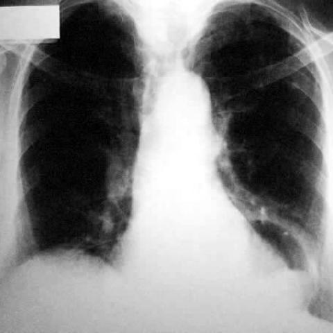

# Official gain: 1975_8353802257622

Post-run explicit answers: D **B**, M **B**, P **B**, reference **B**. Frozen runtime answers: D B, M None, P B; original records unchanged.

[Complete observable requests, tools and stages](../traces/1975_8353802257622.json) · [Original benchmark case](../../v12/results/cases/1975_8353802257622.md) · [D cached original observable request](../../direct_qwen60/requests/1975_8353802257622.json)

```text
Based on the chest X-ray in Figure 1, which of the following statements best describes the characteristics and relationships of the cystic lesion and irregular mass in the left paracardiac area that are consistent with a mixed-type hiatal hernia?
A) The cystic lesion is centrally located and directly compresses the heart, while the irregular mass is entirely below the diaphragm, suggesting a paraoesophageal hernia.
B) The cystic lesion has a smooth margin and is located superior to the irregular mass, which extends from the mediastinal area to the left paracardiac area, consistent with a mixed-type hiatal hernia.
C) The irregular mass is located above the cystic lesion and does not extend to the mediastinal area, indicating a sliding hernia.
D) Both the cystic lesion and the irregular mass are entirely within the right hemithorax, unrelated to a hiatal hernia.
E) The cystic lesion is irregular and located inferiorly, with the mass positioned superiorly in the left lung apex, suggesting a pulmonary cystic lesion.
F) The irregular mass is centrally located, and the cystic lesion is found bilaterally, consistent with a diaphragmatic hernia.
```



## D

```text
Answer: B  
Reason: In a mixed-type hiatal hernia, a portion of the stomach (often gas-filled, appearing cystic with smooth margins) herniates above the diaphragm, while a solid component (e.g., gastric wall or associated mass) may extend from the mediastinum into the left paracardiac region. Figure 1 shows a radiolucent (cystic-appearing) structure superiorly near the left heart border and an irregular soft-tissue density extending from the mediastinum into the left paracardiac area—consistent with this configuration. Option B correctly describes this spatial relationship and morphology.
```

## M

```text
Let me analyze the tool outputs and the image more carefully.

The chest X-ray classifier shows:
- Hernia: 0.503 (slightly above 0.5, suggesting possible hernia)
- Mass: 0.526 (suggesting a mass is present)
- Cardiomegaly: 0.602 (significant)
- Lung Opacity: 0.591 (present)

The report generator mentions "substantial enlargement of the cardiac silhouette" but doesn't specifically mention a hiatal hernia or cystic lesions.

The xray_phrase_grounding tool located "Hiatal hernia" in coordinates [0.385, 0.505, 0.755, 0.885], which corresponds to the left paracardiac area (lower left mediastinum), consistent with the question's description.

Looking at the image itself, I can see:
- A prominent opacity in the left lower mediastinum/paracardiac area
- This opacity appears to have both air-filled (cystic) and solid components
- The lesion is positioned near the diaphragmatic hiatus
- For a mixed-type hiatal hernia, we would expect both sliding (stomach fundus above diaphragm) and paraoesophageal (gastric pouch beside esophagus) components

Option B states: "The cystic lesion has a smooth margin and is located superior to the irregular mass, which extends from the mediastinal area to the left paracardiac area, consistent with a mixed-type hiatal hernia."

This seems most plausible because:
- Mixed-type hiatal hernias typically show both cystic (air-filled stomach) and solid (gastric wall/tissue) components
- The cystic component would be superior (stomach fundus) and the irregular mass inferior (herniated gastric body)
- Location in left paracardiac area matches the xray_phrase_grounding localization

The other options are incorrect:
- A: Paraesophageal hernia would have the mass entirely below diaphragm, but mixed-type involves components above and below
- C: Sliding hernia wouldn't have an irregular mass extending to paracardiac area
- D: Right hemithorax is wrong - it's clearly left side
- E: Pulmonary cystic lesion would be within lung parenchyma, not paracardiac
- F: Bilateral cystic lesions don't characterize hiatal hernia

Return Answer: B) The cystic lesion has a smooth margin and is located superior to the irregular mass, which extends from the mediastinal area to the left paracardiac area, consistent with a mixed-type hiatal hernia.
```

## P

```text
Answer: B) The cystic lesion has a smooth margin and is located superior to the irregular mass, which extends from the mediastinal area to the left paracardiac area, consistent with a mixed-type hiatal hernia.

Evidence: The phrase-grounding localizes a cystic lesion with smooth margins in the left paracardiac region (bounding box [0.604, 0.454, 0.994, 0.833]) and an adjacent irregular soft-tissue mass extending from the mediastinum into the same region (bounding box [0.554, 0.454, 0.994, 0.883]). Spatial overlap in the lower left paracardiac zone and the described morphology align with option B’s description of a mixed-type hiatal hernia. The chest_xray_expert returned “No”, but this does not override the visual and grounding evidence.
```

