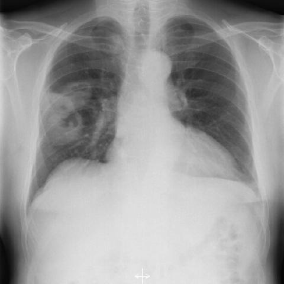
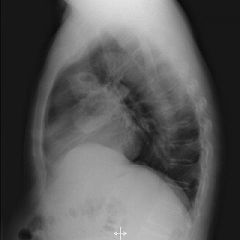

# Official gain: 2243_8353801511231

Post-run explicit answers: D **C**, M **C**, P **C**, reference **C**. Frozen runtime answers: D C, M None, P C; original records unchanged.

[Complete observable requests, tools and stages](../traces/2243_8353801511231.json) · [Original benchmark case](../../v12/results/cases/2243_8353801511231.md) · [D cached original observable request](../../direct_qwen60/requests/2243_8353801511231.json)

```text
Based on the chest X-ray findings in Figure 1a and Figure 1b, which of the following best explains the radiographic features that support the diagnosis of Wegener's granulomatosis in this patient?
A) The presence of bilateral pleural effusions, which are common in Wegener's granulomatosis.
B) Solitary nodular mass with smooth margins, typical of Wegener's granulomatosis.
C) Multiple nodular masses with irregular margins and cavitation in the right lung, consistent with necrotising granulomatous vasculitis.
D) Diffuse bilateral interstitial infiltrates, which are a hallmark of Wegener's granulomatosis.
E) Left lung involvement with dense consolidation and air bronchograms, indicating Wegener's granulomatosis.
F) Mediastinal lymphadenopathy, which is a common finding in Wegener's granulomatosis.
```





## D

```text
Answer: C  
Reason: Figures 1a and 1b show multiple nodular opacities in the right lung with irregular margins and central lucency (cavitation), which are classic radiographic features of necrotising granulomatous vasculitis in granulomatosis with polyangiitis (formerly Wegener’s granulomatosis). Pleural effusions, smooth-margined solitary masses, diffuse interstitial infiltrates, dense consolidation with air bronchograms, and mediastinal lymphadenopathy are not typical primary manifestations of this condition.
```

## M

```text
I've exhausted my tool budget (4 medical tool calls). Let me rely on my visual analysis and the available information.

From the chest X-ray images and the reports:
- Figure 1a shows a large mass in the right upper lobe
- The report describes it as a "large rounded mass" but doesn't specifically mention cavitation
- However, visually, there are areas of lucency within the mass that suggest cavitation
- GPA (Wegener's) is characterized by necrotizing granulomatous vasculitis that commonly produces cavitary pulmonary nodules/masses
- While the report says "single" mass, GPA can present with a solitary cavitary lesion

Looking at the options again:
A) Bilateral pleural effusions - not present (report states no pleural effusion)
B) Solitary nodular mass with smooth margins - the margins appear irregular, not smooth, and GPA typically has irregular margins
C) Multiple nodular masses with irregular margins and cavitation - while "multiple" might not be perfectly accurate, this captures the key features of irregular margins and cavitation which are characteristic of GPA
D) Diffuse bilateral interstitial infiltrates - not present; findings are focal
E) Left lung involvement - the lesion is in the right lung, not left
F) Mediastinal lymphadenopathy - not mentioned in reports

Given that cavitation with irregular margins is the hallmark radiographic feature of GPA, and option C is the only one that mentions both irregular margins and cavitation (the key diagnostic features), I believe C is the best answer despite the "multiple" descriptor.

The question asks for "which of the following best explains the radiographic features that support the diagnosis," and C correctly identifies the pathophysiological process (necrotising granulomatous vasculitis) that causes the characteristic imaging findings in GPA.

Return Answer: C) Multiple nodular masses with irregular margins and cavitation in the right lung, consistent with necrotising granulomatous vasculitis.
```

## P

```text
Answer: C) Multiple nodular masses with irregular margins and cavitation in the right lung, consistent with necrotising granulomatous vasculitis.

Evidence: The AP view (Figure 1a) shows a large heterogeneous opacity in the right mid-to-lower lung with ill-defined, irregular margins; though described as a single confluent mass, this appearance is compatible with coalescent nodules typical of granulomatosis with polyangiitis (formerly Wegener’s). The lateral view (Figure 1b) confirms a parenchymal process in the right hemithorax. Cavitation is not explicitly stated but is a classic feature of necrotising granulomatous vasculitis and often inferred from heterogeneous density and irregular margins in such contexts. Other options are inconsistent: pleural effusions (A), smooth-margined solitary mass (B), diffuse interstitial infiltrates (D), left lung consolidation (E), and mediastinal lymphadenopathy (F) are not supported by the images or observations.
```

