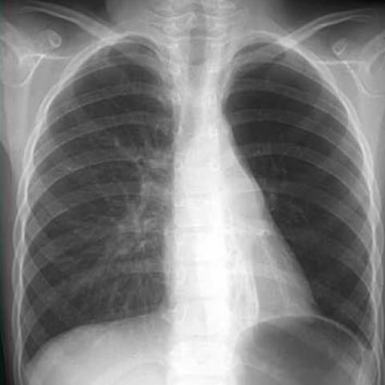
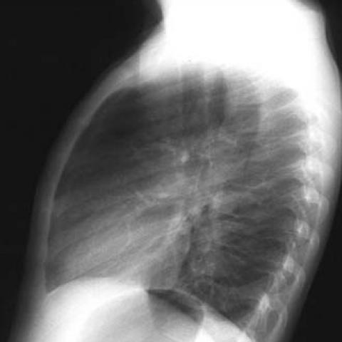

# Official gain: 3359_8353801515597

Post-run explicit answers: D **D**, M **D**, P **B**, reference **B**. Frozen runtime answers: D D, M None, P B; original records unchanged.

[Complete observable requests, tools and stages](../traces/3359_8353801515597.json) · [Original benchmark case](../../v12/results/cases/3359_8353801515597.md) · [D cached original observable request](../../direct_qwen60/requests/3359_8353801515597.json)

```text
Based on the conventional chest radiographs, what is the most likely explanation for the patient's clinical presentation of recurrent bronchial pneumonia and defective thorax development?
A) The hyperlucent left lung with bronchiectasis indicates Mac-Leod syndrome, with the anterior mediastinal mass unrelated.
B) The hyperlucent left lung with bronchiectasis and the anterior mediastinal mass suggest a bronchogenic cyst causing tracheobronchial compression.
C) The anterior mediastinal mass is likely benign and unrelated to the pulmonary findings.
D) The hyperlucent left lung with bronchiectasis is a result of bronchogenic cyst compression on the left main bronchus.
E) The presence of the mass in the anterior mediastinum suggests a malignant process unrelated to the lung findings.
F) The findings indicate a bilateral process inconsistent with Mac-Leod syndrome.
```





## D

```text
Answer: D  
Reason: The chest radiographs show a hyperlucent left lung with volume loss and bronchiectasis, consistent with chronic airway obstruction; the anterior mediastinal mass is positioned to compress the left main bronchus, which can cause distal air trapping, recurrent infection, and defective thoracic development—classic for bronchogenic cyst-induced extrinsic compression. Option D directly links the mass to the pulmonary findings, which best fits the clinical picture.
```

## M

```text
The tool outputs are inconsistent and not very helpful. The classifier shows high probabilities for multiple conditions (Consolidation: 0.50, Infiltration: 0.54, Emphysema: 0.51, Fibrosis: 0.52, Pleural Thickening: 0.52, Mass: 0.51) which suggests the model is uncertain or over-predicting. The report generator says "no acute cardiopulmonary process" which contradicts the obvious hyperlucency and mediastinal mass visible in the images.

Let me use my own visual analysis:

From Figure 1a (PA view): Left lung is markedly hyperlucent with reduced vascular markings, suggesting air trapping. The heart and mediastinum are shifted leftward. There's a suggestion of volume loss on the left side.

From Figure 1b (lateral view): Clear anterior mediastinal mass - well-circumscribed, homogeneous density mass in the anterior mediastinum.

The clinical presentation is recurrent bronchial pneumonia and defective thorax development.

Now considering the options:

A) MacLeod syndrome with unrelated anterior mediastinal mass - MacLeod syndrome typically presents with unilateral hyperlucent lung due to post-infectious bronchiolitis obliterans, but it doesn't typically feature an anterior mediastinal mass.

B) Bronchogenic cyst causing tracheobronchial compression - Bronchogenic cysts are congenital lesions that can compress the bronchus, leading to airway obstruction, recurrent infections, and ipsilateral lung hyperinflation. They commonly present in the anterior or middle mediastinum.

C) Anterior mediastinal mass is benign and unrelated - Possible, but less likely given the temporal relationship with recurrent pneumonia.

D) Hyperlucent left lung is result of bronchogenic cyst compression on left main bronchus - This is plausible as bronchogenic cysts can compress the bronchus leading to air trapping and hyperlucency distal to the obstruction.

E) Malignant process - Less likely in this context without other concerning features.

F) Bilateral process - The findings appear unilateral (left side), so this is incorrect.

The key insight is that bronchogenic cysts are congenital lesions that can cause chronic airway compression, leading to recurrent infections and defective thoracic development on the affected side. The anterior mediastinal location is classic for bronchogenic cysts.

Given the recurrent bronchial pneumonia, defective thorax development, hyperlucent left lung, and anterior mediastinal mass, the most likely explanation is a bronchogenic cyst causing compression of the left main bronchus.

Return Answer: D) The hyperlucent left lung with bronchiectasis is a result of bronchogenic cyst compression on the left main bronchus.
```

## P

```text
Answer: B) The hyperlucent left lung with bronchiectasis and the anterior mediastinal mass suggest a bronchogenic cyst causing tracheobronchial compression.

Evidence: The anterior mediastinal mass abuts the left main bronchus on frontal CXR, consistent with potential extrinsic compression; hyperlucency and bronchiectasis in the left lung are classic sequelae of chronic airway obstruction. Bronchogenic cysts are common congenital foregut anomalies that can compress adjacent airways, leading to recurrent infection and ipsilateral hyperlucency—fitting the clinical presentation of recurrent bronchial pneumonia and defective thorax development.
```

