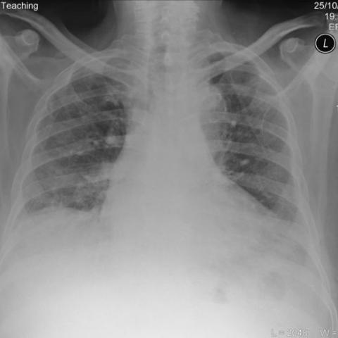

# Official gain: 3397_8353801520783

Post-run explicit answers: D **C**, M **C**, P **C**, reference **C**. Frozen runtime answers: D C, M None, P C; original records unchanged.

[Complete observable requests, tools and stages](../traces/3397_8353801520783.json) · [Original benchmark case](../../v12/results/cases/3397_8353801520783.md) · [D cached original observable request](../../direct_qwen60/requests/3397_8353801520783.json)

```text
Based on the chest X-ray findings in Figure 1, which of the following best describes the location and characteristics of the lung abnormalities observed, and how do they correlate with the patient's clinical presentation?
A) Bibasal reticulonodular shadowing with predominantly central distribution, suggesting pulmonary edema.
B) Upper lobe reticulonodular shadowing with cavitations, indicating possible pulmonary tuberculosis.
C) Bibasal interstitial reticulonodular shadowing with peripheral distribution, consistent with interstitial lung disease.
D) Diffuse alveolar opacities with ground glass appearance, typical of acute respiratory distress syndrome.
E) Unilateral upper lobe reticulonodular pattern, raising suspicion for a malignant process.
F) Central perihilar opacities with nodular characteristics, suggesting sarcoidosis.
```



## D

```text
Answer: C) Bibasal interstitial reticulonodular shadowing with peripheral distribution, consistent with interstitial lung disease.  
Reason: The chest X-ray (Figure 1) shows bilateral, predominantly basal reticulonodular opacities with a peripheral (subpleural) predominance and relative sparing of the upper lobes—classic for interstitial lung disease (e.g., idiopathic pulmonary fibrosis or connective tissue disease–associated ILD). This pattern differs from the central/perihilar distribution of edema or sarcoidosis, upper-lobe cavitary disease of TB, or diffuse alveolar patterns of ARDS.
```

## M

```text
The tool outputs show some inconsistencies that I need to critically evaluate:

1. The classifier shows high probabilities for Fibrosis (0.55), Effusion (0.65), and Lung Opacity (0.81), but also moderate probabilities for many other conditions.

2. The report generator states "the lungs appear clear" and "mild pulmonary edema," which contradicts my visual assessment of clear bibasal reticulonodular opacities.

3. The phrase grounding tool successfully located "Bibasal reticulonodular shadowing" in both lower lung zones, confirming my visual observation.

The report generator's conclusion that "lungs appear clear" is clearly incorrect given the visible abnormalities. This suggests the report generator may be unreliable for this case, possibly due to training biases or image quality issues.

Looking back at the image: The abnormalities are definitely present in the bibasal regions, with a reticulonodular pattern that appears more peripheral than central. There are no cavitations (ruling out TB), no diffuse ground-glass opacities (ruling out ARDS), and the distribution is not upper lobe predominant (ruling out sarcoidosis or typical TB).

Option C describes "Bibasal interstitial reticulonodular shadowing with peripheral distribution, consistent with interstitial lung disease" - this matches my visual assessment and the phrase grounding results.

The classifier's elevated Fibrosis probability (0.55) also supports an interstitial lung disease process rather than pulmonary edema (Edema probability only 0.19).

Return Answer: C) Bibasal interstitial reticulonodular shadowing with peripheral distribution, consistent with interstitial lung disease.
```

## P

```text
Answer: C) Bibasal interstitial reticulonodular shadowing with peripheral distribution, consistent with interstitial lung disease.

Evidence: The reticulonodular opacities are more prominent in the bibasal zones (confirmed by bounding boxes and expert tool), with relative upper lobe sparing. The pattern is diffuse, interstitial, and lacks cavitations, masses, or central predominance—ruling out A, B, D, E, and F. Peripheral distribution aligns with typical interstitial lung disease (e.g., fibrosis), though exact diagnosis requires clinical correlation.
```

