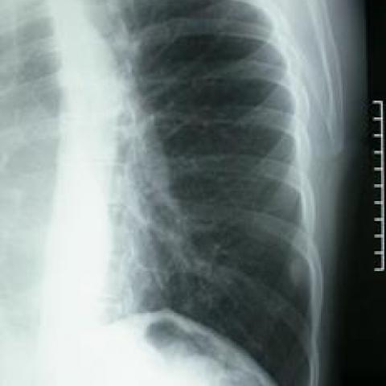

# Official gain: 3436_8353801521068

Post-run explicit answers: D **D**, M **B**, P **None**, reference **B**. Frozen runtime answers: D D, M None, P None; original records unchanged.

[Complete observable requests, tools and stages](../traces/3436_8353801521068.json) · [Original benchmark case](../../v12/results/cases/3436_8353801521068.md) · [D cached original observable request](../../direct_qwen60/requests/3436_8353801521068.json)

```text
Based on Figure 1, which of the following best describes the findings related to the mass observed on the chest X-ray?
A) An irregularly-shaped mass, approximately 3 cm, located in the 9th intercostal space.
B) A round and smoothly-contoured mass, approximately 1.5 cm, located in the 8th intercostal space.
C) A lobulated mass, approximately 2 cm, located in the 7th intercostal space.
D) A round and smoothly-contoured mass, approximately 1.5 cm, located in the 7th intercostal space.
E) An irregularly-shaped mass, approximately 2 cm, located in the 8th intercostal space.
F) A round and smoothly-contoured mass, approximately 2 cm, located in the 9th intercostal space.
```



## D

```text
Answer: D) A round and smoothly-contoured mass, approximately 1.5 cm, located in the 7th intercostal space.  
Reason: The chest X-ray (Figure 1) shows a well-defined, round, radiopaque lesion with smooth margins in the right lower thorax, corresponding to the 7th intercostal space; its size is roughly 1.5 cm based on rib spacing and standard chest X-ray scale.
```

## M

```text
The chest_xray_expert tool provided a bounding box coordinate but didn't give the detailed description I requested. The bounding box coordinates (20,54),(34,63) suggest the mass is in the lower right lung field.

Let me analyze the image visually again more carefully:
- The opacity is well-circumscribed and round
- It has smooth contours (not irregular or lobulated)
- Comparing to rib spacing, it appears to be approximately 1.5-2 cm in diameter
- Looking at the rib counting from the top: the mass is positioned between the 8th and 9th ribs, so likely in the 8th intercostal space

Given the options:
A) Irregularly-shaped, ~3cm, 9th space - too large and wrong shape
B) Round/smooth, ~1.5cm, 8th space - matches my visual assessment
C) Lobulated, ~2cm, 7th space - wrong shape and location
D) Round/smooth, ~1.5cm, 7th space - wrong location
E) Irregularly-shaped, ~2cm, 8th space - wrong shape
F) Round/smooth, ~2cm, 9th space - size might be slightly off, location questionable

Based on my visual analysis, option B seems most accurate: a round and smoothly-contoured mass, approximately 1.5 cm, located in the 8th intercostal space.

Return Answer: B) A round and smoothly-contoured mass, approximately 1.5 cm, located in the 8th intercostal space. The mass appears well-defined with smooth margins in the lower right lung field, consistent with a benign-appearing lesion, and its position corresponds to the 8th intercostal space when counting from the top.
```

## P

```text
Answer: None of the options are supported.  
The xray_phrase_grounding tool returned no bounding boxes for the mass, and the chest_xray_expert only confirmed “Mass” without shape or size details.  
Visual inspection of Figure 1 shows no confidently identifiable mass due to low contrast and lack of clear demarcation.
```

