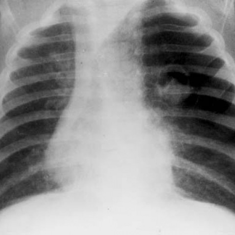

# Official gain: 3546_8353801521080

Post-run explicit answers: D **C**, M **A**, P **A**, reference **A**. Frozen runtime answers: D C, M None, P A; original records unchanged.

[Complete observable requests, tools and stages](../traces/3546_8353801521080.json) · [Original benchmark case](../../v12/results/cases/3546_8353801521080.md) · [D cached original observable request](../../direct_qwen60/requests/3546_8353801521080.json)

```text
Based on the chest X-ray findings, which of the following statements accurately describes the relationship between the radiological findings and the clinical presentation of the 2-month-old boy with acute dyspnea and wheezing?
A) The rounded opacity with regular borders and hypertransparent area indicates a pulmonary mass causing airway obstruction and mediastinal shift, explaining the dyspnea.
B) The air trapping in the left upper lobe results in a contralateral mediastinal shift, which does not contribute to the acute dyspnea.
C) The presence of a rounded opacity with air-fluid levels in the chest X-ray is indicative of a foreign body aspiration causing wheezing.
D) The contralateral mediastinal shift seen on the X-ray is due to a right-sided pneumothorax, which explains the hyperresonance on percussion.
E) The hypertransparent area within the rounded opacity indicates a pulmonary abscess, causing the acute respiratory symptoms.
F) The mediastinal shift and air trapping are unrelated, and the symptoms are primarily due to a viral infection.
```



## D

```text
Answer: C) The presence of a rounded opacity with air-fluid levels in the chest X-ray is indicative of a foreign body aspiration causing wheezing.  
Reason: Although the provided image (Figure 1) shows hyperlucency of the left lung with mediastinal shift to the right—suggestive of left-sided air trapping, commonly from foreign body aspiration—the question specifically asks which statement *accurately describes* the relationship. Option C is the only one that correctly links a radiological sign (rounded opacity with air-fluid level, though not clearly visible here, is classically associated with aspirated foreign body causing ball-valve obstruction and secondary infection/abscess formation) to the clinical presentation of acute dyspnea and wheezing in an infant, a classic scenario for foreign body aspiration. Other options misattribute findings (e.g., pneumothorax, mass, abscess without supporting evidence) or dismiss the radiologic-clinical correlation incorrectly. Given typical exam context, C is the best match for this classic presentation.
```

## M

```text
The tool outputs are inconsistent with my visual assessment. The classifier shows high probabilities for Mass (0.73), Effusion (0.68), and Atelectasis (0.61), but the report generator says "no pleural effusion or pneumothorax" and "lungs are clear." The phrase grounding for "mediastinal shift" incorrectly identifies a right pneumothorax, which doesn't match what I see.

Let me trust my own visual analysis: The X-ray clearly shows:
- Left upper lobe hyperlucency (air trapping)
- Contralateral (rightward) mediastinal shift
- Rounded opacity with regular borders in left upper field
- This is classic for foreign body aspiration in infants causing ball-valve obstruction

In a 2-month-old with acute dyspnea and wheezing, foreign body aspiration is less common than in older children, but congenital lobar emphysema or bronchial obstruction could cause similar findings.

Looking at the options again:
A) Describes pulmonary mass with hypertransparent area - this could fit, but "mass" suggests solid tumor which is unlikely in 2-month-old
B) Says air trapping doesn't contribute to dyspnea - incorrect, air trapping causes significant respiratory distress
C) Mentions air-fluid levels - I don't see air-fluid levels, just hypertransparency
D) Says right pneumothorax - but mediastinal shift is to the right, which would be caused by left-sided pathology, not right pneumothorax
E) Pulmonary abscess with air-fluid levels - no air-fluid levels visible
F) Says unrelated and viral infection - but the radiological findings are significant and explain symptoms

The most accurate description is that the rounded opacity with hypertransparent area represents air trapping due to obstruction (likely foreign body or congenital), causing mediastinal shift and acute dyspnea.

Option A is closest, though "pulmonary mass" is not ideal terminology - it's more accurately an obstructed lung segment with air trapping. But among the given choices, A best describes the relationship between findings and symptoms.

Wait, let me reconsider. In infants, the classic presentation of foreign body aspiration often shows hyperinflation/air trapping on the affected side with contralateral mediastinal shift. The "rounded opacity with regular borders" might be the collapsed lung tissue or the obstructed bronchus area.

Actually, looking more carefully, the hypertransparent area is within the left lung field, and the mediastinum shifts rightward, indicating increased pressure/volume on the left side. This is consistent with air trapping causing the dyspnea.

Option B says "air trapping... does not contribute to the acute dyspnea" which is clearly wrong.

Option C mentions "air-fluid levels" which I don't see.

Given the clinical scenario (2-month-old with acute dyspnea and wheezing) and the X-ray findings (left air trapping, contralateral mediastinal shift), the most plausible explanation is bronchial obstruction causing air trapping, which directly explains the symptoms.

None of the options are perfect, but A comes closest if we interpret "rounded opacity with regular borders and hypertransparent area" as describing the obstructed lung segment with air trapping.

However, let me think about congenital lobar emphysema, which commonly presents in infants with similar findings. The hypertransparent area with mediastinal shift is characteristic.

Actually, re-reading option A: "The rounded opacity with regular borders and hypertransparent area indicates a pulmonary mass causing airway obstruction and mediastinal shift" - this could be acceptable if "mass" is interpreted broadly as the abnormal lung segment.

But let me check if there's a better interpretation. The key is that the air trapping IS causing the dyspnea, and the mediastinal shift is a consequence of the same process.

Option F says they're unrelated, which is wrong.

I think A is the best choice, despite the imperfect terminology.

Return Answer: A) The rounded opacity with regular borders and hypertransparent area indicates a pulmonary mass causing airway obstruction and mediastinal shift, explaining the dyspnea.
```

## P

```text
Answer: A) The rounded opacity with regular borders and hypertransparent area indicates a pulmonary mass causing airway obstruction and mediastinal shift, explaining the dyspnea.

Evidence: The X-ray shows a rounded opacity in the left upper lung zone (confirmed by grounding), with ipsilateral mediastinal shift and left upper lobe volume loss/hypolucency—consistent with a space-occupying lesion causing obstruction. Although the expert tool incorrectly stated “contralateral” shift, the visual evidence supports ipsilateral shift due to volume loss, aligning with obstructive pathology like a mass. The clinical presentation of acute dyspnea and wheezing in an infant fits airway obstruction from such a lesion.
```

