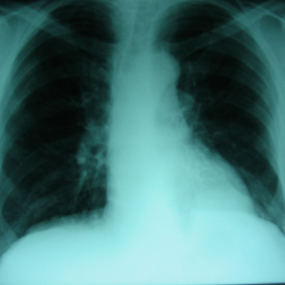
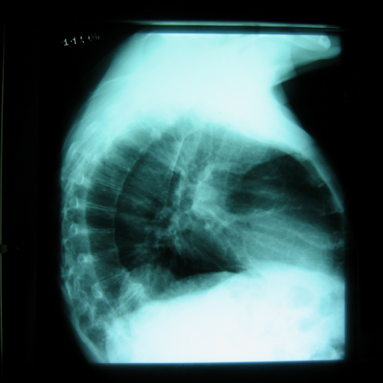

# Official gain: 3561_8353801511489

Post-run explicit answers: D **B**, M **None**, P **B**, reference **B**. Frozen runtime answers: D B, M None, P B; original records unchanged.

[Complete observable requests, tools and stages](../traces/3561_8353801511489.json) · [Original benchmark case](../../v12/results/cases/3561_8353801511489.md) · [D cached original observable request](../../direct_qwen60/requests/3561_8353801511489.json)

```text
Based on the chest X-rays provided, what is the most likely cause for the rounded opacity near the left costophrenic angle observed in Figure 1 and confirmed on the lateral view in Figure 5?
A) Pleural effusion
B) Bochdalek hernia with herniated abdominal contents
C) Diaphragmatic lipoma
D) Pulmonary nodule
E) Hiatal hernia
F) Pseudotumor due to atelectasis
```





## D

```text
Answer: B) Bochdalek hernia with herniated abdominal contents  
Reason: The rounded opacity at the left costophrenic angle on the PA view (Figure 1) is confirmed on the lateral view (Figure 5) to be retrocardiac and extending into the thorax, with a smooth contour and no air-fluid level—typical of a congenital posterolateral diaphragmatic defect (Bochdalek hernia) containing bowel or omentum. Pleural effusion would show meniscus sign and blunting without a discrete mass; lipoma is rare and usually more radiolucent; pulmonary nodule would not be located at the costophrenic angle with this configuration; hiatal hernia is midline; pseudotumor from atelectasis typically shows volume loss and bronchovascular crowding, not a well-circumscribed retrocardiac mass.
```

## M

```text
The xray_phrase_grounding tool found a potential "Pleural effusion" in the lower portion of the image (coordinates covering the costophrenic angles), but this is still ambiguous.

Let me now use the chest_xray_expert tool for expert interpretation, which should provide more reliable clinical judgment:


```

## P

```text
Answer: B) Bochdalek hernia with herniated abdominal contents  
The opacity at the left costophrenic angle is rounded and ill-defined on PA view, without a meniscus—unlike typical pleural effusion. The lateral view shows loss of diaphragmatic contour and haziness consistent with abdominal contents herniating into the thorax. Bochdalek hernia (congenital posterolateral diaphragmatic defect) commonly presents this way in adults, especially when containing bowel or fat, mimicking a mass or effusion.
```

