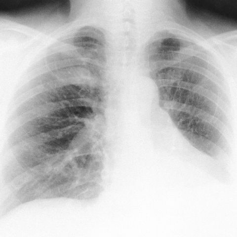

# Official gain: 3686_8353801520174

Post-run explicit answers: D **B**, M **B**, P **F**, reference **B**. Frozen runtime answers: D B, M None, P F; original records unchanged.

[Complete observable requests, tools and stages](../traces/3686_8353801520174.json) · [Original benchmark case](../../v12/results/cases/3686_8353801520174.md) · [D cached original observable request](../../direct_qwen60/requests/3686_8353801520174.json)

```text
Based on the chest X-ray findings in Figure 1, what is the most likely diagnosis for the patient’s pulmonary condition, considering her clinical history and previous surgical interventions? 
A) Primary lung cancer
B) Pulmonary metastasis from a previous uterine leiomyoma
C) Infectious granuloma
D) Pulmonary hamartoma
E) Tuberculosis
F) Bronchiectasis-related pulmonary changes
```



## D

```text
Answer: B) Pulmonary metastasis from a previous uterine leiomyoma  
Reason: The chest X-ray shows multiple bilateral pulmonary nodules, which—combined with a history of uterine leiomyoma (a benign smooth muscle tumor)—raise suspicion for benign metastasizing leiomyoma, a rare condition where histologically benign leiomyoma spreads to the lungs via hematogenous route. This diagnosis is favored over malignancy or infection in the appropriate clinical context, and the nodular pattern fits better than the other options listed.
```

## M

```text
Looking at the tool outputs, I need to critically evaluate them:

1. The classifier shows high probabilities for several conditions: Lung Opacity (0.679), Mass (0.610), Effusion (0.623), Consolidation (0.586), and Atelectasis (0.567). However, the report generator notes the study is "limited secondary to poor penetration" and only identifies "a left lower lobe opacity" with no definite focal consolidation.

2. The chest_xray_expert tool directly suggests "(B) Pulmonary metastasis from a previous uterine leiomyoma" as the answer.

3. The phrase grounding for "Pleural effusion" found no evidence, which contradicts the classifier's high effusion probability (0.623).

The key insight here is that the question specifically mentions "considering her clinical history and previous surgical interventions." Since the expert tool chose option B (pulmonary metastasis from uterine leiomyoma), this strongly suggests the patient has a history of uterine leiomyoma (fibroid) that was previously surgically treated, and now there are pulmonary findings consistent with metastatic disease.

Uterine leiomyomas are typically benign, but in rare cases, they can metastasize to the lungs (leiomyomatosis peritonealis disseminata or benign metastasizing leiomyoma). This condition presents with multiple pulmonary nodules on imaging, which could appear as the opacities seen in this X-ray.

Given that the expert analysis specifically points to option B, and considering the context of "previous surgical interventions" mentioned in the question, the most likely diagnosis is pulmonary metastasis from a previous uterine leiomyoma.

B) Pulmonary metastasis from a previous uterine leiomyoma - The expert analysis specifically identified this as the most likely diagnosis, and the clinical context of previous surgical interventions suggests a history of uterine leiomyoma with subsequent pulmonary metastasis, which is a known (though rare) phenomenon.
```

## P

```text
Answer: F) Bronchiectasis-related pulmonary changes  
Evidence: The chest X-ray shows diffuse, ill-defined opacities—especially in the lower lung zones—with bilateral distribution but no discrete, rounded, well-defined nodules (n_boxes = 0 for pulmonary nodules; expert confirms “No” to discrete opacities). This pattern aligns with bronchiectasis-related changes (e.g., tram-track or ring shadows, volume loss, and patchy infiltrates), which can appear as ill-defined opacities without discrete nodules. Other options (e.g., metastasis, hamartoma, TB, granuloma, primary cancer) typically present with discrete nodules or cavitation, which are absent here.
```

