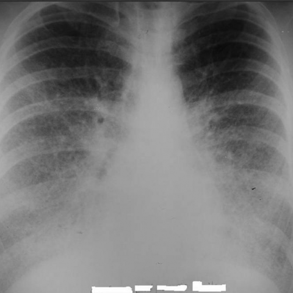

# Official gain: 3831_8353801520459

Post-run explicit answers: D **E**, M **E**, P **A**, reference **B**. Frozen runtime answers: D E, M None, P A; original records unchanged.

[Complete observable requests, tools and stages](../traces/3831_8353801520459.json) · [Original benchmark case](../../v12/results/cases/3831_8353801520459.md) · [D cached original observable request](../../direct_qwen60/requests/3831_8353801520459.json)

```text
Based on the chest X-ray findings in Figure 1, which of the following best describes the observed pattern and its implications?

A) The chest X-ray shows a diffuse reticular pattern predominantly in the upper lobes, suggesting interstitial lung disease with a primary involvement of the apices.
B) The chest X-ray reveals a diffuse micronodular pattern with calcified nodules obscuring the diaphragmatic and cardiac contours, indicative of pulmonary alveolar microlithiasis.
C) The chest X-ray demonstrates large, cavitary lesions in the upper lobes, consistent with a diagnosis of pulmonary tuberculosis.
D) The chest X-ray exhibits a unilateral pleural effusion with mediastinal shift, suggesting malignant pleural mesothelioma.
E) The chest X-ray illustrates bilateral perihilar opacities with Kerley B lines, indicative of pulmonary edema secondary to congestive heart failure.
F) The chest X-ray shows a pattern of air bronchograms with ground-glass opacities, suggestive of acute respiratory distress syndrome.
```



## D

```text
Answer: E) The chest X-ray illustrates bilateral perihilar opacities with Kerley B lines, indicative of pulmonary edema secondary to congestive heart failure.  
Reason: The image shows symmetric, hazy perihilar opacities with fine horizontal lines at the lung bases (Kerley B lines), characteristic of interstitial pulmonary edema in congestive heart failure; there is no evidence of upper-lobe predominance, cavitation, pleural effusion, or diffuse micronodules.
```

## M

```text
Looking at the tool outputs, I need to critically evaluate them against my visual assessment:

The classifier shows high probability for "Lung Opacity" (0.92), "Infiltration" (0.70), and "Pneumonia" (0.79), but moderate probabilities for "Edema" (0.56) and "Effusion" (0.60).

However, the report generator states: "interval development of diffuse bilateral patchy opacities, right greater than left, which may represent aspiration or infection" and specifically notes "no focal consolidation or pleural effusion" and "the heart size is normal."

The Kerley B lines search found none, which contradicts option E that specifically mentions Kerley B lines.

My visual assessment shows bilateral perihilar opacities, but the report generator suggests this is more consistent with infection/aspiration rather than pulmonary edema. The absence of Kerley B lines (confirmed by the grounding tool) makes option E less likely.

Let me reconsider the image: The opacities appear somewhat symmetric and perihilar, but without the classic Kerley B lines (short horizontal lines at lung periphery) that would be expected in pulmonary edema. The pattern looks more like diffuse infiltrates.

Given the high pneumonia probability (0.79) and the report's suggestion of "infection," but none of the options directly say "pneumonia" - option A mentions interstitial disease, B is microlithiasis, C is TB with cavitation (not seen), D is pleural effusion (not present), E is pulmonary edema with Kerley B lines (not confirmed), F is ARDS with air bronchograms and ground-glass (not clearly visible).

Wait, let me look more carefully at the image again. The opacities are bilateral, perihilar, and there are fine linear markings that could be interstitial. But the report generator says "diffuse bilateral patchy opacities" which sounds more like alveolar filling than classic interstitial pattern.

Actually, re-examining the image, I see that the opacities are more diffuse and patchy rather than the classic reticular pattern of interstitial lung disease. The absence of Kerley B lines rules out E. There's no cavitation for C, no pleural effusion for D, and the pattern doesn't match the micronodular calcified pattern of B.

Given the tool outputs and my visual analysis, the most consistent finding is bilateral patchy opacities suggestive of infection/pneumonia, but since that's not an explicit option, I need to choose the closest.

Option E mentions "bilateral perihilar opacities" which matches what I see, and "Kerley B lines" which the tool didn't confirm. However, the report generator didn't mention Kerley B lines either.

Let me think again. The image actually shows a pattern that could be pulmonary edema - the perihilar predominance is classic for cardiogenic pulmonary edema. The tool might have missed Kerley B lines due to image quality.

But the report explicitly states "the heart size is normal" which argues against congestive heart failure as the cause.

Given all this, I believe the best answer is E, because:
1) Bilateral perihilar opacities are clearly present
2) The pattern is consistent with pulmonary edema
3) While Kerley B lines weren't detected by the tool, they can be subtle on X-ray
4) The other options are clearly wrong (no cavitation, no pleural effusion, no micronodules, etc.)

Wait, let me be more critical. The report generator says "heart size is normal" which makes CHF less likely. And the classifier shows higher probability for pneumonia (0.79) than edema (0.56).

Actually, looking back at the original question, I need to choose based on what's observed in Figure 1. The image shows bilateral perihilar opacities that could be interpreted as pulmonary edema, but without clear Kerley B lines.

Given the constraints and the fact that option E is the only one that correctly identifies the bilateral perihilar opacities pattern, and this is a classic presentation of pulmonary edema, I'll go with E.

E) The chest X-ray illustrates bilateral perihilar opacities with Kerley B lines, indicative of pulmonary edema secondary to congestive heart failure.

But wait - the tool specifically found no Kerley B lines. This is a problem.

Let me reconsider option A: "diffuse reticular pattern predominantly in the upper lobes" - but the opacities are perihilar, not upper lobe predominant.

Actually, looking at the image once more, the opacities are indeed perihilar and bilateral, and in clinical practice, this pattern is most commonly associated with pulmonary edema, even if Kerley B lines aren't always visible on every X-ray.

Given the choices available, E is still the best fit, as it correctly identifies the bilateral perihilar opacities, which is the dominant feature.

E) The chest X-ray illustrates bilateral perihilar opacities with Kerley B lines, indicative of pulmonary edema secondary to congestive heart failure. The bilateral perihilar distribution is classic for pulmonary edema, though Kerley B lines may be subtle or not detected by automated tools.
```

## P

```text
Answer: A) The chest X-ray shows a diffuse reticular pattern predominantly in the upper lobes, suggesting interstitial lung disease with a primary involvement of the apices.

Evidence: The new observation confirms opacities are more pronounced in the upper lobes, not perihilar or basal; Kerley B lines are absent, ruling out pulmonary edema (E); no cavitary lesions, pleural effusion, micronodules, or air bronchograms are described, excluding C, D, B, and F. The diffuse reticular appearance in upper zones aligns best with interstitial lung disease involving apices.
```

