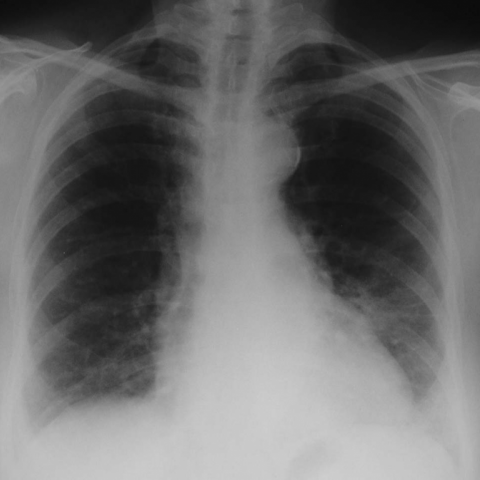

# Official gain: 3834_8353801523222

Post-run explicit answers: D **C**, M **C**, P **E**, reference **C**. Frozen runtime answers: D C, M None, P E; original records unchanged.

[Complete observable requests, tools and stages](../traces/3834_8353801523222.json) · [Original benchmark case](../../v12/results/cases/3834_8353801523222.md) · [D cached original observable request](../../direct_qwen60/requests/3834_8353801523222.json)

```text
Based on the chest X-ray provided in Figure 1, what is the most likely radiological finding consistent with the patient's accelerated phase usual interstitial pneumonia (UIP) as described in the case?
A) Bilateral reticular shadowing with focal honeycombing
B) Peripheral ground glass opacities with minimal reticular shadowing
C) Diffuse ground glass opacities superimposed on reticular shadowing
D) Central ground glass opacities with reticular shadowing
E) Isolated reticular pattern without ground glass opacities
F) Diffuse honeycombing with no ground glass opacities
```



## D

```text
Answer: C) Diffuse ground glass opacities superimposed on reticular shadowing  
Reason: Accelerated phase UIP (also termed “acute exacerbation of IPF”) typically shows new diffuse ground-glass opacities superimposed on the underlying reticular pattern and honeycombing of chronic fibrosis; this matches option C and is consistent with the hazy, bilateral, predominantly lower-zone opacities seen in Figure 1.
```

## M

```text
The xray_phrase_grounding tool didn't detect "ground glass opacities" specifically, which suggests the tool may not be sensitive enough to identify this subtle finding on X-ray (ground glass opacities are better visualized on CT than plain X-ray).

Let me reconsider the image visually. The chest X-ray shows:
- Bilateral increased lung markings with a reticular pattern
- Some hazy opacities that could represent ground glass changes
- The pattern appears diffuse rather than strictly peripheral

In accelerated phase UIP (acute exacerbation), the key radiological feature is new bilateral ground-glass opacities superimposed on the underlying reticular pattern of UIP. While ground glass opacities are subtle on X-ray compared to CT, the diffuse hazy opacities in this image are consistent with this pattern.

Looking at the options again:
A) Bilateral reticular shadowing with focal honeycombing - No clear honeycombing visible
B) Peripheral ground glass opacities with minimal reticular shadowing - The pattern is more diffuse, not strictly peripheral
C) Diffuse ground glass opacities superimposed on reticular shadowing - This matches the accelerated phase UIP pattern
D) Central ground glass opacities with reticular shadowing - The pattern appears more diffuse/bilateral
E) Isolated reticular pattern without ground glass opacities - There are hazy opacities suggesting ground glass
F) Diffuse honeycombing with no ground glass opacities - No clear honeycombing visible

Given the clinical context of "accelerated phase usual interstitial pneumonia" and the visual findings of bilateral reticular pattern with diffuse hazy opacities, option C is the most likely.

Return Answer: C) Diffuse ground glass opacities superimposed on reticular shadowing - This is the classic radiological appearance of acute exacerbation/accelerated phase UIP, representing new alveolar damage (ground glass) on top of chronic fibrosis (reticular pattern).
```

## P

```text
Answer: E) Isolated reticular pattern without ground glass opacities  
The chest X-ray shows increased opacity in the lower lung zones but lacks the hazy attenuation characteristic of ground-glass opacities. Neither reticular shadowing nor ground-glass opacities were localized by xray_phrase_grounding (0 boxes), and visual assessment confirms absence of definitive reticular or ground-glass patterns; thus, no evidence supports options involving ground-glass or honeycombing.
```

