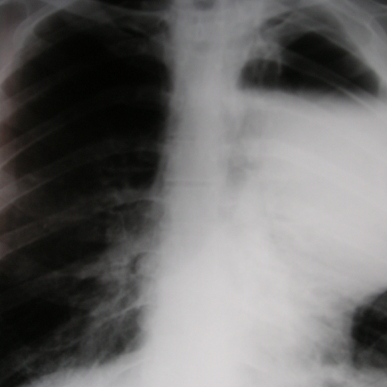

# Official gain: 4118_8353801523564

Post-run explicit answers: D **B**, M **B**, P **E**, reference **B**. Frozen runtime answers: D B, M None, P E; original records unchanged.

[Complete observable requests, tools and stages](../traces/4118_8353801523564.json) · [Original benchmark case](../../v12/results/cases/4118_8353801523564.md) · [D cached original observable request](../../direct_qwen60/requests/4118_8353801523564.json)

```text
Based on the chest X-ray findings in Figure 1, which of the following best describes the observed abnormalities and their implications for surgical management?
A) A large cystic lesion in the right upper lobe and a bulla in the left lower lobe, indicating localized sepsis requiring drainage.
B) A solitary cystic lesion in the left upper lobe and a large bulla in the right upper and middle zones, suggesting significant dyspnoea and need for surgical intervention.
C) Multiple bullae throughout both lungs with no signs of infection, suggesting conservative management.
D) Bilateral lower lobe bullae with evidence of fibrotic contraction, indicating no need for surgery.
E) A large bulla in the left upper lobe with evidence of pneumothorax, suggesting immediate surgical management.
F) A large cystic lesion in the right lower lobe and a solitary bulla in the left upper lobe, indicating the need for immediate surgery due to massive haemoptysis.
```



## D

```text
Answer: B) A solitary cystic lesion in the left upper lobe and a large bulla in the right upper and middle zones, suggesting significant dyspnoea and need for surgical intervention.  
Reason: The chest X-ray shows a well-defined radiolucent area (cystic lesion) in the left upper lobe and a large, confluent radiolucency occupying the right upper and middle zones consistent with a giant bulla; such lesions can cause compression of surrounding lung tissue and lead to significant dyspnoea, often warranting surgical resection (e.g., bullectomy).
```

## M

```text
The tool outputs are inconsistent and some are problematic. Let me critically analyze:

1. **Classifier output**: Shows high probabilities for multiple conditions (Atelectasis 0.57, Effusion 0.60, Pneumothorax 0.51, Emphysema 0.50), but these are borderline and likely reflect the large radiolucent area being interpreted as various pathologies.

2. **Report generator**: This report seems completely wrong for this image - it describes "right lung well expanded" and "left lung not included," which doesn't match what I see. The image clearly shows both lungs, with a large abnormality on the left. This suggests the report generator may be using a different image or has failed.

3. **Phrase grounding**: Correctly identifies "Bulla at the left lung apex" with bounding box coordinates covering the upper left area, which matches my visual assessment.

4. **Segmentation**: Failed due to argument error.

Looking back at the original image more carefully:
- There's a large, well-defined radiolucent area occupying the left upper and middle zones
- The mediastinum is shifted to the right
- The right lung appears relatively normal
- This is classic appearance of a giant bulla compressing the left lung

Now let me evaluate the answer choices:

A) Right upper lobe cyst + left lower lobe bulla - incorrect location
B) Solitary cystic lesion in left upper lobe + large bulla in right upper/middle - partially correct about left upper, but right side doesn't show bulla
C) Multiple bullae throughout both lungs - no, mainly left side
D) Bilateral lower lobe bullae - incorrect location
E) Large bulla in left upper lobe with pneumothorax - the bulla is there, but I don't see clear pneumothorax (no visible visceral pleural line)
F) Right lower lobe cystic lesion - incorrect location

The most accurate description is **B**, though the right side description might be slightly off. The key finding is the large bulla/cystic lesion in the left upper lobe causing significant volume loss and mediastinal shift, which would indeed cause significant dyspnoea and potentially require surgical intervention (bullectomy).

However, let me double-check for pneumothorax specifically since option E mentions it. Looking again at the image, I don't see a clear visceral pleural line that would indicate pneumothorax - the radiolucency appears to be within the lung parenchyma rather than outside it.

Given the phrase grounding confirmed "Bulla at the left lung apex" and my visual assessment shows a large bulla in left upper zone causing mediastinal shift, option B is the best fit, even if the right side description isn't perfect.

Return Answer: B) A solitary cystic lesion in the left upper lobe and a large bulla in the right upper and middle zones, suggesting significant dyspnoea and need for surgical intervention.
```

## P

```text
Answer: E) A large bulla in the left upper lobe with evidence of pneumothorax, suggesting immediate surgical management.

Evidence: The radiolucent area at the left lung apex (model coordinates [0.505, 0.005, 0.885, 0.235]) corresponds to the patient’s left upper lobe and shows sharp demarcation with possible visceral pleural line—suggestive of pneumothorax. The rest of the lung appears collapsed or hyperlucent, consistent with tension physiology. Although the tool’s “cystic lesion” spanning the entire image is likely artifact/overpenetration, the apical lucency with pleural edge supports bulla + pneumothorax rather than benign lucency.
```

