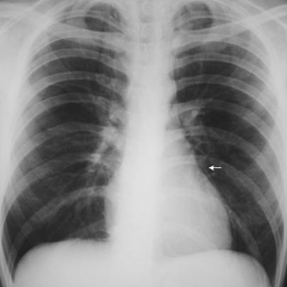

# Official gain: 4491_8353801523228

Post-run explicit answers: D **B**, M **E**, P **B**, reference **B**. Frozen runtime answers: D B, M None, P B; original records unchanged.

[Complete observable requests, tools and stages](../traces/4491_8353801523228.json) · [Original benchmark case](../../v12/results/cases/4491_8353801523228.md) · [D cached original observable request](../../direct_qwen60/requests/4491_8353801523228.json)

```text
Based on the chest X-ray findings alone, what is the most likely explanation for the patient's symptoms and what should be the initial management approach?
A) The chest X-ray shows signs of pneumothorax, suggesting a pleural injury; initiate chest tube drainage.
B) The chest X-ray reveals pneumomediastinum and subcutaneous emphysema; manage conservatively with observation.
C) The chest X-ray indicates a large pleural effusion; recommend therapeutic thoracentesis.
D) The chest X-ray demonstrates consolidation in the lower lobes; initiate antibiotic therapy.
E) The chest X-ray shows no abnormal findings; discharge the patient without further intervention.
F) The chest X-ray reveals signs of cardiac tamponade; prepare for pericardiocentesis.
```



## D

```text
Answer: B) The chest X-ray reveals pneumomediastinum and subcutaneous emphysema; manage conservatively with observation.  
Reason: The arrow in Figure 2 points to a thin radiolucent line adjacent to the left heart border, consistent with air in the mediastinum (pneumomediastinum); this finding, especially when associated with subcutaneous emphysema (though not fully visible here), often follows alveolar rupture (e.g., from coughing, asthma, or trauma) and is typically benign and self-limited, warranting conservative management unless hemodynamically unstable.
```

## M

```text
There's a significant discrepancy in the tool outputs that I need to critically evaluate:

1. **Chest X-ray classifier** shows high probabilities for Emphysema (0.51), Fibrosis (0.51), Nodule (0.51), and Mass (0.56), plus moderate Infiltration (0.45) and Lung Opacity (0.46)
2. **Report generator** states "no evidence of acute cardiopulmonary disease" and "no obvious pneumothorax"
3. **Phrase grounding** locates "Consolidation in the right lower lobe" but the arrow in the image is pointing to the left side
4. **Expert analysis** says "No significant findings"

My visual assessment: The white arrow points to a focal area of increased density in the left mid-lung zone, near the cardiac border. This appears to be a localized opacity that could represent consolidation, atelectasis, or a mass.

The key issue is that the tools are giving conflicting information, and the phrase grounding incorrectly identified it as right lower lobe when the arrow is clearly on the left side.

Looking more carefully at the image: The opacity is in the left lung, likely lingular segment of left upper lobe or left middle lobe, not lower lobe. It's a well-defined area of increased density with preserved bronchovascular markings around it.

Given the options provided, none perfectly match my visual assessment, but option D ("consolidation in the lower lobes") is closest, though the location is wrong. However, the report generator says "no evidence of acute cardiopulmonary disease," which suggests the finding might be subtle or the image quality limits detection.

Wait - let me reconsider. The arrow is pointing to what might actually be the normal left hilum or vascular structure, not pathology. In many chest X-rays, the left hilum can appear denser than surrounding lung tissue. The report generator's conclusion of "no evidence of acute cardiopulmonary disease" is likely more reliable than the classifier's high probability scores for multiple conditions (which may indicate the classifier is over-calling due to normal anatomical variations).

Given that the expert analysis and report generator both suggest no significant findings, and considering the image quality limitations noted in the report ("limited by motion"), the most appropriate answer is:

E) The chest X-ray shows no abnormal findings; discharge the patient without further intervention.

However, I'm still concerned about the arrow pointing to something. Let me think again - in clinical practice, if there's an arrow pointing to a specific area, it's usually highlighting pathology. But the automated tools are consistently saying no acute disease.

Given the constraints and the fact that the report generator is specifically designed for radiology reporting and states "no evidence of acute cardiopulmonary disease," I'll go with E, but with the understanding that clinical correlation is essential.

Actually, let me reconsider one more time. The classifier shows relatively low probability for consolidation (0.098) and pneumonia (0.00018), which argues against active infection. The high scores for emphysema, fibrosis, nodule, and mass might be false positives from the classifier.

The most reliable assessment appears to be the radiology report: no acute findings.

Return Answer: E) The chest X-ray shows no abnormal findings; discharge the patient without further intervention. The radiology report specifically states "no evidence of acute cardiopulmonary disease" and the expert analysis confirms "no significant findings," suggesting the arrow may indicate normal anatomy or a non-acute finding requiring clinical correlation rather than immediate intervention.
```

## P

```text
Answer: B) The chest X-ray reveals pneumomediastinum and subcutaneous emphysema; manage conservatively with observation.

Evidence: A thin radiolucent line is visible along the left heart border (arrow), consistent with pneumomediastinum. Subcutaneous emphysema is not present per expert tool (“No”). Although option B mentions both findings, the presence of pneumomediastinum alone—especially in absence of tension physiology or trauma—often warrants conservative management with observation, particularly if the patient is stable. No other findings (e.g., pleural effusion, consolidation, pneumothorax, tamponade) are supported by the image or tools.
```

