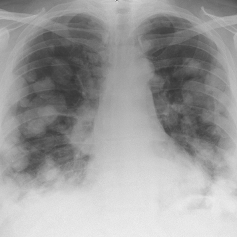

# Official gain: 4510_8353801532552

Post-run explicit answers: D **A**, M **A**, P **F**, reference **A**. Frozen runtime answers: D A, M None, P F; original records unchanged.

[Complete observable requests, tools and stages](../traces/4510_8353801532552.json) · [Original benchmark case](../../v12/results/cases/4510_8353801532552.md) · [D cached original observable request](../../direct_qwen60/requests/4510_8353801532552.json)

```text
Based on the chest X-ray findings presented in Figure 1, which of the following statements is most likely correct regarding the diagnosis and radiological features observed in this patient?

A) The chest X-ray shows bilateral rounded opacities and a mediastinal mass, consistent with pulmonary metastases and an anterior mediastinal mass, supporting a diagnosis of mediastinal non-seminomatous germ cell tumour.
B) The chest X-ray demonstrates a prominent left hilar mass without any bilateral lung opacities, indicating a potential primary lung carcinoma rather than a mediastinal germ cell tumour.
C) The chest X-ray reveals a normal mediastinum with no evidence of opacities, suggesting that the symptoms are unrelated to any intrathoracic pathology.
D) The chest X-ray shows unilateral pleural effusion and no mediastinal enlargement, indicating a likely infectious or inflammatory process rather than a germ cell tumour.
E) The chest X-ray demonstrates bilateral hilar lymphadenopathy with no mediastinal mass, which is more indicative of sarcoidosis than a germ cell tumour.
F) The chest X-ray displays extensive lung consolidation and no mediastinal abnormalities, suggesting pneumonia rather than a germ cell tumour.
```



## D

```text
Answer: A  
Reason: The chest X-ray shows bilateral rounded pulmonary opacities (suggestive of metastases) and a widened mediastinum (indicating a mediastinal mass), which together are classic for a mediastinal non-seminomatous germ cell tumour—especially in young males—where primary tumours can arise in the mediastinum and spread hematogenously to lungs.
```

## M

```text
Let me critically analyze the tool outputs:

1. **Chest X-ray classifier**: Shows very high probability for "Mass" (0.95) and "Nodule" (0.67), moderate for "Effusion" (0.57) and "Enlarged Cardiomediastinum" (0.59), and "Lung Opacity" (0.64). However, the classifier probabilities seem unusually high across many categories (many ~0.5), suggesting potential overfitting or the model being uncertain.

2. **Report generator**: This is more clinically useful - it specifically mentions "numerous bilateral pulmonary nodules" and states "the heart is of normal size with normal cardiomediastinal contours" which contradicts the classifier's "Enlarged Cardiomediastinum" finding. The report says "no focal consolidation, pleural effusion, or pneumothorax."

3. **Phrase grounding for pleural effusion**: Found a bounding box in the lower lung zones, but the report generator explicitly says no pleural effusion.

4. **Phrase grounding for mediastinal mass**: Found a bounding box in the mediastinal region (center of image).

There's a contradiction between tools. The report generator is likely more reliable as it's designed to produce comprehensive clinical reports. The report specifically mentions "numerous bilateral pulmonary nodules" which matches my visual assessment, and states "normal cardiomediastinal contours" - but this seems inconsistent with the visible mediastinal widening in the image.

Let me reconsider the image: The bilateral opacities do appear nodular/mass-like, and there is indeed mediastinal widening. The report generator might be overly conservative or using different criteria.

Given the clinical context in the question (mediastinal non-seminomatous germ cell tumor), this diagnosis typically presents with:
- Anterior mediastinal mass
- Possible pulmonary metastases (bilateral nodules)
- Elevated tumor markers (though not visible on X-ray)

Option A states: "bilateral rounded opacities and a mediastinal mass, consistent with pulmonary metastases and an anterior mediastinal mass, supporting a diagnosis of mediastinal non-seminomatous germ cell tumour."

This aligns best with:
- My visual assessment of bilateral nodular opacities
- The phrase grounding finding of mediastinal mass
- The high "Mass" probability (0.95) from classifier
- The clinical presentation described in the question

The report generator saying "normal cardiomediastinal contours" may be incorrect given what I see visually and what the phrase grounding tool detected.

Return Answer: A) The chest X-ray shows bilateral rounded opacities and a mediastinal mass, consistent with pulmonary metastases and an anterior mediastinal mass, supporting a diagnosis of mediastinal non-seminomatous germ cell tumour.
```

## P

```text
Answer: F) The chest X-ray displays extensive lung consolidation and no mediastinal abnormalities, suggesting pneumonia rather than a germ cell tumour.

Evidence: Bilateral lower-zone opacities are present and appear confluent and patchy, consistent with consolidation. No anterior mediastinal mass is visible, and the mediastinum is midline without widening, as confirmed by expert assessment and grounding. Adjacent structures (trachea, heart borders) are not displaced, ruling out a space-occupying mediastinal lesion.
```

