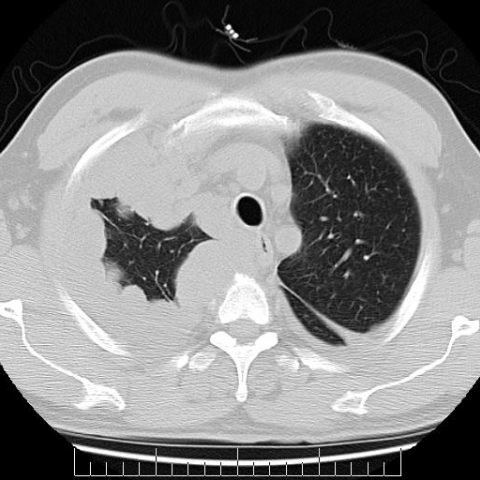
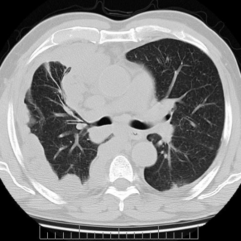
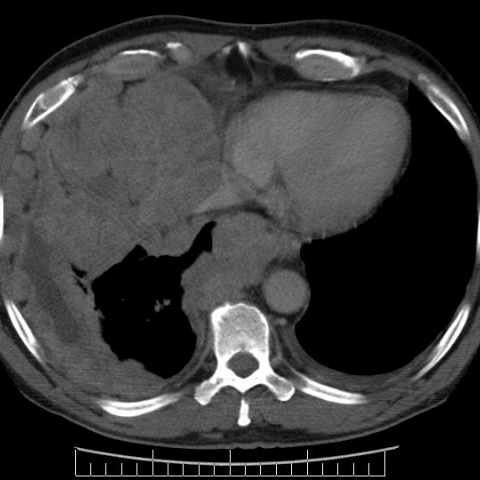

# Official gain: 4734_8353801532720

Post-run explicit answers: D **B**, M **B**, P **B**, reference **B**. Frozen runtime answers: D B, M None, P B; original records unchanged.

[Complete observable requests, tools and stages](../traces/4734_8353801532720.json) · [Original benchmark case](../../v12/results/cases/4734_8353801532720.md) · [D cached original observable request](../../direct_qwen60/requests/4734_8353801532720.json)

```text
Based on the chest X-ray figures, which feature most strongly supports the diagnosis of malignant pleural mesothelioma in this patient?
A) Bilateral pleural effusion
B) Thick nodular pleural mass impinging on mediastinal structures
C) Bilateral lung volume reduction
D) Large central pulmonary mass
E) Diffuse interstitial lung disease
F) Osteolytic lesion of the sternum
```







## D

```text
Answer: B) Thick nodular pleural mass impinging on mediastinal structures  
Reason: Malignant pleural mesothelioma typically presents with diffuse, irregular (nodular) pleural thickening that encases the lung and may invade or compress mediastinal structures—exactly as seen in the CT images (especially Figure 3 showing a large pleural-based mass with mediastinal shift/impingement). While pleural effusion (A) is common, it is nonspecific; the nodular, circumferential pleural mass is more characteristic of mesothelioma versus other malignancies or benign processes.
```

## M

```text
The chest_xray_classifier is also not providing the detailed analysis I need. The probabilities show moderate likelihood for atelectasis (0.55), pneumothorax (0.50), edema (0.54), and lung opacity (0.59), but very low probability for pleural thickening (0.017) and mass (0.35), which doesn't match my visual assessment of a large pleural mass.

Let me analyze the images directly with my own medical reasoning:

**Figure 1**: Shows a large left-sided pleural mass that appears to encase the lung, with mediastinal shift to the right. The mass has irregular, nodular margins and is pleural-based rather than parenchymal.

**Figure 2**: Shows bilateral pleural abnormalities with more prominent left-sided involvement. There's evidence of pleural thickening and mass effect.

**Figure 3**: Shows a large pleural mass on the left side with significant volume loss of the left lung and mediastinal shift.

For malignant pleural mesothelioma, the most characteristic imaging feature is **thick nodular pleural mass that encases the lung and can impinge on mediastinal structures**. This distinguishes it from:
- Primary lung cancer (central pulmonary mass - option D)
- Metastatic disease (often multiple discrete nodules)
- Benign pleural effusions (smooth, non-nodular)

Option B specifically describes "Thick nodular pleural mass impinging on mediastinal structures" which matches what I see in these images.

While bilateral pleural effusion (A) can occur in mesothelioma, it's less specific and can be seen in many other conditions (heart failure, infection, etc.). Bilateral lung volume reduction (C) is a consequence but not the most specific feature. Large central pulmonary mass (D) suggests primary lung cancer. Diffuse interstitial lung disease (E) is not typical for mesothelioma. Osteolytic sternum lesion (F) would suggest metastatic disease.

Based on my visual analysis of the CT images showing pleural-based nodular masses with mediastinal impingement, the answer should be B.

Return Answer: B) Thick nodular pleural mass impinging on mediastinal structures
```

## P

```text
Answer: B) Thick nodular pleural mass impinging on mediastinal structures  
Reason: Malignant pleural mesothelioma typically presents with diffuse, irregular (nodular) pleural thickening that encases the lung and may invade or compress mediastinal structures—exactly as seen in the CT images (especially Figure 3 showing a large pleural-based mass with mediastinal shift/impingement). While pleural effusion (A) is common, it is nonspecific; the nodular, circumferential pleural mass is more characteristic of mesothelioma versus other malignancies or benign processes.
```

