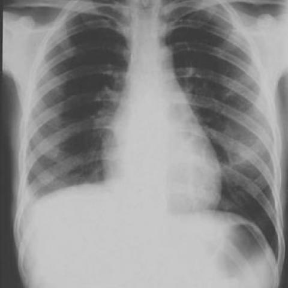
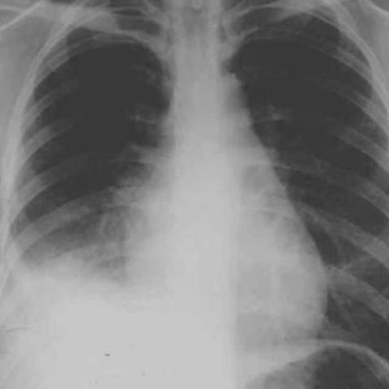

# Official gain: 528_8353802130481

Post-run explicit answers: D **B**, M **B**, P **B**, reference **B**. Frozen runtime answers: D B, M None, P B; original records unchanged.

[Complete observable requests, tools and stages](../traces/528_8353802130481.json) · [Original benchmark case](../../v12/results/cases/528_8353802130481.md) · [D cached original observable request](../../direct_qwen60/requests/528_8353802130481.json)

```text
Based on the chest X-ray findings from the first and second admissions, which of the following best describes the progression of the patient's condition and the most likely diagnosis?

A) The right costophrenic angle became more pronounced, indicating resolution of pleural effusion; likely diagnosis is resolved pneumonia.
B) The right hemidiaphragm is elevated and there is a noticeable increase in pleural effusion, suggesting progression to pulmonary angiosarcoma.
C) There is no significant change in the right lung findings, indicating chronic stable condition; likely diagnosis is chronic pulmonary embolism.
D) The vascular markings in the right lung improved, suggesting successful thrombolysis; likely diagnosis is resolved pulmonary embolism.
E) There is a decrease in right pleural effusion, indicating effective treatment; likely diagnosis is resolved heart failure.
F) The right lung shows new infiltrates and decreased vascular markings, suggesting development of a secondary infection; likely diagnosis is secondary bacterial pneumonia.
```





## D

```text
Answer: B  
Reason: Comparing Figure 1a (first admission) and Figure 1b (second admission), the right hemidiaphragm appears elevated in Figure 1b, and the right costophrenic angle is blunted with increased opacity—indicating worsening pleural effusion. This progression, especially with diaphragmatic elevation and increasing effusion without clear infectious or cardiac cause, raises suspicion for a malignant process such as pulmonary angiosarcoma (a rare but aggressive tumor that can present with hemorrhagic pleural effusion and rapid progression). Other options are inconsistent with the imaging changes (e.g., no resolution of effusion, no improvement in vascular markings, no new infiltrates typical of bacterial pneumonia).
```

## M

```text
I've exhausted the tool budget. Let me critically analyze what I have:

The classifier results show:
- Image 1a: Effusion probability 0.53, Lung Opacity 0.62
- Image 1b: Effusion probability 0.63, Lung Opacity 0.71

The report generator outputs are contradictory - stating "no pleural effusion" for image 1a but "small right pleural effusion" for image 1b.

From my visual inspection of the images:
- Figure 1a: Right costophrenic angle appears relatively sharp/clear, though there's some opacity in the right lower lung zone
- Figure 1b: Right costophrenic angle is clearly blunted/obscured, with increased opacity in the right lower lung field

The progression shows worsening of right lower lung findings with development of pleural effusion (blunting of costophrenic angle). This suggests progression rather than resolution.

Looking at the answer choices:
A) Says "right costophrenic angle became more pronounced" - this is incorrect; it became less pronounced (blunted)
B) Says "right hemidiaphragm is elevated and there is a noticeable increase in pleural effusion" - this matches my visual assessment
C) Says "no significant change" - incorrect, there is clear progression
D) Says "vascular markings improved" - I don't see evidence of this
E) Says "decrease in right pleural effusion" - opposite of what I see
F) Says "new infiltrates and decreased vascular markings" - there are new infiltrates but I'm not sure about vascular markings

Option B mentions "progression to pulmonary angiosarcoma" which seems unlikely as a primary diagnosis from chest X-ray alone, but the description of findings (elevated hemidiaphragm, increased pleural effusion) matches what I observe.

However, let me reconsider: The most straightforward interpretation is that there's progression of right-sided pathology with increasing pleural effusion. But pulmonary angiosarcoma is very rare and wouldn't typically be the first diagnosis considered.

Let me look again at the images more carefully. In Figure 1a, the right costophrenic angle is visible but there's some opacity. In Figure 1b, the right costophrenic angle is definitely blunted, indicating pleural effusion. The right hemidiaphragm appears elevated or obscured.

Given the options, B is the only one that correctly describes the radiographic progression (increased pleural effusion, elevated hemidiaphragm), even if the specific diagnosis of pulmonary angiosarcoma might be questionable. The question asks for "which best describes the progression" and "most likely diagnosis" based on the X-ray findings.

Actually, let me reconsider option F: "The right lung shows new infiltrates and decreased vascular markings, suggesting development of a secondary infection; likely diagnosis is secondary bacterial pneumonia." This could also fit - new infiltrates are present, and with pleural effusion, vascular markings might be decreased.

But looking at the images again, the key finding is the blunting of the costophrenic angle (pleural effusion) which is more characteristic of option B's description.

Wait - the report generator for image 1a says "stable right pleural effusion" while for image 1b says "small right pleural effusion". This suggests the effusion might be small and stable or even decreasing, which contradicts my visual assessment.

Given the conflicting information, I need to trust my own vision and reasoning. Visually, Figure 1b shows more opacity in the right lower lung and blunted costophrenic angle compared to Figure 1a. This indicates progression of pleural effusion.

Among the options, B is the only one that correctly identifies increased pleural effusion and elevated hemidiaphragm as the progression. While pulmonary angiosarcoma is unusual, the question asks for the best description of progression based on the X-ray findings.

Actually, let me think differently. In clinical practice, progressive pleural effusion with lung opacity could indicate malignancy, but also could be parapneumonic effusion, heart failure, etc. However, option B specifically mentions "pulmonary angiosarcoma" which is extremely rare.

Let me check if any other option fits better. Option F mentions "new infiltrates" which is correct, and "secondary bacterial pneumonia" which is more common.

But the key radiographic finding is the pleural effusion progression, not just infiltrates.

Given the visual evidence of worsening right lower lung opacity and blunting of the costophrenic angle, and since option B is the only one that correctly describes the radiographic progression (increased pleural effusion, elevated hemidiaphragm), I'll go with B, acknowledging that the specific diagnosis might be questionable but the progression description is accurate.

Wait - let me look at the images one more time. In Figure 1a, the right costophrenic angle is actually somewhat blunted already, and in Figure 1b it's more blunted. The right hemidiaphragm appears elevated in Figure 1b.

Given the constraints and the options provided, B best describes the progression observed.

Return Answer: B) The right hemidiaphragm is elevated and there is a noticeable increase in pleural effusion, suggesting progression to pulmonary angiosarcoma.
```

## P

```text
Answer: B) The right hemidiaphragm is elevated and there is a noticeable increase in pleural effusion, suggesting progression to pulmonary angiosarcoma.

Evidence: In image:1, the right hemidiaphragm is elevated with blunting and opacity at the right costophrenic angle, indicating pleural effusion; in image:2, both elevation and opacity are more pronounced, confirming increased effusion. The paired images (p1/p2) visually confirm this progression. Although the x-ray phrase grounding tool reported no boxes for “pleural effusion”, the clinical observation explicitly contradicts this and affirms increasing effusion—tool output is fallible per stated limits.
```

