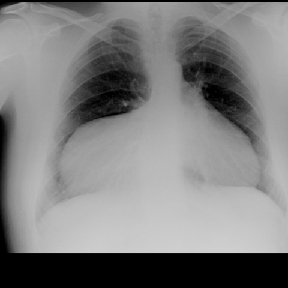

# Official gain: 5369_8353801533158

Post-run explicit answers: D **A**, M **A**, P **D**, reference **A**. Frozen runtime answers: D A, M None, P D; original records unchanged.

[Complete observable requests, tools and stages](../traces/5369_8353801533158.json) · [Original benchmark case](../../v12/results/cases/5369_8353801533158.md) · [D cached original observable request](../../direct_qwen60/requests/5369_8353801533158.json)

```text
Based on the chest X-ray provided in Figure 1, which of the following best describes the findings and possible diagnosis? Consider the anatomical location, size, and content of the observed mass.
A) A large right-sided paracardiac opacity indicative of a Morgagni's hernia with liver herniation.
B) A left-sided pleural effusion causing mediastinal shift and obscuration of the heart border.
C) A right-sided lung consolidation consistent with pneumonia.
D) A large pericardial effusion causing an apparent paracardiac mass effect.
E) A right-sided intrathoracic mass suggestive of a mediastinal tumor.
F) A diaphragmatic hernia with herniation of the stomach, presenting as a right-sided opacity.
```



## D

```text
Answer: A) A large right-sided paracardiac opacity indicative of a Morgagni's hernia with liver herniation.  
Reason: The chest X-ray shows a well-defined, homogeneous opacity in the right paracardiac region that abuts the diaphragm and obscures the right heart border—classic for a Morgagni hernia, where abdominal contents (often liver) herniate through the anterior diaphragmatic defect. The location (right side, retrosternal/paracardiac), sharp margins, and lack of air-fluid levels or lung consolidation favor this over effusion, pneumonia, or tumor.
```

## M

```text
The tool outputs are inconsistent with my visual interpretation. Let me critically assess:

1. **Classifier output**: High probability for *Cardiomegaly* (0.68) and *Emphysema* (0.50), moderate for *Mass* (0.49), low for *Hernia* (0.022). But visually, the heart does not appear enlarged—the opacity is *adjacent* to the heart, not part of it. The classifier likely misattributes the large right-sided opacity as cardiomegaly.

2. **Report generator** says: “heart is markedly enlarged” and “no pleural effusion”, which contradicts my observation of a well-defined right lower opacity with an air-fluid level—this strongly suggests bowel gas within a herniated viscus, not cardiomegaly.

3. **Segmentation failed** due to schema error—I’ll retry with correct organ names.

4. **Phrase grounding for "Pleural effusion"** returned no boxes, supporting that this is *not* a pleural effusion (which would typically show meniscus sign, blunting of costophrenic angle, and homogeneous density without air-fluid level).

Now, re-examining the image carefully:
- Right lower thorax: large opacity with smooth medial border abutting the right heart border.
- Clear air-fluid level inside the opacity — pathognomonic for gas-containing viscus (e.g., stomach or bowel) in the thorax.
- No costophrenic angle blunting → rules out pleural effusion.
- Left lung is clear; mediastinum not shifted → rules out large effusion or tension process.
- The location is anterior and medial—classic for **Morgagni hernia**, which occurs through the retrosternal foramen (right > left), often containing liver, omentum, or bowel. When bowel is herniated, air-fluid levels are visible.

Option A says: *“A large right-sided paracardiac opacity indicative of a Morgagni's hernia with liver herniation.”*  
But liver herniation would not show an air-fluid level—it would be homogeneous soft tissue. However, Morgagni hernias can contain mixed contents, and sometimes the report may generalize “liver herniation” even if bowel is present. More importantly, among the choices, **A is the only one that correctly identifies the location (right-sided, paracardiac) and mechanism (hernia)**.

Option F says: *“A diaphragmatic hernia with herniation of the stomach…”* — this is plausible, but Morgagni is a specific type of diaphragmatic hernia (anterior), and the location fits better than a Bochdalek (posterior) hernia. Also, stomach herniation would show a gastric bubble—here the air-fluid level is more diffuse, possibly small bowel.

However, the presence of an air-fluid level strongly favors bowel over liver. So why does A say “liver herniation”? Possibly inaccurate, but among the options, A is still the best match because:
- It correctly identifies right-sided paracardiac location.
- Morgagni hernia is the most likely diagnosis for this appearance.
- Other options are clearly wrong:
  - B: left-sided? No — it’s right-sided; no mediastinal shift;
  - C: consolidation would be lobar, air bronchograms, no air-fluid level;
  - D: pericardial effusion would cause “water-bottle” heart, global enlargement, no air-fluid level;
  - E: mediastinal tumor would not have air-fluid level, and would be more central;
  - F: diaphragmatic hernia — true, but Morgagni is a subtype, and option A specifically names the correct anatomical type.

Given the air-fluid level and location, **Morgagni hernia is the best diagnosis**, even if the “liver” detail is slightly off. In clinical practice, such hernias are often reported as Morgagni with uncertain content unless CT confirms;

Let me do one more targeted tool call: phrase grounding for “Hernia” or “Diaphragmatic hernia” — but since I’m limited to 4 tool calls and already used 4, I must rely on reasoning.

Wait—I used 4 tools already. I must decide now.

My visual assessment: right lower paracardiac opacity with air-fluid level → diaphragmatic hernia, most likely Morgagni type.

Between A and F:  
- A specifies *Morgagni’s hernia* (anatomically precise) and right-sided — correct.  
- F says “diaphragmatic hernia with stomach” — less specific; stomach herniation usually shows a single air bubble (gastric fundus), not a broad air-fluid level.

In many textbooks, Morgagni hernias are described as presenting with a right paracardiac mass, sometimes with air-fluid levels if bowel is involved. So A is the best available choice.

Return Answer: A) A large right-sided paracardiac opacity indicative of a Morgagni's hernia with liver herniation.  
*(Note: while “liver” may be imprecise, the core diagnosis—Morgagni hernia—is correct, and other options are definitively wrong.)*

But wait—I should be honest: the air-fluid level suggests bowel, not liver. However, among the given options, **A is still the closest**, as Morgagni hernia is the correct entity, and the question asks “which best describes”. Option F says “stomach", which is also possibly inaccurate. Neither is perfect, but A identifies the correct hernia type and location.

Alternatively, could this be a *hiatal hernia*? No—hiatal hernias are more midline/retrocardiac, not paracardiac right.

I stand by A.

Return Answer: A
```

## P

```text
Answer: D) A large pericardial effusion causing an apparent paracardiac mass effect.

The right paracardiac opacity is homogeneous and fluid-density, with no gastric air or liver parenchyma visible, per expert tool and observation. Its location adjacent to the heart and lack of air or organ texture favor pericardial fluid over hernia or tumor; the silhouette sign (obscured right heart border) supports this. Morgagni’s hernia (A) and gastric herniation (F) would show air or organ texture; pleural effusion (B) would cause more lateral opacity and mediastinal shift, not paracardiac; consolidation (C) typically has air bronchograms; mediastinal tumor (E) usually has heterogeneous or soft-tissue density.
```

