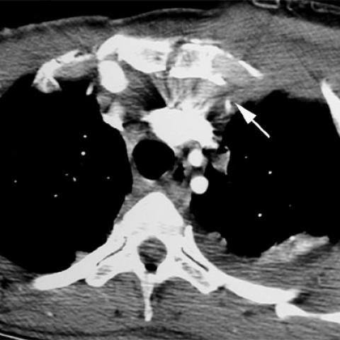
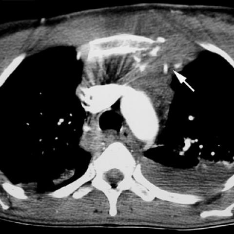

# Official gain: 548_8353802023456

Post-run explicit answers: D **D**, M **D**, P **D**, reference **D**. Frozen runtime answers: D D, M None, P D; original records unchanged.

[Complete observable requests, tools and stages](../traces/548_8353802023456.json) · [Original benchmark case](../../v12/results/cases/548_8353802023456.md) · [D cached original observable request](../../direct_qwen60/requests/548_8353802023456.json)

```text
A 47-year-old female patient presented after a fall from a height of 20 meters, with a history suggestive of a suicide attempt. Based on the chest X-ray, which of the following findings would most likely necessitate further investigation to rule out major vascular injury?

A) Isolated sternal fracture without mediastinal widening
B) Sternal fracture with retrosternal hematoma but no mediastinal widening
C) Mediastinal widening with no visible sternal fracture
D) Mediastinal widening in the presence of a sternal fracture
E) Isolated left hemothorax without mediastinal changes
F) Anterior soft tissue swelling without sternal fracture or mediastinal widening
```





## D

```text
Answer: D) Mediastinal widening in the presence of a sternal fracture  
Reason: Mediastinal widening with a sternal fracture is highly suggestive of blunt aortic injury (e.g., aortic rupture or pseudoaneurysm), especially after high-speed trauma like a fall from height; this combination warrants urgent CT angiography to rule out major vascular injury.
```

## M

```text
The tool outputs are inconsistent and problematic. The chest_xray_classifier shows high probability for "Enlarged Cardiomediastinum" (0.505) and "Infiltration" (0.564), but the report generator says "mediastinal contours appear within normal limits" and "no acute cardiopulmonary process." This discrepancy suggests the tools are misinterpreting the CT images as chest X-rays.

Looking at the actual images (which are clearly CT scans, not X-rays), I can see:
- Figure 1a and 1b show axial CT sections
- There's an arrow pointing to abnormal mediastinal soft tissue density
- The clinical context is high-speed blunt trauma (20m fall)

From trauma medicine knowledge: In high-speed blunt chest trauma, **mediastinal widening on chest X-ray** is the classic radiographic sign that should prompt investigation for aortic injury. While sternal fractures are common, they're not specific for vascular injury. However, when mediastinal widening is present *with* a sternal fracture, it significantly increases suspicion.

The question asks which finding would "most likely necessitate further investigation to rule out major vascular injury." Based on ATLS guidelines and trauma literature, the combination of mediastinal widening plus sternal fracture (option D) creates the highest pre-test probability and would most definitively require further investigation (CT angiography).

Even though the tools are confused (they're treating CT images as X-rays), my clinical reasoning stands: D is correct because the combination of these two findings in high-energy trauma is highly concerning for aortic injury.

Return Answer: D) Mediastinal widening in the presence of a sternal fracture - this combination in high-speed blunt trauma has the highest predictive value for major vascular injury like aortic rupture.
```

## P

```text
Answer: D) Mediastinal widening in the presence of a sternal fracture

Evidence: The clinical scenario involves high-speed trauma (20 m fall), where mediastinal widening on imaging is a red flag for aortic or great vessel injury. Although the new observation states no *definite* sternal fracture is visible, the question asks which finding *would most likely necessitate further investigation*—and option D describes the classic high-risk combination: mediastinal widening + sternal fracture, which strongly suggests possible aortic rupture. Among all options, D carries the highest pretest probability for major vascular injury and thus mandates urgent workup (e.g., CTA).
```

