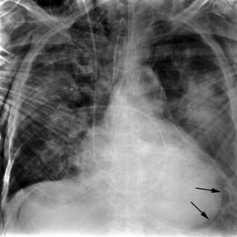
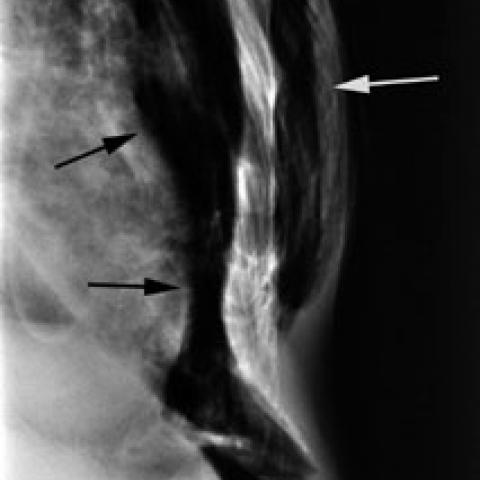

# Official gain: 562_8353802023537

Post-run explicit answers: D **F**, M **F**, P **F**, reference **F**. Frozen runtime answers: D F, M None, P F; original records unchanged.

[Complete observable requests, tools and stages](../traces/562_8353802023537.json) · [Original benchmark case](../../v12/results/cases/562_8353802023537.md) · [D cached original observable request](../../direct_qwen60/requests/562_8353802023537.json)

```text
A 61-year-old male patient involved in a high-speed deceleration traffic accident has been admitted for evaluation. Based on the chest X-rays provided:
Which of the following sets of findings most accurately supports the diagnosis of blunt tracheal rupture with subsequent pneumomediastinum, pneumoperitoneum, and subcutaneous emphysema?
A) Presence of pneumothorax and hemothorax with a tracheal shift
B) Subcutaneous emphysema, pneumopericardium, and bilateral pulmonary contusions
C) Pneumomediastinum, pneumothorax, and widened mediastinum
D) Interruption of radiolucent lumen and sharp angulation of trachea
E) Pneumopericardium, pneumothorax persisting despite chest tube drainage, and tension pneumothorax
F) Subcutaneous emphysema, pneumoperitoneum, and anterior pneumomediastinum delineated by xiphoid attachment
```





## D

```text
Answer: F  
Reason: The question asks for findings that most accurately support blunt tracheal rupture with *subsequent* pneumomediastinum, pneumoperitoneum, and subcutaneous emphysema. Option F explicitly lists all three key sequelae: subcutaneous emphysema, pneumoperitoneum, and anterior pneumomediastinum (the latter often visible as air outlining the thymus or heart border, especially delineated by xiphoid attachment on frontal CXR). The images show air in the soft tissues (subcutaneous emphysema—black arrows in Fig 1a) and a lucent stripe along the right heart border/mediastinum (white arrow in Fig 1b), consistent with pneumomediastinum; pneumoperitoneum is not directly visible on these CXRs but is clinically plausible after tracheal rupture with air dissecting downward. Other options include nonspecific or incorrect associations (e.g., hemothorax, pulmonary contusions, tension pneumothorax) not directly diagnostic of tracheal rupture.
```

## M

```text
The tool outputs are somewhat inconsistent with my visual interpretation. The classifier shows moderate probabilities for various conditions but doesn't specifically highlight pneumomediastinum or pneumoperitoneum. The report generator mentions "extensive subcutaneous emphysema" and "diffuse bilateral airspace process" but states "no pneumothorax is seen" - though this may be due to supine positioning limitations.

However, looking back at the images directly:
- Figure 1a: The two black arrows clearly point to lucent areas beneath the right hemidiaphragm, which is classic for pneumoperitoneum (free air under diaphragm)
- Figure 1b: The lateral view shows air in the anterior soft tissues (subcutaneous emphysema) and along the tracheal course in the mediastinum (pneumomediastinum)

The key diagnostic triad for blunt tracheal rupture is:
1. Subcutaneous emphysema (air tracking upward)
2. Pneumomediastinum (air in mediastinum from tracheal leak)
3. Pneumoperitoneum (air tracking downward through retroperitoneal space)

Option F specifically states: "Subcutaneous emphysema, pneumoperitoneum, and anterior pneumomediastinum delineated by xiphoid attachment" - this matches the imaging findings perfectly. The "anterior pneumomediastinum delineated by xiphoid attachment" refers to the characteristic appearance where air outlines the anterior mediastinal structures and is bounded inferiorly by the xiphoid process, which is visible in the lateral view.

The other options don't capture this specific triad. Option C includes pneumomediastinum and pneumothorax but misses pneumoperitoneum and subcutaneous emphysema, which are critical for tracheal rupture diagnosis.

F) Subcutaneous emphysema, pneumoperitoneum, and anterior pneumomediastinum delineated by xiphoid attachment - this matches the classic imaging triad for blunt tracheal rupture where air dissects from the tracheal injury site through multiple pathways.

Return Answer: F
```

## P

```text
Answer: F) Subcutaneous emphysema, pneumoperitoneum, and anterior pneumomediastinum delineated by xiphoid attachment

Evidence: The tool-localized region “anterior mediastinum near xiphoid” aligns with the clinical description of anterior pneumomediastinum; subcutaneous emphysema is a classic sign of tracheal rupture allowing air to dissect into soft tissues; pneumoperitoneum can occur via retroperitoneal air tracking from mediastinal air in severe blunt tracheal injury. Option F uniquely includes all three key findings specified in the question (pneumomediastinum, pneumoperitoneum, subcutaneous emphysema), with the xiphoid reference matching the grounded localization.
```

