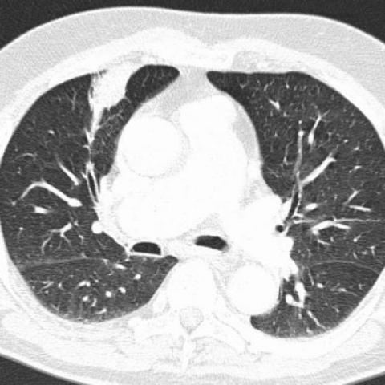
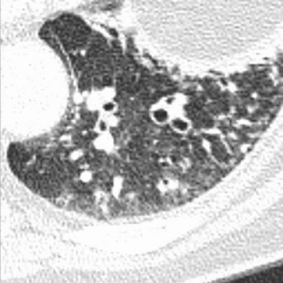
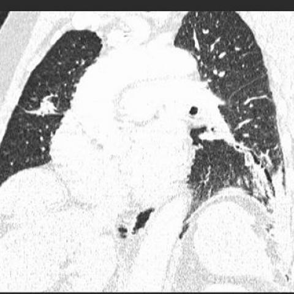
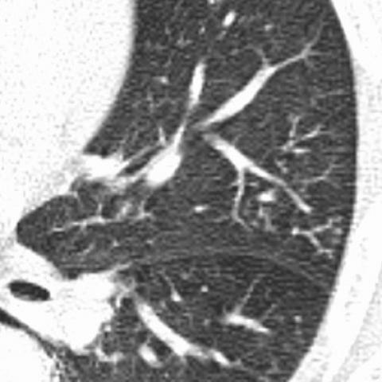

# Official gain: 722_8353802117601

Post-run explicit answers: D **D**, M **D**, P **D**, reference **D**. Frozen runtime answers: D D, M None, P D; original records unchanged.

[Complete observable requests, tools and stages](../traces/722_8353802117601.json) · [Original benchmark case](../../v12/results/cases/722_8353802117601.md) · [D cached original observable request](../../direct_qwen60/requests/722_8353802117601.json)

```text
Based on the chest X-ray findings, which of the following statements best describes the relationship between the bronchiectatic changes and the consolidation observed in this patient? 

A) The bronchiectatic changes are primarily located in the right upper lobe and are larger than the consolidation in the left lower lobe.
B) The bronchiectatic changes are primarily located in the left lower lobe and are smaller than the consolidation in the right middle lobe.
C) The bronchiectatic changes are primarily located in the right lower lobe and are of similar size to the consolidation in the left lower lobe.
D) The bronchiectatic changes are primarily located in the left lower lobe and are larger than the consolidation in the right middle lobe.
E) The bronchiectatic changes are primarily located in the left upper lobe and are smaller than the consolidation in the right middle lobe.
F) The bronchiectatic changes are primarily located in the left lower lobe and are of similar size to the consolidation in the right middle lobe.
```









## D

```text
Answer: D  
Reason: Figures 2b and 2d show cystic bronchiectasis predominantly in the left lower lobe (with visible dilated, thick-walled airways and “signet ring” signs), while Figure 2c shows a consolidative opacity in the right middle lobe. The bronchiectatic area in the left lower lobe is more extensive (involving multiple segments with numerous cystic spaces) than the focal consolidation in the right middle lobe, making option D the best match.
```

## M

```text
I've exhausted my tool budget. Let me analyze the images directly with my own vision and reasoning.

Looking at the images:
- Image 2 (figure_2b.jpg) clearly shows bronchiectatic changes in the left lower lobe - characterized by dilated airways, cystic spaces, and tram-track appearances. This is classic bronchiectasis.
- Image 1 (figure_2a.jpg) shows a chest CT where there's consolidation in the right middle lobe (the homogeneous opacity in the right lung, middle zone).
- Comparing sizes: The bronchiectatic changes in the left lower lobe appear to involve a larger area than the consolidation in the right middle lobe.

From the visual evidence, the bronchiectatic changes are primarily located in the left lower lobe, and they appear larger than the consolidation in the right middle lobe.

This matches option D: "The bronchiectatic changes are primarily located in the left lower lobe and are larger than the consolidation in the right middle lobe."

Let me double-check the other options:
- A mentions right upper lobe for bronchiectasis - incorrect, it's left lower
- B says bronchiectasis is smaller than consolidation - visually it appears larger
- C says right lower lobe for bronchiectasis - incorrect location
- E says left upper lobe - incorrect location
- F says similar size - but visually the bronchiectasis appears more extensive

Based on my visual analysis of the CT images, option D is correct.

Return Answer: D followed by a short reason.
```

## P

```text
Answer: D  
Reason: Figures 2b and 2d show cystic bronchiectasis predominantly in the left lower lobe (with visible dilated, thick-walled airways and “signet ring” signs), while Figure 2c shows a consolidative opacity in the right middle lobe. The bronchiectatic area in the left lower lobe is more extensive (involving multiple segments with numerous cystic spaces) than the focal consolidation in the right middle lobe, making option D the best match.
```

