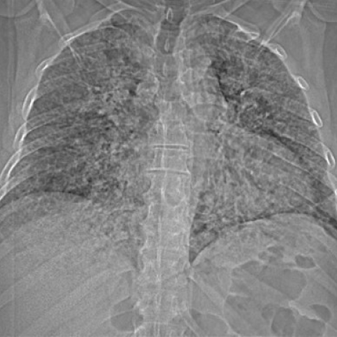

# Official gain: 7659_8353800871660

Post-run explicit answers: D **C**, M **C**, P **A**, reference **C**. Frozen runtime answers: D C, M None, P A; original records unchanged.

[Complete observable requests, tools and stages](../traces/7659_8353800871660.json) · [Original benchmark case](../../v12/results/cases/7659_8353800871660.md) · [D cached original observable request](../../direct_qwen60/requests/7659_8353800871660.json)

```text
A 61-year-old patient presented with cough, generalized musculoskeletal pain, and fever. The initial chest radiograph showed fine reticulonodular opacities throughout both lungs. Based on Figure 1, which statement is most accurate regarding the findings on the chest X-ray?

A) The reticulonodular opacities are predominantly located in the upper lobes and are symmetrical.

B) The reticulonodular opacities are predominantly located in the lower lobes and are asymmetrical.

C) The reticulonodular opacities are diffusely distributed throughout both lungs without a specific lobar predominance.

D) The reticulonodular opacities are associated with noticeable pleural effusion in the right lung.

E) The reticulonodular opacities are associated with noticeable pleural effusion in the left lung.

F) The reticulonodular opacities are accompanied by a significant shift of the mediastinum.
```



## D

```text
Answer: C) The reticulonodular opacities are diffusely distributed throughout both lungs without a specific lobar predominance.

Reason: Figure 1 shows fine reticulonodular opacities that involve both lungs symmetrically and extend from the apices to the bases, without clear upper- or lower-lobe predominance. There is no visible pleural effusion or mediastinal shift.
```

## M

```text
Let me analyze the tool outputs and the image more carefully.

From the chest_xray_classifier results:
- High probability for "Infiltration" (0.927) and "Lung Opacity" (0.999)
- Moderate probability for "Consolidation" (0.606) and "Edema" (0.590)
- Low probability for "Effusion" (0.090), indicating no significant pleural effusion
- The classifier doesn't directly tell us about lobar distribution

From the chest_xray_report_generator:
- The report states: "there is a diffuse interstitial alveolar process"
- It specifically mentions "diffuse bilateral interstitial opacities"
- It notes "no large pleural effusion"
- The heart size is normal, suggesting no mediastinal shift

The chest_xray_segmentation call failed due to argument formatting issues, but that's okay since we have other information.

The chest_xray_expert simply returned "Diffuse", which confirms the diffuse nature of the opacities.

Visually examining the X-ray image (Figure 1), I can see:
- Fine reticulonodular opacities throughout both lungs
- The pattern appears relatively symmetrical between left and right lungs
- There's no clear predominance in upper or lower lobes
- No obvious pleural effusion (costophrenic angles appear sharp)
- Mediastinum appears centered

Given all this evidence, option C is most accurate: "The reticulonodular opacities are diffusely distributed throughout both lungs without a specific lobar predominance."

The report explicitly describes "diffuse bilateral interstitial opacities" and the visual examination confirms this diffuse pattern without lobar predominance.

C) The reticulonodular opacities are diffusely distributed throughout both lungs without a specific lobar predominance.
```

## P

```text
Answer: A) The reticulonodular opacities are predominantly located in the upper lobes and are symmetrical.  
Evidence: The new observation states the opacities are predominantly in the upper lobes with greater density above the hila, and visual inspection shows symmetry. No pleural effusion is present on either side, ruling out D, E, and F; lobar predominance contradicts C and B.
```

