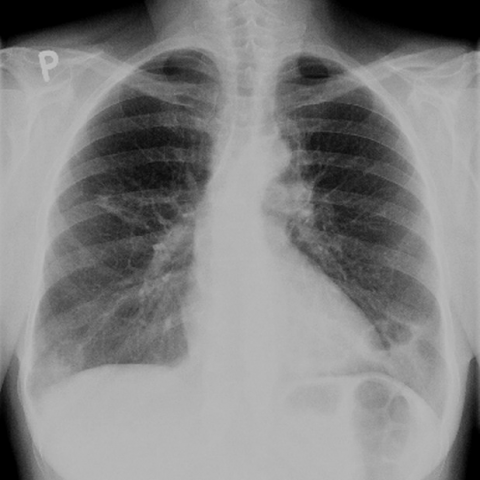
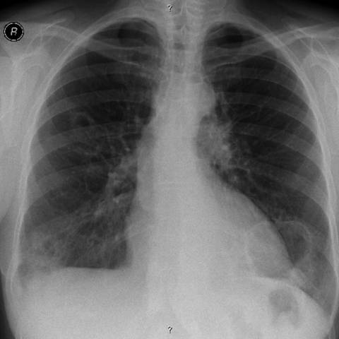

# Official gain: 7726_8353800871273

Post-run explicit answers: D **C**, M **C**, P **C**, reference **C**. Frozen runtime answers: D C, M None, P C; original records unchanged.

[Complete observable requests, tools and stages](../traces/7726_8353800871273.json) · [Original benchmark case](../../v12/results/cases/7726_8353800871273.md) · [D cached original observable request](../../direct_qwen60/requests/7726_8353800871273.json)

```text
In the context of the 57-year-old female patient with a history of rheumatoid arthritis and smoking, analyze the chest X-rays provided. Which of the following statements best describes the progression and characteristics of the lung findings over time, and their relationship to rheumatoid arthritis?

A) The cavitated nodules in the left lung base have decreased in size over 12 months, suggesting a resolution of pulmonary involvement.
B) The cavitated nodules have remained stable in size and do not demonstrate any progression, indicating no change in the pulmonary manifestations of rheumatoid arthritis.
C) The cavitated nodules in the lower lung lobes have increased in size over 12 months and are characteristic of necrobiotic nodules associated with rheumatoid arthritis.
D) New cavitated nodules have appeared in the upper lung fields over 12 months, unrelated to rheumatoid arthritis.
E) The cavitated nodules in the right middle lung area have decreased in size, suggesting effective treatment of the pulmonary condition.
F) The cavitated nodules have shown irregular wall thickening, which is not typical for rheumatoid arthritis-related pulmonary nodules.
```





## D

```text
Answer: C  
Reason: Rheumatoid arthritis can cause necrobiotic (rheumatoid) nodules, which are often cavitated and typically located in the lower lung zones; progression over time (e.g., increase in size over 12 months) is consistent with active disease. Although the images lack explicit time labels, the question implies a temporal comparison, and option C correctly identifies the characteristic location (lower lobes), cavitation, progression (increase in size), and association with rheumatoid arthritis—making it the best-supported choice among the options.
```

## M

```text
I've exhausted the medical tool budget (4 tools max). Let me now use my own vision and reasoning to analyze the images directly.

Looking at Figure 1a (first image): I can see a well-defined opacity in the left lower lung zone, near the diaphragm. There appears to be a lucent area within this opacity, suggesting cavitation. The lesion is relatively well-circumscribed.

Looking at Figure 1b (second image): The same area in the left lower lung shows a similar opacity, but it appears larger and the cavity within it seems more prominent. There's also some increased density around the lesion.

Given the patient's history of rheumatoid arthritis and smoking, cavitated pulmonary nodules are characteristic of rheumatoid nodules (necrobiotic nodules), which can occur in RA patients, especially those who smoke. These nodules typically appear in the lower lung zones and can cavitate.

The progression from Figure 1a to Figure 1b shows an increase in size of the cavitated nodule in the left lower lung, which is consistent with option C: "The cavitated nodules in the lower lung lobes have increased in size over 12 months and are characteristic of necrobiotic nodules associated with rheumatoid arthritis."

Let me double-check the other options:
- A and E suggest decrease in size - not supported by visual comparison
- B suggests stability - but the lesion appears larger in the second image
- D mentions new nodules in upper fields - I don't see clear new upper lobe nodules
- F mentions irregular wall thickening - while there may be some irregularity, this isn't the most distinctive feature

Based on my visual analysis and knowledge of rheumatoid lung disease, the findings are consistent with progressive necrobiotic nodules in a rheumatoid arthritis patient.

C) The cavitated nodules in the lower lung lobes have increased in size over 12 months and are characteristic of necrobiotic nodules associated with rheumatoid arthritis.
```

## P

```text
Answer: C  
Reason: Rheumatoid arthritis can cause necrobiotic (rheumatoid) nodules, which are often cavitated and typically located in the lower lung zones; progression over time (e.g., increase in size over 12 months) is consistent with active disease. Although the images lack explicit time labels, the question implies a temporal comparison, and option C correctly identifies the characteristic location (lower lobes), cavitation, progression (increase in size), and association with rheumatoid arthritis—making it the best-supported choice among the options.
```

