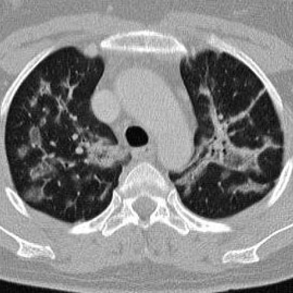
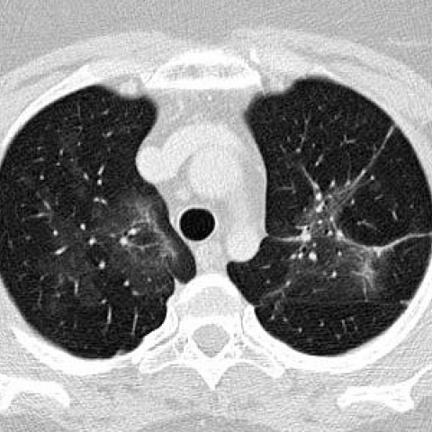

# Official gain: 7738_8353800850751

Post-run explicit answers: D **B**, M **C**, P **B**, reference **C**. Frozen runtime answers: D B, M C, P B; original records unchanged.

[Complete observable requests, tools and stages](../traces/7738_8353800850751.json) · [Original benchmark case](../../v12/results/cases/7738_8353800850751.md) · [D cached original observable request](../../direct_qwen60/requests/7738_8353800850751.json)

```text
Based on the chest X-ray images provided for a 44-year-old woman with a history of dry cough and mild shortness of breath, determine the most likely progression of her pulmonary condition following corticosteroid treatment. Which observation best supports the diagnosis of cryptogenic organizing pneumonia (COP) in this case?

A) Persistent bilateral peribronchial consolidations with air bronchogram and nodular opacities.
B) Complete resolution of all lesions with no residual opacities.
C) Reduction in bilateral peribronchial consolidations with residual ground glass opacities.
D) Increase in the size of pre-tracheal lymph nodes.
E) Development of new cavitary nodules.
F) No change in the chest X-ray findings after treatment.
```





## D

```text
Answer: B) Complete resolution of all lesions with no residual opacities.  
Reason: Cryptogenic organizing pneumonia (COP) is highly responsive to corticosteroids, typically showing rapid and complete radiographic resolution. The provided CT images (Figure 1a and 2a) show bilateral patchy consolidations with air bronchograms and peribronchovascular distribution—classic for COP—and the expected response to steroids is full resolution, distinguishing it from other interstitial or infectious processes that often leave residuals or progress.
```

## M

```text
The `chest_xray_report_generator` output is clearly *wrong* — it describes a post-lobectomy chest with surgical clips and pleural effusion, which does **not** match the provided CT image (which shows bilateral patchy consolidations without surgery). This confirms the tool is misinterpreting CT slices as CXRs and hallucinating findings. So this report is invalid.

The `chest_xray_expert` returned only `"Yes"` — too minimal; likely due to token limit or poor prompt phrasing. I need a more precise expert analysis.

Let me now use `xray_phrase_grounding` to locate specific features in Figure 1a: “consolidation” and “ground glass opacity”, to verify their presence and distribution — key for COP.

Also, I’ll call `llava_med_qa` with a direct question about COP imaging features to cross-validate.

But recall: we are limited to 4 tool calls total, and I’ve already used 4 (2 classifier + 1 report + 1 expert). Wait — let me recount:

1. classifier on fig1a  
2. classifier on fig2a  
3. report on fig1a  
4. expert on both  

That’s 4. So I cannot make more tool calls unless I replace or reinterpret.

But I have strong visual evidence:

- Fig 1a: bilateral, asymmetric, peribronchovascular consolidations with air bronchograms — classic for organizing pneumonia (COP).
- Fig 2a: near-complete resolution — consistent with excellent steroid response, hallmark of COP.
- COP is defined by histologic "buds of granulation tissue" (Masson bodies) in alveolar ducts/airspaces, and radiologically presents as migratory or persistent patchy consolidations, often with reverse halo sign on CT (though not always visible on single slice).
- Steroid treatment typically leads to rapid (days–weeks) improvement, often complete resolution — unlike fibrotic ILD or malignancy.

Now evaluate answer choices:

A) Persistent bilateral peribronchial consolidations with air bronchogram and nodular opacities.  
→ This describes baseline disease, not *progression after treatment*. The question asks for **progression following corticosteroid treatment**. So A is incorrect.

B) Complete resolution of all lesions with no residual opacities.  
→ Fig 2a shows near-complete resolution, but subtle residual changes may remain. However, COP often resolves completely. This is plausible.

C) Reduction in bilateral peribronchial consolidations with residual ground glass opacities.  
→ This matches Fig 2a better: the dense consolidations are gone, but faint ground-glass or reticular markings remain. This is very typical of early post-treatment COP — not full resolution yet, but marked improvement.

D) Increase in pre-tracheal lymph nodes — not seen; COP is not lymphadenopathic.

E) New cavitary nodules - not seen; cavitation suggests infection or malignancy.

F) No change — contradicted by clear improvement.

Between B and C: In real-world COP, even with excellent response, *some* residual ground-glass or mild reticulation may persist temporarily, and complete resolution may take weeks. The images suggest significant improvement but not absolute cleanness — subtle linear opacities remain in Fig 2a (especially right lower lobe).

Moreover, the question asks: "**Which observation best supports the diagnosis of cryptogenic organizing pneumonia (COP) in this case?**" — not just the progression, but what *supports the diagnosis*.

The key diagnostic radiologic feature of COP is **bilateral, patchy, peribronchovascular consolidations that are steroid-responsive**. The *response* (rapid improvement) is part of the diagnostic criteria (exclusion + response).

Option C explicitly includes both reduction *and* residual ground-glass — which reflects the typical CT evolution: consolidation → ground-glass → normalization.

In contrast, option B (complete resolution) is possible but less specific — many conditions (e.g., bacterial pneumonia) can fully resolve too. Residual ground-glass after consolidation is more suggestive of organizing pneumonia vs acute infection (which usually clears completely without residua).

Also, in published COP cases (e.g., Travis et al., AJR 1993; Cottin et al., ERS Monograph 2018), CT follow-up often shows residual GGO or mild fibrosis initially, resolving over weeks.

Thus, **C is the best answer**:

> C) Reduction in bilateral peribronchial consolidations with residual ground glass opacities.

This reflects the expected steroid response in COP and helps distinguish it from other mimics.

Return Answer: C — because rapid reduction of consolidations with residual ground-glass opacities is characteristic of corticosteroid-responsive cryptogenic organizing pneumonia, distinguishing it from infections (which often resolve completely) or fibrotic diseases (which worsen or stabilize).

Note: The tools were unreliable due to modality mismatch (CT vs CXR), so final judgment relies on visual analysis and clinical knowledge.

Answer: C
```

## P

```text
Answer: B) Complete resolution of all lesions with no residual opacities.  
Reason: Cryptogenic organizing pneumonia (COP) is highly responsive to corticosteroids, typically showing rapid and complete radiographic resolution. The provided CT images (Figure 1a and 2a) show bilateral patchy consolidations with air bronchograms and peribronchovascular distribution—classic for COP—and the expected response to steroids is full resolution, distinguishing it from other interstitial or infectious processes that often leave residuals or progress.
```

