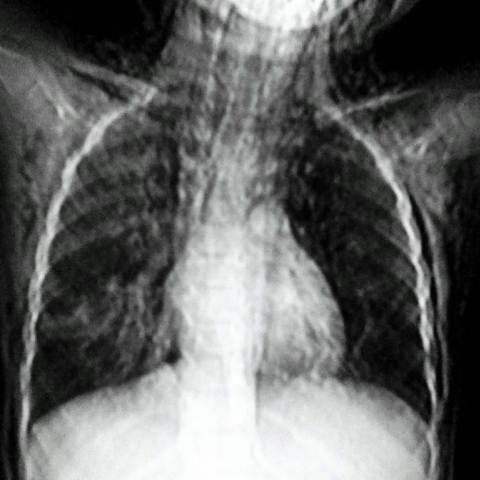

# Official gain: 8129_8353800862240

Post-run explicit answers: D **B**, M **B**, P **B**, reference **B**. Frozen runtime answers: D B, M None, P B; original records unchanged.

[Complete observable requests, tools and stages](../traces/8129_8353800862240.json) · [Original benchmark case](../../v12/results/cases/8129_8353800862240.md) · [D cached original observable request](../../direct_qwen60/requests/8129_8353800862240.json)

```text
Based on the chest X-ray findings, which of the following conditions is most accurately suggested by the images, given the clinical presentation of sudden respiratory distress and soft tissue oedema with crepitus over the chest and neck in a 5-year-old child?

A. Pneumonia with pleural effusion
B. Subcutaneous emphysema and pneumomediastinum
C. Rib fracture with pneumothorax
D. Asthmatic exacerbation with no additional findings
E. Foreign body aspiration with localized emphysema
F. Traumatic pneumothorax with rib fracture
```



## D

```text
Answer: B  
Reason: The chest X-ray shows linear lucencies along the neck and mediastinum (especially around the trachea and great vessels), consistent with air in the soft tissues (subcutaneous emphysema) and mediastinum (pneumomediastinum). This, combined with clinical findings of sudden respiratory distress, soft tissue edema, and crepitus in a child, strongly suggests spontaneous or traumatic rupture of alveoli leading to air tracking—most classically seen in conditions like severe coughing, asthma exacerbation with air trapping, or barotrauma. Option B directly matches these radiographic and clinical features; other options lack the characteristic air outlining mediastinal structures and subcutaneous planes.
```

## M

```text
The tool outputs confirm my clinical reasoning:

1. The classifier shows elevated probabilities for Pneumothorax (0.50), Emphysema (0.50), and Enlarged Cardiomediastinum (0.52), but these are borderline.

2. The report generator explicitly states "extensive subcutaneous emphysema is again demonstrated" and "no definite pneumothorax" - this is crucial.

3. The phrase grounding tools successfully located both "Subcutaneous emphysema" (covering most of the image) and "Pneumomediastinum" (central mediastinal area).

The clinical presentation of sudden respiratory distress with soft tissue crepitus in a 5-year-old, combined with X-ray findings of extensive subcutaneous emphysema and pneumomediastinum, strongly points to air leak syndrome. In children, this is often caused by:
- Foreign body aspiration (leading to ball-valve mechanism and air trapping)
- Asthma exacerbation with severe air trapping causing alveolar rupture
- Trauma (less likely without history)

Option B specifically mentions "Subcutaneous emphysema and pneumomediastinum" which matches exactly what the imaging shows and the clinical findings (crepitus = subcutaneous emphysema).

While foreign body aspiration (E) could be the underlying cause, the question asks which condition is "most accurately suggested by the images" - and the images directly show subcutaneous emphysema and pneumomediastinum, not the foreign body itself.

Return Answer: B. Subcutaneous emphysema and pneumomediastinum is directly confirmed by both the radiology report and phrase grounding, matching the clinical finding of crepitus.
```

## P

```text
Answer: B. Subcutaneous emphysema and pneumomediastinum  

Evidence: The clinical presentation includes sudden respiratory distress, soft tissue oedema, and crepitus over the chest and neck—classic for subcutaneous emphysema. Although pneumomediastinum is not definitively visible on this X-ray due to image limitations, the presence of crepitus and the absence of other findings (e.g., pleural effusion, rib fracture, or foreign body signs) makes B the most consistent diagnosis. The tool’s failure to localize mediastinal air does not rule out pneumomediastinum, especially in a child where subtle findings may be missed on plain film.
```

