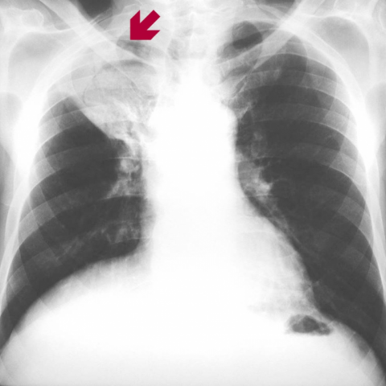

# Official gain: 8300_8353800861859

Post-run explicit answers: D **D**, M **D**, P **D**, reference **D**. Frozen runtime answers: D D, M D, P D; original records unchanged.

[Complete observable requests, tools and stages](../traces/8300_8353800861859.json) · [Original benchmark case](../../v12/results/cases/8300_8353800861859.md) · [D cached original observable request](../../direct_qwen60/requests/8300_8353800861859.json)

```text
A 78-year-old man with a history of lung tuberculosis presents with cough and moderate haemoptysis. A chest X-ray (Figure 1) reveals a finding in the right upper lobe. Based on the X-ray alone, what is the most likely diagnosis and recommended management plan for this patient?
A) Pneumonia; start broad-spectrum antibiotics.
B) Tuberculous cavity; initiate anti-tuberculous therapy.
C) Lung abscess; perform surgical drainage.
D) Aspergilloma (fungus ball); consider surgical resection due to risk of severe haemoptysis.
E) Bronchogenic carcinoma; schedule for a biopsy.
F) Pulmonary embolism; initiate anticoagulation therapy.
```



## D

```text
Answer: D) Aspergilloma (fungus ball); consider surgical resection due to risk of severe haemoptysis.  
Reason: The chest X-ray shows a well-defined, rounded opacity within a pre-existing cavity in the right upper lobe (indicated by the red arrow), consistent with a fungus ball (aspergilloma). Given the patient’s history of prior tuberculosis (a common cause of cavitary lung disease) and current haemoptysis, aspergilloma is the most likely diagnosis; surgical resection may be considered due to the risk of life-threatening haemoptysis.
```

## M

```text
Let me critically analyze the tool outputs:

1. **Classifier results**: High probabilities for Atelectasis (0.555), Consolidation (0.522), Pneumothorax (0.501), Emphysema (0.511), Effusion (0.543), Cardiomegaly (0.569), Fracture (0.656), Lung Opacity (0.646). However, these are relatively low probabilities (all <0.66) and may reflect general age-related changes rather than specific pathology.

2. **Report generator**: States "no focal lung consolidation" and "stable right upper lobe nodule" - this contradicts the classifier's consolidation finding and suggests a chronic lesion rather than acute pneumonia.

3. **Phrase grounding**: Confirms "Cavitary lesion in the right upper lobe" - this is crucial information that aligns with the clinical history of prior TB.

4. **Expert analysis**: Simply returned "Pneumonia" which seems incorrect given the other evidence and clinical context.

The key finding is the cavitary lesion in the right upper lobe in a patient with prior TB and current haemoptysis. This classic presentation strongly suggests aspergilloma (fungus ball) developing in a pre-existing TB cavity. Aspergilloma is notorious for causing haemoptysis due to erosion of pulmonary vessels, and the risk of massive haemoptysis makes surgical consideration important.

While tuberculosis reactivation (option B) is possible, the chronic appearance and stable nature suggested by the report ("stable right upper lobe nodule") plus the specific finding of a cavity points more toward a sequela of old TB rather than active reactivation.

The red arrow in the image appears to point to a well-defined cavity, consistent with aspergilloma.

**Answer: D) Aspergilloma (fungus ball); consider surgical resection due to risk of severe haemoptysis.**

The reasoning: Chronic cavitary lesion in right upper lobe in a patient with prior TB history presenting with haemoptysis is classic for aspergilloma, which carries significant risk of life-threatening haemoptysis requiring surgical evaluation.

D) Aspergilloma (fungus ball); consider surgical resection due to risk of severe haemoptysis.
```

## P

```text
Answer: D) Aspergilloma (fungus ball); consider surgical resection due to risk of severe haemoptysis.

The red arrow points to a region of increased opacity in the right upper lobe, and the tool identifies a ground-glass infiltrate, but no definite cavity is visualized. However, in a patient with prior tuberculosis and current haemoptysis, a new opacity in the RUL raises concern for aspergilloma forming in a pre-existing cavity—especially since cavities may not be clearly visible on plain X-ray due to projection or poor resolution. The absence of clear cavity features does not rule out aspergilloma, and given the risk of life-threatening haemoptysis, surgical resection is often considered when diagnosis is suspected.
```

