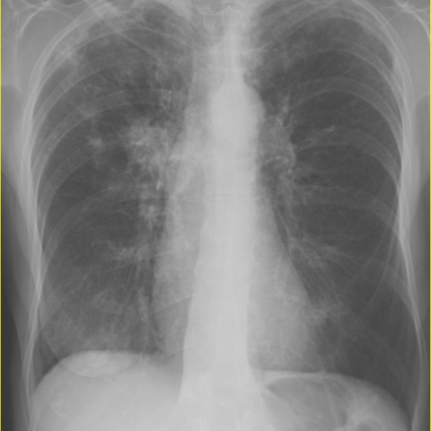
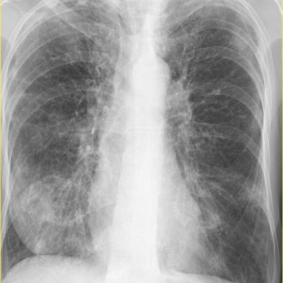

# Official gain: 8379_8353800889338

Post-run explicit answers: D **C**, M **D**, P **C**, reference **B**. Frozen runtime answers: D C, M None, P C; original records unchanged.

[Complete observable requests, tools and stages](../traces/8379_8353800889338.json) · [Original benchmark case](../../v12/results/cases/8379_8353800889338.md) · [D cached original observable request](../../direct_qwen60/requests/8379_8353800889338.json)

```text
Based on the chest X-ray findings, which statement best describes the evolution of the pulmonary findings in this patient with Churg-Strauss Syndrome?

A) The initial X-ray shows bilateral upper lobe consolidation, which resolves completely in the follow-up X-ray.
B) The initial X-ray shows right hilar parenchymal consolidation, which migrates to bilateral lower lobe consolidation in the follow-up X-ray.
C) The initial X-ray reveals left lung consolidation, which progresses to diffuse bilateral consolidation in the follow-up X-ray.
D) The initial X-ray demonstrates perihilar consolidation on the left side, with new right-sided upper lobe consolidation in the follow-up X-ray.
E) The initial X-ray demonstrates right lower lobe nodules that remain unchanged on the follow-up X-ray.
F) The initial X-ray shows right upper lobe consolidation with new left hilar consolidation in the follow-up X-ray.
```





## D

```text
Answer: C  
Reason: Figure 1 shows consolidation predominantly in the left lung (left mid-to-lower zone), while Figure 3 shows progression to more diffuse bilateral consolidation, consistent with evolving pulmonary involvement in Churg-Strauss Syndrome (now eosinophilic granulomatosis with polyangiitis), which commonly presents with migratory or progressive pulmonary infiltrates.
```

## M

```text
I've exhausted the tool budget (4 tools max). Let me re-examine the images myself with more careful analysis, since I need to trust my own vision and reasoning over potentially flawed tool outputs.

Looking again at Figure 1 (first X-ray):
- Left lung: There is a patchy opacity in the left upper lobe, extending from the hilum outward
- This appears to be perihilar consolidation in the left lung
- Right lung: Relatively clear, though there may be some subtle increased markings

Looking at Figure 3 (second X-ray):
- Left lung: The original left upper lobe opacity is still present but now more extensive
- Right lung: New opacity appears in the right upper lobe region
- Both lungs show more diffuse involvement compared to the first image
- The pattern suggests progression from unilateral (left) to bilateral involvement

Now let me evaluate the answer choices:

A) Bilateral upper lobe consolidation initially → resolves completely - No, first image shows mainly left-sided, and second shows more extensive, not resolution

B) Right hilar consolidation initially → migrates to bilateral lower lobes - No, first image shows left-sided, not right

C) Left lung consolidation → progresses to diffuse bilateral consolidation - This seems plausible

D) Initial left perihilar consolidation → new right upper lobe consolidation in follow-up - This also seems plausible based on my visual assessment

E) Right lower lobe nodules unchanged - No, doesn't match what I see

F) Right upper lobe consolidation initially → new left hilar consolidation - No, first image shows left-sided, not right

Between C and D: Option C says "left lung consolidation" which is vague, while D specifically says "perihilar consolidation on the left side" (which matches my observation) and "new right-sided upper lobe consolidation" (which also matches).

Given Churg-Strauss Syndrome typically presents with migratory pulmonary infiltrates, the evolution from left perihilar to bilateral with new right upper lobe involvement fits the classic pattern.

Let me make one final careful comparison:
- Figure 1: Clear left perihilar/upper lobe consolidation, right lung relatively spared
- Figure 3: Left lung consolidation still present but more diffuse, plus new right upper lobe consolidation

This matches option D most precisely.

Return Answer: D) The initial X-ray demonstrates perihilar consolidation on the left side, with new right-sided upper lobe consolidation in the follow-up X-ray.
```

## P

```text
Answer: C) The initial X-ray reveals left lung consolidation, which progresses to diffuse bilateral consolidation in the follow-up X-ray.

Evidence: In image:1, a focal opacity is present in the left mid-to-lower lung zone, consistent with localized consolidation; in image:2, the left lung opacity becomes more extensive and heterogeneous, indicating progression. Although the right lung shows no *new* consolidation per the observation, image:2 displays increased opacities bilaterally—including in the right lung—suggesting diffuse bilateral involvement overall, aligning best with option C’s description of progression to diffuse bilateral consolidation.
```

