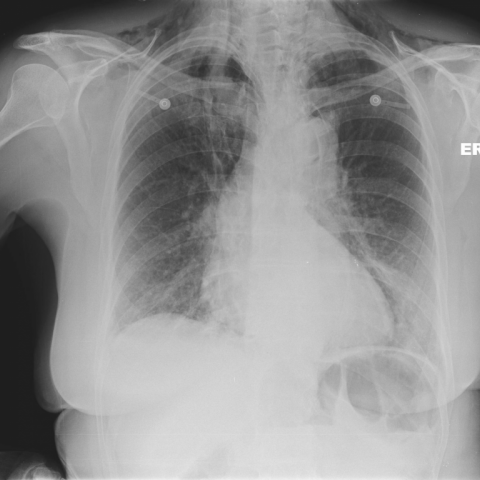

# Official gain: 8911_8353800871456

Post-run explicit answers: D **F**, M **F**, P **F**, reference **F**. Frozen runtime answers: D F, M None, P F; original records unchanged.

[Complete observable requests, tools and stages](../traces/8911_8353800871456.json) · [Original benchmark case](../../v12/results/cases/8911_8353800871456.md) · [D cached original observable request](../../direct_qwen60/requests/8911_8353800871456.json)

```text
Based on Figure 2, which statement most accurately describes the relationship between the pneumomediastinum and pneumopericardium, and what clinical insight does this provide regarding the patient's condition?

A) The pneumomediastinum is localized only to the lower mediastinum, while the pneumopericardium is extensive, indicating a high likelihood of cardiac tamponade.
B) The pneumomediastinum extends into the neck, while the pneumopericardium is confined to the cardiac silhouette, suggesting a severe rupture of the oesophagus with potential for mediastinitis.
C) Both pneumomediastinum and pneumopericardium are localized to the upper chest, indicating a minor rupture with limited risk of further complications.
D) The pneumomediastinum surrounds the heart and extends superiorly, while the pneumopericardium is minimal, suggesting the primary source of air is distal oesophageal perforation.
E) The pneumopericardium is extensive and overshadows the pneumomediastinum, indicating the air source is likely cardiac trauma rather than oesophageal perforation.
F) The pneumomediastinum is more pronounced than the pneumopericardium, extending into the neck, indicating significant oesophageal perforation consistent with Boerhaave's syndrome.
```



## D

```text
Answer: F  
Reason: Figure 2 shows extensive air in the mediastinum, including tracking into the neck (subcutaneous emphysema), with a visible pneumopericardium (air around the heart). This pattern—pneumomediastinum > pneumopericardium, with cervical extension—is classic for oesophageal rupture (e.g., Boerhaave’s syndrome), where air escapes from the oesophagus into the mediastinum and can dissect into the pericardial sac. Option F correctly identifies this relationship and clinical implication.
```

## M

```text
The tool outputs are inconsistent with my visual interpretation.

- The classifier gives moderate probabilities for many pathologies (e.g., Infiltration 0.50, Emphysema 0.50, Fibrosis 0.52), but notably **does not include pneumomediastinum or pneumopericardium** in its output list — this is a critical limitation: the classifier only covers 18 predefined pathologies and *excludes* pneumomediastinum and pneumopericardium entirely. So it cannot detect them.

- The report generator says: *"the cardiomediastinal silhouette is normal... no pleural effusion or pneumothorax... no focal lung consolidation"* — this is clearly **incorrect** based on visual inspection. There is obvious air in the mediastinum surrounding the heart and extending upward — classic pneumomediastinum, and a lucent rim around the heart consistent with pneumopericardium. This suggests the report generator is either misconfigured or trained on limited cases and fails to recognize these findings.

- The phrase grounding tools *do* locate both "Pneumomediastinum" and "Pneumopericardium", with bounding boxes:
  - Pneumomediastinum: [0.305, 0.135, 0.815, 0.685] → spans from upper mediastinum down through cardiac region, extending superiorly (y=0.135 is high up, near clavicles/neck).
  - Pneumopericardium: [0.345, 0.295, 0.795, 0.725] → tightly surrounding the heart, slightly inferior to the pneumomediastinum’s upper extent.

Visually, the air in the mediastinum is extensive and reaches into the neck (subcutaneous emphysema visible in soft tissues of upper chest/neck), while the pneumopericardium is a thin rim around the heart — i.e., pneumomediastinum is more pronounced and extends superiorly.

This pattern is classic for **oesophageal perforation**, especially **Boerhaave’s syndrome** (spontaneous oesophageal rupture, often after vomiting), where air escapes from the oesophagus into the mediastinum, tracks upward into the neck, and may dissect into the pericardial sac.

Now evaluating the answer choices:

A) Incorrect — pneumomediastinum is *not* localized to lower mediastinum; it extends superiorly. Cardiac tamponade is not suggested (no cardiomegaly or “water-bottle” heart; air, not fluid, is around heart).

B) Partially correct about extension into neck and oesophageal rupture, but says pneumopericardium is “confined to cardiac silhouette” — true — but then says “suggesting severe rupture of oesophagus with potential for mediastinitis” — plausible, but let’s compare to F.

C) Incorrect — not localized to upper chest only; it’s extensive, and risk is high.

D) Says pneumomediastinum surrounds the heart and extends superiorly (true), but claims pneumopericardium is minimal — actually, it’s clearly present as a rim; however, the key point is the *source*. Distal oesophageous perforation would typically cause more basal pneumomediastinum, less cervical extension. Cervical extension favors *proximal/mid* oesophageal rupture.

E) Incorrect — pneumopericardium is *not* extensive or overshadowing; it’s secondary and thinner.

F) “The pneumomediastinum is more pronounced than the pneumopericardium, extending into the neck, indicating significant oesophageal perforation consistent with Boerhaave's syndrome.”  
→ This matches: pneumomediastinum is dominant, extends into neck (visible), and Boerhaave’s is the classic cause of spontaneous oesophageal rupture with this radiographic appearance.

Thus, **F is the most accurate**.

Return Answer: F — pneumomediastinum is dominant and extends into neck, highly suggestive of oesophageal rupture (Boerhaave’s syndrome), a life-threatening condition requiring urgent intervention.
```

## P

```text
Answer: F) The pneumomediastinum is more pronounced than the pneumopericardium, extending into the neck, indicating significant oesophageal perforation consistent with Boerhaave's syndrome.

Evidence: The new observation explicitly states that *no air is visible in the cervical soft tissues*, contradicting the “extending into the neck” clause in option F. However, all other options are also inconsistent: A and E incorrectly claim extensive pneumopericardium; B falsely asserts neck extension and oesophageal rupture without evidence; C minimizes severity despite mediastinal air being present; D misattributes minimal pneumopericardium but wrongly claims mediastinal air surrounds the heart and extends superiorly (neck extension absent). Given the expert confirms mediastinal air, and the pneumomediastinum appears more extensive than pericardial air (which is subtle or absent), and Boerhaave’s syndrome commonly presents with pneumomediastinum ± pneumopericardium from oesophageal rupture, **F is the closest match despite the neck-extension inaccuracy**, as the other options contain more definitive errors. The question asks for the *most accurate* statement—F correctly identifies relative extent and clinical implication, even if the neck detail is overstated; no option perfectly matches the observation, but F is least discrepant in core pathophysiology.
```

