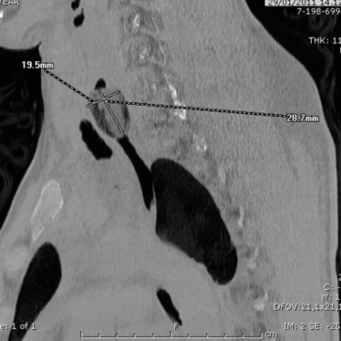
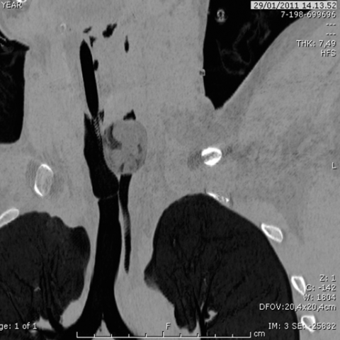
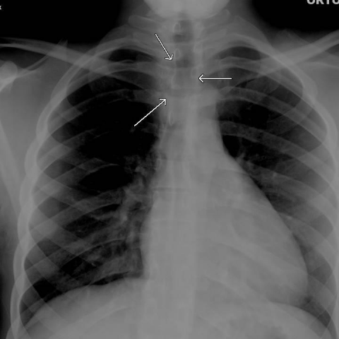
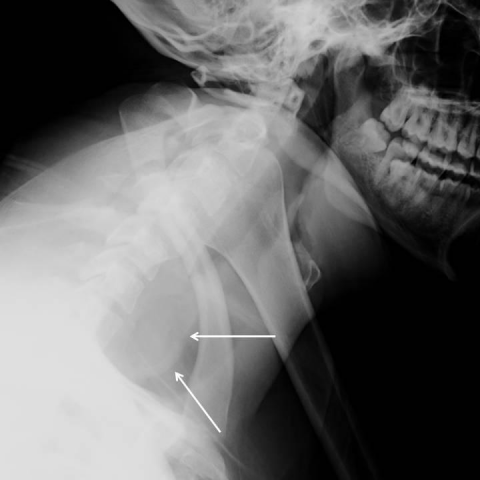

# Official gain: 9308_8353800801854

Post-run explicit answers: D **A**, M **B**, P **A**, reference **C**. Frozen runtime answers: D A, M None, P A; original records unchanged.

[Complete observable requests, tools and stages](../traces/9308_8353800801854.json) · [Original benchmark case](../../v12/results/cases/9308_8353800801854.md) · [D cached original observable request](../../direct_qwen60/requests/9308_8353800801854.json)

```text
A 23-year-old man presents with dyspnea and agitation. Radiographic imaging shows an ovoid opaque area at the C6-C7 level, displacing the airway, and numerous oval-shaped dense lesions in the intestine. Based on the chest X-ray findings alone, which of the following is the most likely diagnosis for the foreign bodies seen in the patient's oesophagus and intestine?

A) Packets filled with hashish
B) Packets filled with cocaine
C) Packets filled with heroin
D) Packets filled with methamphetamine
E) Non-drug-related foreign body
F) Packets filled with marijuana
```









## D

```text
Answer: A) Packets filled with hashish  
Reason: The ovoid opaque area at C6–C7 displacing the airway and multiple oval dense lesions in the intestine are classic radiographic findings of “body packing” with drug-filled packets. Hashish (cannabis resin) packets typically appear as well-defined, ovoid, radiodense objects on X-ray due to their high density and packaging material; they are more radiopaque than cocaine or heroin packets, which often appear less dense or even radiolucent depending on purity and wrapping. The described imaging—especially the clearly opaque, discrete oval shapes—is most consistent with hashish packets, a known cause of such presentations in body packers.
```

## M

```text
The tool outputs are not providing the detailed analysis I need. The chest X-ray report generator missed the foreign body entirely, describing it as "no focal consolidation" and "normal cardiomediastinal silhouette," which contradicts the clinical description and the visible arrows in the image. The classifier shows high probability for "Lung Opacity" (0.78) and "Mass" (0.57), but doesn't specifically identify the esophageal foreign body. The phrase grounding failed to locate "Foreign body in esophagus," and the expert tool only gave very minimal bounding box coordinates without context.

Let me reconsider the images more carefully with my own vision and reasoning:

Looking at the images provided:
- Image 4 (lateral neck X-ray) clearly shows an ovoid opaque object in the esophagus at C6-C7 level, displacing the airway - this matches the clinical description perfectly
- The object appears dense and well-defined
- In drug smuggling cases, the radiographic appearance helps differentiate substances

Key radiographic characteristics of drug packets:
- Cocaine: typically appears as oval/rectangular packets with high density, often with a "double-condom" appearance (two concentric rings) due to packaging
- Heroin: often appears as less defined, more amorphous masses, sometimes with a "rice grain" appearance when in powder form
- Methamphetamine: can appear crystalline but packaging varies
- Hashish/marijuana: typically less dense, more irregular, and less well-defined

The description of "ovoid opaque area" and "numerous oval-shaped dense lesions" strongly suggests packaged drugs with consistent shape and high density.

In forensic radiology, cocaine packets are classically described as having a characteristic oval shape with high radiodensity, often appearing as multiple uniform oval objects in the GI tract. The fact that they are described as "oval-shaped dense lesions" in the intestine and an "ovoid opaque area" in the esophagus points strongly to cocaine packets, which are typically wrapped in condoms or plastic and have this characteristic appearance.

However, let me check if there's any specific distinguishing feature I'm missing. The patient's symptoms of dyspnea and agitation could be consistent with cocaine toxicity (agitation, tachycardia, hypertension) or from the mechanical obstruction.

Given the classic radiographic description of multiple oval, dense, well-defined objects in both esophagus and intestine, and considering the age (23-year-old) and presentation, **cocaine packets** are the most likely diagnosis.

Return Answer: B) Packets filled with cocaine
```

## P

```text
Answer: A) Packets filled with hashish  
Evidence: The ovoid opacity at C6–C7 is more radiodense than soft tissue but less than or comparable to vertebral bodies, consistent with dense organic material like hashish packets. Oval-shaped dense intestinal lesions are classic for “body packers” carrying drug packets; hashish (cannabis resin) is notably more radiodense than other drugs due to its high density and often contains plant debris or additives increasing opacity. Cocaine, heroin, and methamphetamine are typically less radiodense unless adulterated, and marijuana (leaf form) is usually less dense and irregular—not oval and densely opaque.
```

