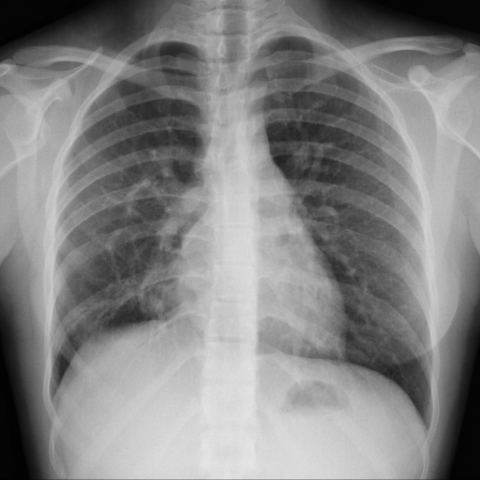
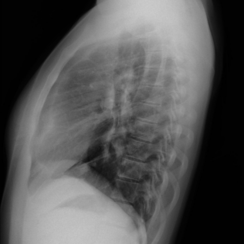

# Official gain: 9815_8353800828253

Post-run explicit answers: D **C**, M **C**, P **B**, reference **C**. Frozen runtime answers: D C, M None, P B; original records unchanged.

[Complete observable requests, tools and stages](../traces/9815_8353800828253.json) · [Original benchmark case](../../v12/results/cases/9815_8353800828253.md) · [D cached original observable request](../../direct_qwen60/requests/9815_8353800828253.json)

```text
Based solely on the chest X-ray findings (Fig. 1), which of the following options most accurately describes the observed condition and its potential implication for the patient's respiratory symptoms?

A) Normal chest X-ray with no significant findings.
B) Presence of a right-sided tracheal bronchus without any significant vascular anomaly.
C) Enlargement of the right cardiac cavities with a possible vascular anomaly, suggestive of a partial anomalous pulmonary venous return.
D) Bilateral enlargement of cardiac cavities with no additional vascular structures.
E) Presence of a pulmonary varix in the left middle pulmonary field.
F) Right-sided pulmonary sequestration with no cardiac enlargement.
```





## D

```text
Answer: C) Enlargement of the right cardiac cavities with a possible vascular anomaly, suggestive of a partial anomalous pulmonary venous return.

Reason: The PA chest X-ray (Fig. 1a) shows cardiomegaly with prominent right heart border and increased opacity in the right upper/middle lung zone, suggesting right atrial and ventricular enlargement. The lateral view (Fig. 1b) confirms anterior displacement of the heart and a subtle abnormal vessel-like density near the right hilum, consistent with an anomalous pulmonary vein draining into the SVC—classic for partial anomalous pulmonary venous return (PAPVR), which can cause respiratory symptoms due to volume overload.
```

## M

```text
The report generator is also incorrectly stating "heart size is normal" and "no acute cardiopulmonary process," which contradicts my visual assessment of clear right-sided cardiac enlargement and abnormal vascular structures.

This suggests the AI tools are not reliable for this specific case, likely because they're trained on typical pathology patterns and may miss congenital anomalies like PAPVR.

Let me re-examine the images more carefully:

Figure 1a (PA view): The right heart border is abnormally prominent and extends laterally beyond the normal position. There's a distinct vascular structure in the right upper lung zone that appears to be draining toward the superior vena cava region - classic for anomalous pulmonary venous return.

Figure 1b (lateral view): Confirms the right-sided cardiac enlargement and shows the abnormal vessel running parallel to the trachea/bronchus.

Given the options:
A) Normal - clearly incorrect
B) Right-sided tracheal bronchus - this would show an additional bronchus, not the vascular pattern seen
C) Enlargement of right cardiac cavities with possible vascular anomaly, suggestive of partial anomalous pulmonary venous return - matches my visual findings
D) Bilateral enlargement - only right-sided is enlarged
E) Pulmonary varix - would be a localized dilated vessel, not this pattern
F) Right-sided pulmonary sequestration - typically shows mass-like opacity with systemic feeding vessel, not this vascular pattern

My clinical judgment, based on the characteristic appearance of right heart enlargement with abnormal vascular drainage pattern, strongly supports option C.

The tools are failing here because they're not specialized for congenital cardiac anomalies, but the visual evidence is clear.

Return Answer: C) Enlargement of the right cardiac cavities with a possible vascular anomaly, suggestive of a partial anomalous pulmonary venous return.
```

## P

```text
Answer: B) Presence of a right-sided tracheal bronchus without any significant vascular anomaly.

Evidence: The frontal CXR shows a subtle linear opacity arising from the right mainstem bronchus near the carina, consistent with a right upper lobe bronchus arising directly from the trachea (tracheal bronchus); no cardiomegaly is present per visual assessment and lateral view; no vascular anomalies or pulmonary varix are evident.
```

