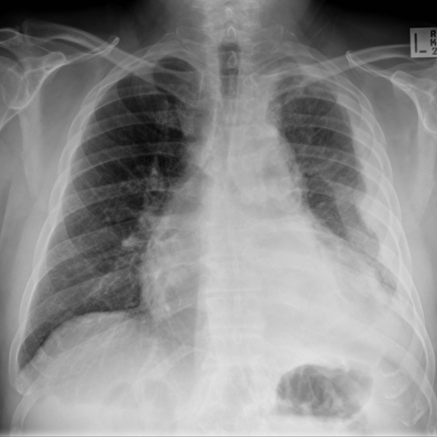
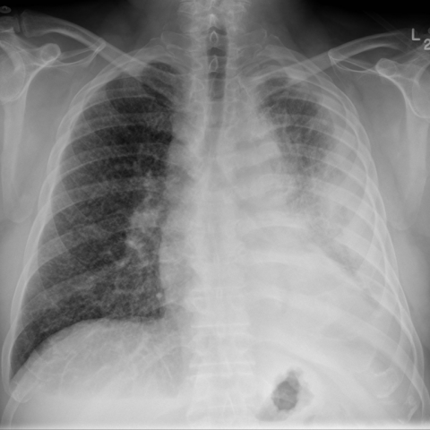
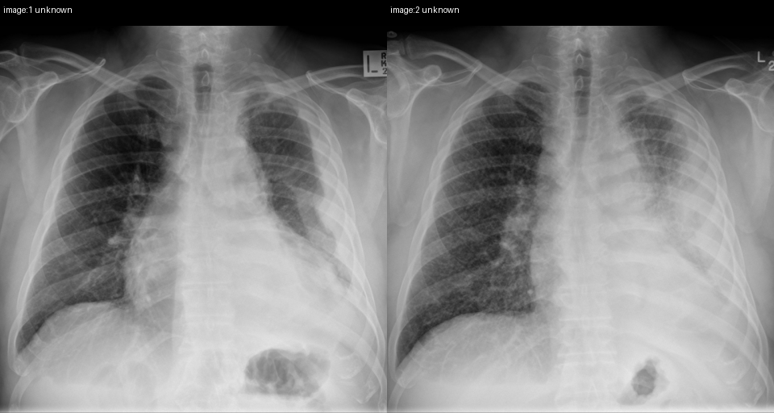

# Official gain: 10569_8353800725393

Post-run explicit answers: D **B**, M **B**, P **B**, reference **B**. Frozen runtime answers: D B, M B, P B; original records unchanged.

[Complete observable requests, tools and stages](../traces/10569_8353800725393.json) · [Original benchmark case](../../v12/results/cases/10569_8353800725393.md) · [D cached original observable request](../../direct_qwen60/requests/10569_8353800725393.json)

```text
Based on the chest X-ray images provided, which of the following best describes the changes observed in the patient's condition over the 6-month period, specifically focusing on the contralateral lung?  
A) There is a decrease in the number of miliary nodules in the right lung, suggesting a response to chemotherapy.  
B) There is an increase in the number and distribution of miliary nodules in the right lung, consistent with metastatic spread.  
C) The miliary nodules in the right lung remain unchanged, indicating a stable disease state.  
D) The right lung shows new large masses instead of miliary nodules, indicating a potential new primary malignancy.  
E) The right lung exhibits alveolar opacities rather than miliary nodules, suggesting an infectious process.  
F) There is no significant change in the pleural thickening of the left hemithorax.
```





## D

```text
Answer: B  
Reason: Comparing Figure 1a and Figure 1b (6 months apart), the right lung—contralateral to the left-sided pleural abnormality—shows a marked increase in diffuse, fine nodular opacities (miliary pattern) in Figure 1b, consistent with progression of metastatic disease. The left hemithorax shows pleural thickening/effusion in both, but the question specifically asks about the contralateral (right) lung.
```

## M

```text
B) There is an increase in the number and distribution of miliary nodules in the right lung, consistent with metastatic spread.

Reason: Visual comparison shows the right lung has more numerous and widespread small opacities in Figure 1b compared to Figure 1a. The classifier shows increased "Lung Lesion" (0.104→0.181) and "Lung Opacity" (0.531→0.669) probabilities, supporting progression. While the automated report mentions a "stable right hilar mass", my visual assessment and the quantitative increases suggest worsening diffuse nodular pattern rather than stability, making option B most consistent with the observed changes.
```

## P

```text
Answer: B) There is an increase in the number and distribution of miliary nodules in the right lung, consistent with metastatic spread.

Evidence: Fine nodular opacities in the right lung are more numerous and more diffusely distributed in image:2 compared to image:1, especially in mid-to-lower zones. No new large mass-like opacities are present in image:2, ruling out options D and E. The change is progressive, not stable or decreasing, excluding A and C; option F addresses the left hemithorax, not the contralateral (right) lung as asked.
```

## P 实际派生图

以下为本轮传入 observe/final 的保存图像；框和解剖覆盖不代表病灶真值。

p1:paired · paired_original_pixels · 来源 image:1, image:2



