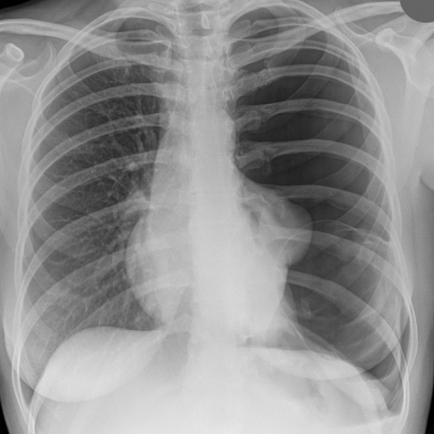
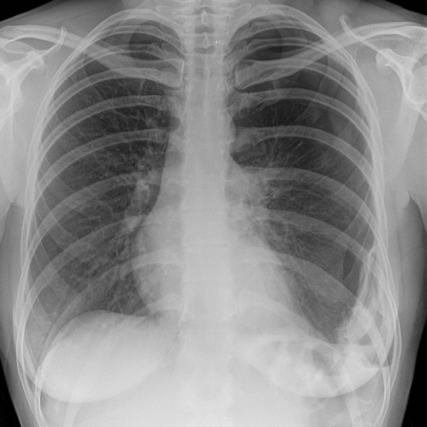
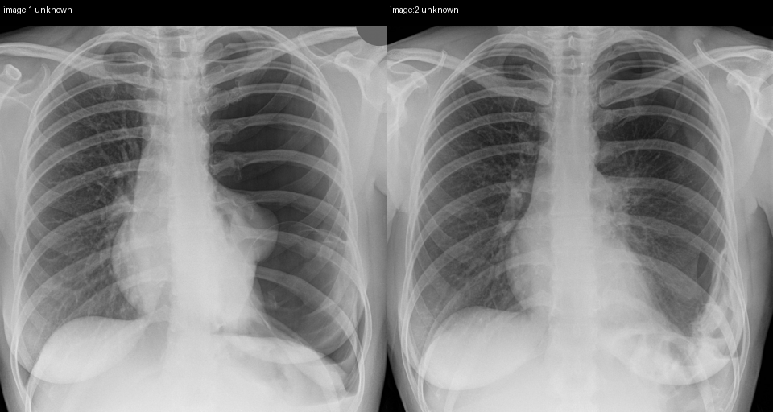
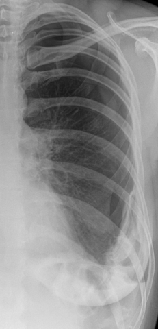
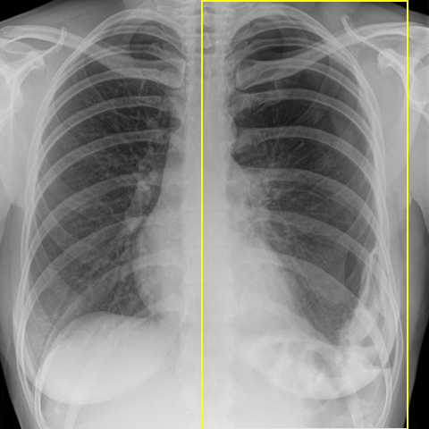

# Official gain: 11624_8353800763402

Post-run explicit answers: D **B**, M **B**, P **B**, reference **C**. Frozen runtime answers: D B, M B, P B; original records unchanged.

[Complete observable requests, tools and stages](../traces/11624_8353800763402.json) · [Original benchmark case](../../v12/results/cases/11624_8353800763402.md) · [D cached original observable request](../../direct_qwen60/requests/11624_8353800763402.json)

```text
Based on the chest X-ray images provided, which of the following best describes the changes observed in the left lung from Figure 1 to Figure 3, and the underlying reasoning for these observations?

A) Figure 1 shows a large left-sided pneumothorax and a cystic structure, and Figure 3 shows complete resolution of the pneumothorax with no cystic changes, indicating successful drainage and healing without residual cyst.

B) Figure 1 shows a large left-sided pneumothorax and a cystic structure, and Figure 3 shows a re-expansion of the left lung with disappearance of the cystic structure, indicating that the structure was likely a bullae that resolved with the pneumothorax.

C) Figure 1 shows a large left-sided pneumothorax and a cystic structure, and Figure 3 shows a recurrent pneumothorax with a persistent cystic structure, suggesting a bronchogenic cyst that contributes to recurrent pneumothorax due to its rupture.

D) Figure 1 shows a large left-sided pneumothorax and a cystic structure, and Figure 3 shows a stable lung with no pneumothorax, but a new opacity in the left lower zone, indicating an infection or abscess formation in the previously cystic area.

E) Figure 1 shows a large left-sided pneumothorax and a cystic structure, and Figure 3 shows a shrinking pneumothorax and disappearance of the cystic structure, suggesting that the cystic structure was a fluid collection that resolved spontaneously.
```





## D

```text
Answer: B  
Reason: Figure 1 shows a large left-sided pneumothorax with a well-defined cystic-appearing lucency (likely a bulla) in the left upper/mid zone. In Figure 3, the left lung is re-expanded, the pneumothorax has resolved, and the cystic lucency is no longer visible—consistent with a bulla that collapsed and was no longer apparent after re-expansion, rather than a persistent or new pathology. This pattern supports resolution of a bleb/bulla-associated pneumothorax.
```

## M

```text
B) Figure 1 shows a large left-sided pneumothorax and a cystic structure, and Figure 3 shows a re-expansion of the left lung with disappearance of the cystic structure, indicating that the structure was likely a bullae that resolved with the pneumothorax.

Reason: Figure 1 clearly shows a large left pneumothorax with complete collapse of the left lung and a well-defined cystic lucency (likely a bulla). Figure 3 shows significant re-expansion of the left lung with visible lung markings throughout, and the cystic structure is no longer apparent. The report for Figure 1 confirms "large left pneumothorax with complete collapse," while Figure 3's report mentions "moderate left pneumothorax" but visually shows much better re-expansion than described—suggesting the cystic structure (likely a bulla) collapsed/ruptured with the pneumothorax and did not persist. Option B best fits the visual evidence of resolution of both pneumothorax and cystic structure, consistent with a bulla rather than a persistent cyst or new pathology.
```

## P

```text
Answer: B) Figure 1 shows a large left-sided pneumothorax and a cystic structure, and Figure 3 shows a re-expansion of the left lung with disappearance of the cystic structure, indicating that the structure was likely a bullae that resolved with the pneumothorax.

The well-defined lucency without lung markings in the left upper/mid zone present in Figure 1 is absent in Figure 3, and lung markings have reappeared throughout the left hemithorax, confirming resolution of the pneumothorax. The cystic structure seen in Figure 1 also disappears in Figure 3, consistent with a bulla that collapsed and re-expanded with the lung rather than a persistent lesion like a bronchogenic cyst or abscess. Volume loss and mediastinal shift persist, suggesting incomplete full re-expansion but no recurrent pneumothorax or new opacity.
```

## P 实际派生图

以下为本轮传入 observe/final 的保存图像；框和解剖覆盖不代表病灶真值。

p1:paired · paired_original_pixels · 来源 image:1, image:2



p3:roi · unmodified_pixel_roi · 来源 image:2



p3:location · location_overlay · 来源 image:2



