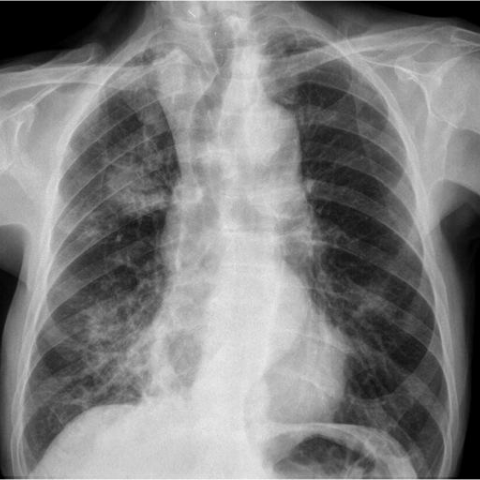
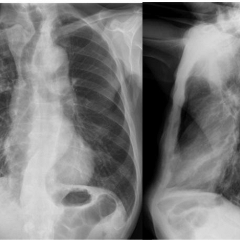
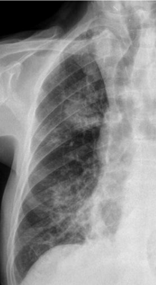
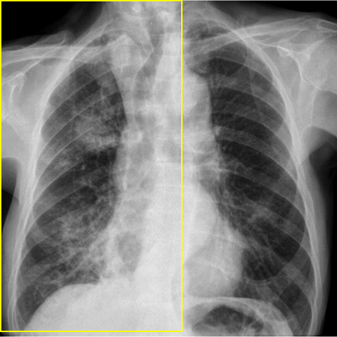
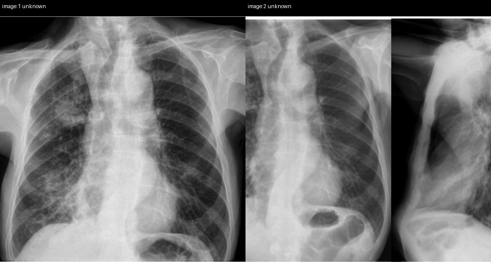

# Official gain: 11801_8353800651620

Post-run explicit answers: D **A**, M **E**, P **A**, reference **B**. Frozen runtime answers: D A, M E, P A; original records unchanged.

[Complete observable requests, tools and stages](../traces/11801_8353800651620.json) · [Original benchmark case](../../v12/results/cases/11801_8353800651620.md) · [D cached original observable request](../../direct_qwen60/requests/11801_8353800651620.json)

```text
Based on the chest radiograph findings, what is the most likely diagnosis for the patient's condition given the clinical history and imaging characteristics? Consider the patterns and changes in airspace consolidations observed in the X-ray images.

A) Chronic eosinophilic pneumonia
B) Lipoid pneumonia
C) Primary pulmonary lymphoma
D) Sarcoidosis
E) Lepidic predominant adenocarcinoma
F) Bronchiectasis
```





## D

```text
Answer: A) Chronic eosinophilic pneumonia  
Reason: The chest radiograph shows bilateral, peripheral, and migratory airspace consolidations—classic for chronic eosinophilic pneumonia (CEP), which often presents with upper and mid-lung zone predominant opacities that can shift over time. The pattern is distinct from the more central or nodular distributions seen in sarcoidosis, lymphoma, or adenocarcinoma, and lacks the tram-track or cystic changes of bronchiectasis or the fat-density features of lipoid pneumonia.
```

## M

```text
E) Lepidic predominant adenocarcinoma

Reason: The X-ray shows bilateral, peripheral, and lower-zone predominant airspace opacities with a somewhat hazy, ground-glass appearance—characteristic of lepidic spread in adenocarcinoma (formerly bronchioloalveolar carcinoma). Unlike acute pneumonia (which would be more homogeneous and lobar), this pattern is patchy, persistent, and migratory-appearing, fitting the indolent growth of lepidic-predominant adenocarcinoma. Chronic eosinophilic pneumonia typically shows upper-lobe predominance and migratory consolidation; lipoid pneumonia shows fat-density on CT (not visible on X-ray alone); primary pulmonary lymphoma usually presents as a large mass or diffuse infiltrate with hilar adenopathy; sarcoidosis shows symmetric hilar lymphadenopathy and micronodules; bronchiectasis shows tram-tracking and ring shadows—not dominant consolidation. The high "Mass" probability (0.91) from the classifier may reflect the confluent peripheral opacities mimicking a mass-like process, consistent with extensive lepidic spread.
```

## P

```text
Answer: A) Chronic eosinophilic pneumonia  
Evidence: The consolidations are predominantly peripheral and involve upper/mid lung zones in image 1. The spatial distribution changes between image 1 (right-dominant) and image 2 (more left lower zone involvement), suggesting a migratory pattern. Migratory, peripheral consolidations are classic for chronic eosinophilic pneumonia.
```

## P 实际派生图

以下为本轮传入 observe/final 的保存图像；框和解剖覆盖不代表病灶真值。

p1:roi · unmodified_pixel_roi · 来源 image:1



p1:location · location_overlay · 来源 image:1



p2:paired · paired_original_pixels · 来源 image:1, image:2



