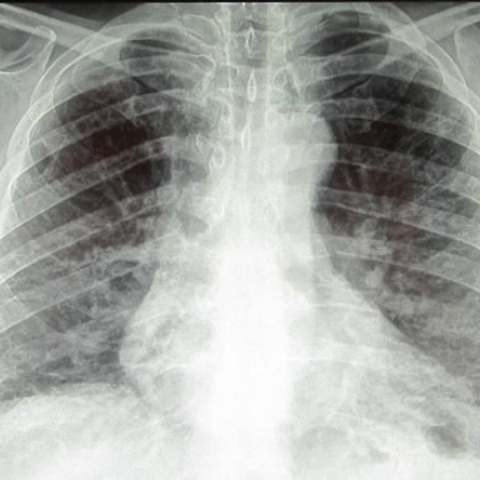
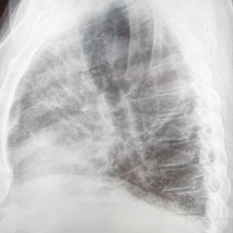
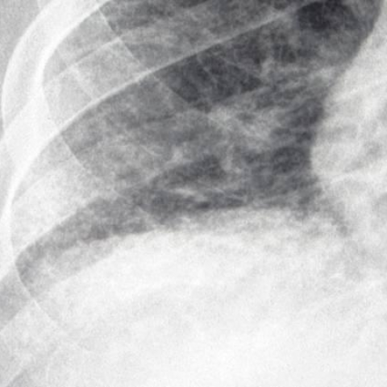
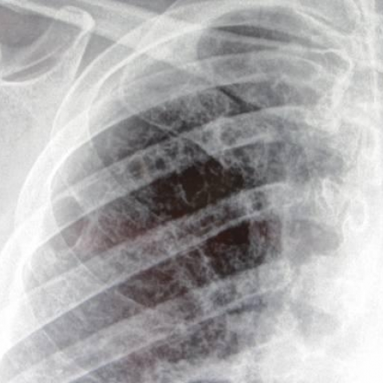
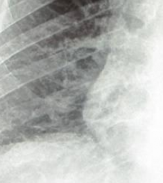
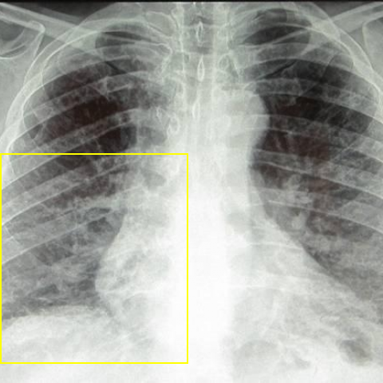
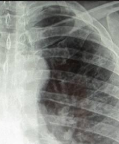
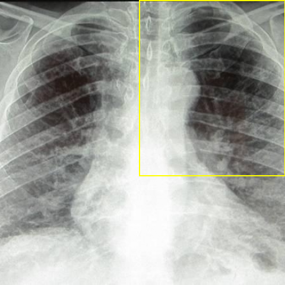

# Official gain: 11804_8353800651404

Post-run explicit answers: D **A**, M **D**, P **D**, reference **D**. Frozen runtime answers: D A, M D, P D; original records unchanged.

[Complete observable requests, tools and stages](../traces/11804_8353800651404.json) · [Original benchmark case](../../v12/results/cases/11804_8353800651404.md) · [D cached original observable request](../../direct_qwen60/requests/11804_8353800651404.json)

```text
Based on the chest X-rays provided, which of the following statements best describes the relationship and localization of the reticular markings and hyperlucency observed in the patient's lungs?

A) The lower lobe reticular markings are more prominent on the right side, and the upper lobe hyperlucency is more pronounced on the left side.
B) The lower lobe reticular markings are equally prominent on both sides, and the upper lobe hyperlucency is more pronounced on the right side.
C) The lower lobe reticular markings are more prominent on the left side, and the upper lobe hyperlucency is equally pronounced on both sides.
D) The lower lobe reticular markings are more prominent on the right side, and the upper lobe hyperlucency is equally pronounced on both sides.
E) The lower lobe reticular markings are equally prominent on both sides, and the upper lobe hyperlucency is more pronounced on the left side.
F) The lower lobe reticular markings are more prominent on the left side, and the upper lobe hyperlucency is more pronounced on the right side.
```









## D

```text
Answer: A  
Reason: The chest X-ray (Figure 1a) shows more prominent reticular markings in the right lower lobe compared to the left, and increased hyperlucency (indicating air trapping or loss of parenchyma) is more evident in the left upper lobe. This asymmetry is confirmed on the lateral views (Figures 1b–1d), where the left upper zone appears more radiolucent and the right lower zone shows denser interstitial markings.
```

## M

```text
Looking at the chest X-ray (Figure 1a) and the available tool outputs:

The phrase grounding confirmed reticular markings in the lower lobes spanning the entire lower half of the image. The segmentation shows the left lung occupies the lower-left portion (bbox: 7, 273, 358, 480) and right lung the upper-right portion (bbox: 27, 0, 417, 239).

From visual inspection of Figure 1a:
- The right lower lobe area (which would be in the lower right portion of the image, overlapping with the left lung's anatomical position due to projection) shows more dense reticular opacities
- The upper lobes show increased lucency (hyperlucency), and this appears relatively symmetric between sides

The classifier showed high probabilities for fibrosis (0.52) and emphysema (0.51), which aligns with reticular markings (fibrosis) and hyperlucency (emphysema).

Given the options, D states: "The lower lobe reticular markings are more prominent on the right side, and the upper lobe hyperlucency is equally pronounced on both sides."

This matches my visual assessment where the right side shows more prominent reticular markings in the lower zones, and the hyperlucency in upper lobes appears symmetric.

Answer: D) The lower lobe reticular markings are more prominent on the right side, and the upper lobe hyperlucency is equally pronounced on both sides.
```

## P

```text
Answer: D) The lower lobe reticular markings are more prominent on the right side, and the upper lobe hyperlucency is equally pronounced on both sides.

Evidence:  
1. In image:1, reticular markings are more prominent in the right lower lung zone (boxed p1:roi) than the left, per the new observation.  
2. Hyperlucency in the upper lobes (p2:roi and comparison of both sides) is not clearly asymmetric; both show similar attenuation and vascular pruning.  
3. Lateral/oblique views (images 2–4) lack sufficient side-by-side contrast to override the frontal CXR assessment, and the multi-image expert tool failed.
```

## P 实际派生图

以下为本轮传入 observe/final 的保存图像；框和解剖覆盖不代表病灶真值。

p1:roi · unmodified_pixel_roi · 来源 image:1



p1:location · location_overlay · 来源 image:1



p2:roi · unmodified_pixel_roi · 来源 image:1



p2:location · location_overlay · 来源 image:1



