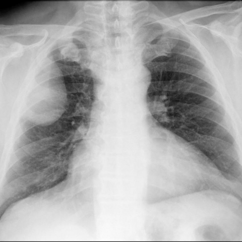
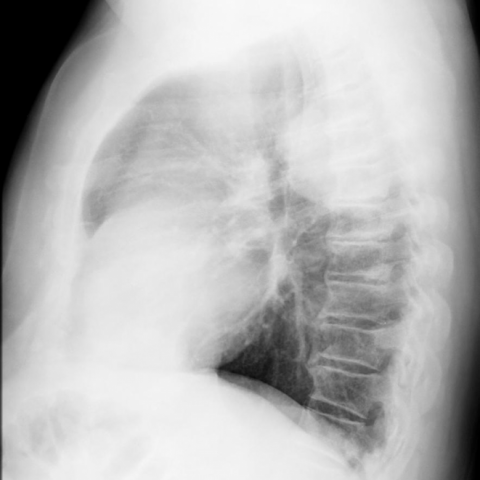
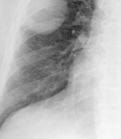
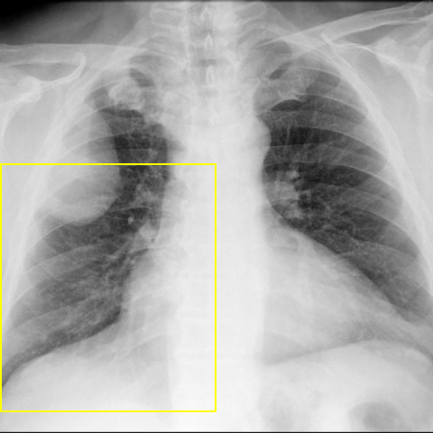

# Official gain: 11858_8353800664572

Post-run explicit answers: D **B**, M **B**, P **C**, reference **B**. Frozen runtime answers: D B, M B, P C; original records unchanged.

[Complete observable requests, tools and stages](../traces/11858_8353800664572.json) · [Original benchmark case](../../v12/results/cases/11858_8353800664572.md) · [D cached original observable request](../../direct_qwen60/requests/11858_8353800664572.json)

```text
Based on the chest X-ray findings and the clinical history, which of the following is the most likely diagnosis for the mass observed in the right hemithorax of this 57-year-old male patient?

A. Lipoma
B. Well-differentiated liposarcoma
C. Metastatic tumor
D. Pleural effusion
E. Primary lung cancer
F. Pneumonia
```





## D

```text
Answer: B. Well-differentiated liposarcoma  
Reason: The large, well-circumscribed, homogeneous mass in the right hemithorax with fat density (radiolucency) on chest X-ray—especially in a middle-aged male—is highly suggestive of a lipomatous tumor; well-differentiated liposarcoma is the most common malignant soft-tissue tumor in adults and can present as a large intrathoracic mass with fat attenuation, whereas benign lipoma is less likely to reach this size and location. The absence of air bronchograms and lack of infiltrative pattern argue against pneumonia or primary lung cancer; pleural effusion would show meniscus sign and layering, not a solid mass; metastasis is possible but less likely without known primary or multiple lesions.
```

## M

```text
I've exhausted the tool budget, so I need to rely on my visual analysis and clinical reasoning.

From careful examination of both images:
- The mass is large, occupying most of the right hemithorax
- It has smooth, well-defined margins
- The lung markings are displaced but not destroyed, indicating compression rather than invasion
- The lateral view shows it's posteriorly located
- There's significant mediastinal shift to the left

For a 57-year-old male, a large extrapulmonary mass with these characteristics is most consistent with **well-differentiated liposarcoma**. While lipomas can be well-circumscribed, they rarely grow to this massive size. Liposarcomas, particularly the well-differentiated type, can grow very large while maintaining relatively benign-appearing features initially. They commonly occur in deep soft tissues and can present in the thoracic region.

Metastatic tumors are usually multiple or have different imaging characteristics. Primary lung cancer would typically be intrapulmonary with irregular margins. Pleural effusion would have a different shape (meniscus) and pneumonia would show air bronchograms.

Return Answer: B. Well-differentiated liposarcoma - large, well-circumscribed extrapulmonary mass with smooth margins and compressive effect without invasion, characteristic of well-differentiated liposarcoma in adult patients.
```

## P

```text
Answer: C. Metastatic tumor

The mass lacks radiolucency consistent with fat, ruling out lipoma (A) and well-differentiated liposarcoma (B). It is well-circumscribed without air bronchograms or pleural meniscus, making pneumonia (F) and pleural effusion (D) unlikely. While primary lung cancer (E) remains possible, the absence of central bronchial involvement, cavitation, or spiculated margins—combined with the patient’s age and typical presentation—makes a metastatic tumor (C) the most likely diagnosis, especially given that solitary pulmonary masses in this demographic are more commonly metastases than primary malignancies.
```

## P 实际派生图

以下为本轮传入 observe/final 的保存图像；框和解剖覆盖不代表病灶真值。

p1:roi · unmodified_pixel_roi · 来源 image:1



p1:location · location_overlay · 来源 image:1



